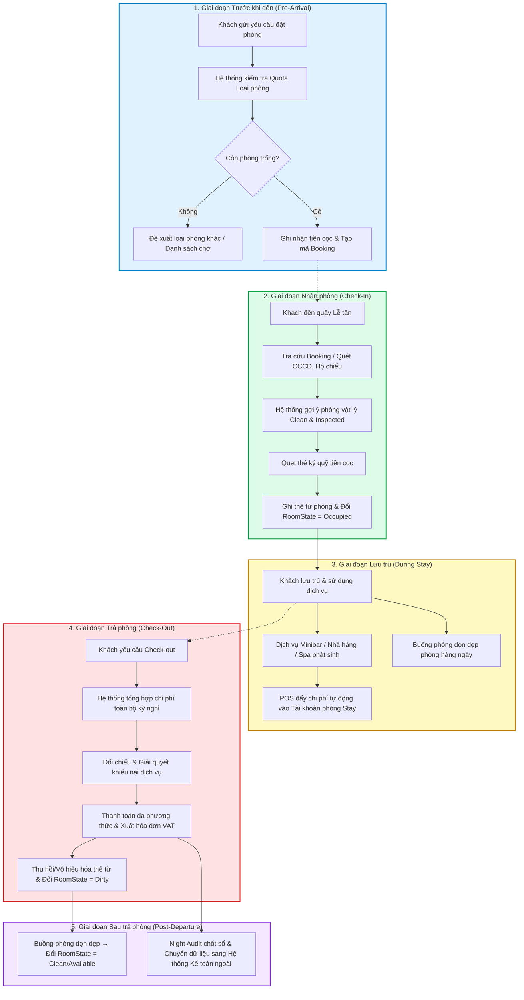
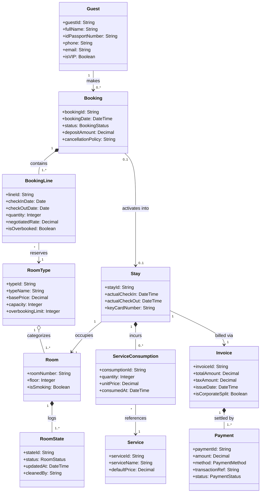

# 📚 BÁO CÁO BÀI TẬP: SOFTWARE ENGINEERING — TUTORIAL 1 (WEEK 3)
## CHỦ ĐỀ: USER TASKS, DOMAIN MODELING & SOFTWARE QUALITY ATTRIBUTES

**Trường:** Đại học Tôn Đức Thắng (TDTU)  
**Khoa:** Công nghệ Thông tin  
**Môn học:** Kỹ thuật Phần mềm (Software Engineering)  
**Thời gian:** Tháng 02/2025  

### 👥 THÔNG TIN NHÓM THỰC HIỆN:
1. **524H0195 — Ngô Lâm Tiên**
2. **524H0191 — Nguyễn Công Thành**

---

# 🏨 PHẦN 1: HỆ THỐNG THÔNG TIN KHÁCH SẠN (HOTEL INFORMATION SYSTEM - HIS)
*(User Tasks and Requirements)*

---

### Câu 1: Mô tả tác vụ Check-Out theo phong cách Task & Support (Soren Lauesen)

Dựa trên ngữ cảnh hệ thống thông tin khách sạn và phương pháp tiếp cận **Tasks & Support** của giáo sư Soren Lauesen, tác vụ Trả phòng (Check-Out) được mô tả chi tiết như sau:

| Thông tin tác vụ | Chi tiết đặc tả |
|---|---|
| **Tác vụ (Task)** | **1.3 Checkout (Trả phòng & Quyết toán lưu trú)** |
| **Mục đích (Purpose)** | Giải phóng phòng vật lý, tất toán tài khoản chi phí của khách, thu tiền/chốt thẻ thanh toán, chuyển trạng thái phòng sang cần dọn dẹp, tiễn khách. |
| **Điều kiện kích hoạt (Trigger / Precondition)** | Khách hàng đến quầy lễ tân thông báo trả phòng hoặc kích hoạt tính năng Express Checkout trên Kiosk / Mobile App. |
| **Tần suất (Frequency)** | Trung bình ~0.5 lượt checkout/phòng/ngày (khách sạn 300 phòng $\approx$ 150 lượt/ngày). |
| **Tình huống tới hạn (Critical)** | Giờ cao điểm sáng 07:30 – 09:30 AM (các đoàn tour 40–50 khách trả phòng cùng lúc để kịp chuyến bay); đường truyền cổng thanh toán thẻ ngân hàng bị gián đoạn; khách khiếu nại chi phí minibar. |

#### Bảng chi tiết Task & Support (Sub-tasks, Problems & Example Solutions):

| Sub-tasks (Tác vụ con) & Vấn đề (Problems) | Example solution (Giải pháp hỗ trợ từ hệ thống máy tính) |
|---|---|
| **1. Xác định phòng & khách hàng**<br>• *Vấn đề:* Khách quên số phòng, phát âm tên khó tìm, nhiều khách trùng họ tên. | Hệ thống hỗ trợ quét mã thẻ từ phòng để mở hồ sơ tức thì; tìm kiếm linh hoạt theo Tên, Số điện thoại, Mã Booking hoặc Số CCCD/Hộ chiếu. |
| **2. Tổng hợp chi phí dịch vụ phát sinh**<br>• *Vấn đề:* Phí minibar uống sáng sớm hoặc hóa đơn nhà hàng phút chót chưa kịp đưa lên lễ tân. | Hệ thống đồng bộ thời gian thực (Real-time integration) từ POS Nhà hàng, Spa; nhân viên buồng phòng kiểm tra phòng và nhập số lượng trực tiếp qua Mobile App lên PMS. |
| **3. Xem xét hóa đơn & Xử lý khiếu nại**<br>• *Vấn đề:* Khách tranh cãi về chi phí minibar; khách công tác yêu cầu tách hóa đơn tiền phòng về công ty và chi phí ăn uống tự trả. | Giao diện hiển thị chi tiết từng dòng dịch vụ kèm thời gian; Hỗ trợ tính năng **Tách hóa đơn (Split Folio)** linh hoạt sang 2 hóa đơn độc lập; Lễ tân có thể xóa/giảm phí khiếu nại nếu có mã xác nhận của Quản lý ca. |
| **4. Quyết toán thanh toán**<br>• *Vấn đề:* Thẻ tín dụng bị từ chối; khách muốn trả một phần tiền mặt, một phần chuyển khoản hoặc cấn trừ tiền cọc (Deposit). | Tích hợp máy POS thanh toán đa phương thức (Thẻ quốc tế, Thẻ nội địa, Tiền mặt, Quét mã VietQR); Tự động giải phóng khoản phong tỏa tiền cọc (Release Pre-authorization); Tự động phát hành Hóa đơn điện tử VAT gửi qua Email. |
| **5. Thu hồi thẻ phòng & Cập nhật trạng thái phòng**<br>• *Vấn đề:* Lễ tân quên báo buồng phòng, dẫn đến phòng trống nhưng trên hệ thống vẫn báo bận, hoặc cấp nhầm phòng bẩn cho khách mới. | Đầu đọc thẻ tự động vô hiệu hóa mã từ trên thẻ; Hệ thống ngay lập tức đổi trạng thái phòng sang **"Vacant / Dirty" (Trống / Cần dọn)** và tự động gửi thông báo phân công công việc vào danh sách của nhân viên buồng phòng. |

#### Các biến thể (Variants):
- **1a. Trả phòng nhanh (Express Checkout):** Khách thả thẻ vào hộp "Drop Box" tại sảnh; hệ thống tự động chốt tài khoản theo thẻ tín dụng đã ủy quyền trước và gửi hóa đơn điện tử qua email.
- **1b. Trả phòng theo đoàn (Group Checkout):** Hướng dẫn viên du lịch đại diện quyết toán toàn bộ tiền phòng cho cả đoàn (Master Bill), từng khách lẻ chỉ thanh toán chi phí phát sinh cá nhân (Extra Bill).

---

### Câu 2: Các tác vụ điển hình của HIS và Trực quan hóa Luồng công việc (Workflow)

#### 1. Sáu tác vụ điển hình mà Hệ thống Thông tin Khách sạn (HIS / PMS) phải hỗ trợ:
1. **Đặt phòng (Reservation / Book guest):** Tiếp nhận thông tin giữ chỗ, kiểm tra số lượng phòng trống theo loại phòng (RoomType), quản lý đặt cọc, hủy phòng và chính sách giá theo mùa.
2. **Nhận phòng (Check-In):** Đối chiếu đặt phòng, phân bổ số phòng vật lý sạch, ghi nhận giấy tờ tùy thân, ký quỹ và lập thẻ từ phòng cho khách.
3. **Quản lý lưu trú & Dịch vụ (Stay & Service Management):** Theo dõi quá trình lưu trú, đổi phòng khi có sự cố, ghi nhận chi phí ăn uống (F&B), spa, giặt ủi, minibar, tổng hợp danh sách khách ăn sáng (Breakfast list).
4. **Quản lý Buồng phòng (Room State & Housekeeping):** Quản lý chu trình trạng thái phòng (`Sạch / Clean` $\rightarrow$ `Đang có khách / Occupied` $\rightarrow$ `Bẩn / Dirty` $\rightarrow$ `Đang dọn / Cleaning` $\rightarrow$ `Đã kiểm định / Inspected` $\rightarrow$ `Bảo trì / Out-of-Order`).
5. **Trả phòng (Check-Out):** Quyết toán tài khoản lưu trú, in hóa đơn VAT, thu hồi chìa khóa, giải phóng phòng và cập nhật trạng thái dọn dẹp.
6. **Kiểm toán đêm & Kế toán (Night Audit & Account Transfer):** Chốt sổ doanh thu ngày, khóa kỳ kế toán ngày, chuyển dữ liệu công nợ sang Hệ thống Kế toán tổng hợp (Back-office Accounting System).

#### 2. Trực quan hóa Luồng công việc (Activity Workflow Diagram):



---

### Câu 3: Yêu cầu ngầm định (Tacit Requirements) và Khả năng Thẩm định

#### 1. Yêu cầu ngầm định (Tacit Requirements) là gì?
- **Định nghĩa:** Yêu cầu ngầm định là những nhu cầu, kỳ vọng mà người dùng coi là **"hiển nhiên phải có"** (the unstated obvious) dựa trên thói quen làm việc và tri thức ẩn (tacit knowledge) của họ, do đó họ **không chủ động nói ra hoặc viết thành văn bản** trong quá trình kỹ sư phần mềm phỏng vấn thu thập yêu cầu.
- **Nguyên nhân xuất hiện:**
  - Người dùng cho rằng "ai làm phần mềm cũng phải tự biết điều đó".
  - Tri thức ẩn đã biến thành phản xạ tiềm thức (subconscious routines), người dùng chỉ nhận ra khi phần mềm mới bị thiếu.
- **Ví dụ cụ thể trong Hệ thống Khách sạn:**
  - *Chống mất dữ liệu:* Khi lễ tân đang nhập dở thông tin của đoàn 30 khách mà mạng bị ngắt hoặc mất điện, phần mềm phải tự động lưu tạm (Auto-save) cục bộ, không được bắt nhập lại từ đầu.
  - *Tốc độ thao tác:* Thời gian hoàn tất Check-in không được vượt quá 45 giây để tránh làm khách mệt mỏi sau chuyến bay dài.
  - *Giao diện ca đêm:* Phần mềm phải có phím tắt điều hướng nhanh và độ tương phản phù hợp cho nhân viên trực ca đêm dễ nhìn.

#### 2. Có thể thực hiện kiểm tra thẩm định (Validation Check) đối với yêu cầu ngầm định không?
👉 **CÂU TRẢ LỜI: HOÀN TOÀN CÓ THỂ, NHƯNG KHÔNG THỂ BẰNG CÁCH ĐỌC DUYỆT TÀI LIỆU VĂN BẢN ĐƠN THUẦN.**

Do yêu cầu ngầm định không nằm trên văn bản đặc tả, việc thẩm định phải sử dụng các kỹ thuật công nghệ phần mềm thực nghiệm:
1. **Quan sát thực địa (Contextual Inquiry / Ethnographic Shadowing):** Kỹ sư phần mềm ngồi trực tiếp bên cạnh nhân viên lễ tân vào các khung giờ cao điểm (sáng trả phòng, tối nhận phòng) để ghi nhận những thao tác thực tế và phản ứng của người dùng.
2. **Làm mẫu thử tương tác (Interactive Prototyping & Think-Aloud Protocol):** Xây dựng giao diện mẫu (Mockup/Wireframe tương tác) cho nhân viên dùng thử. Ngay lập tức họ sẽ thốt lên: *"Ủa, nút in nhanh hóa đơn tạm ở đâu?"* hoặc *"Sao phải dùng chuột click nhiều thế, sao không dùng phím Tab/Enter?"* $\rightarrow$ Tri thức ẩn được lộ diện.
3. **Diễn tập kịch bản tình huống bất thường (Scenario Walkthrough & Role-Playing):** Đặt người dùng vào các tình huống ngặt nghèo (khách mất hộ chiếu, hệ thống POS nhà hàng mất kết nối) để kiểm tra xem hệ thống có đáp ứng được các giả định ngầm của họ không.
4. **Đối chiếu Bảng kiểm tra tiêu chuẩn ngành (Industry Checklists & Standards):** Sử dụng các tiêu chuẩn chất lượng quốc tế (ISO/IEC 25010), tiêu chuẩn bảo mật thanh toán thẻ PCI-DSS và thông lệ ngành khách sạn để kiểm tra chéo các yêu cầu chưa được người dùng nhắc đến.

---

### Câu 5: Phân tích Khiếm khuyết Domain Model Mẫu & Mô hình Miền Mở rộng

#### 1. Phân tích mô hình cho trước và các điểm thiếu sót:
Mô hình cho trước trong tài liệu gồm:
`Guest` (1) ── (1..*) `Stay` (1) ── (1..*) `Room State` (1) ── (1) `Room`  
`Stay` (1) ── (0..*) `Service` (1) ── (1) `Service Type`

**4 Khiếm khuyết cốt lõi:**
1. **Thiếu thực thể Loại phòng (Room Type):** Khách sạn không bán từng số phòng cụ thể (phòng 301, 302) mà bán theo Loại phòng (Single, Double, Suite, Family) với giá tiền và sức chứa chuẩn.
2. **Thiếu thực thể Đặt phòng trước (Booking / Reservation):** Thực thể `Stay` chỉ được tạo ra khi khách đã đến khách sạn nhận phòng. Mô hình mẫu hoàn toàn không có cách nào ghi nhận việc khách đặt chỗ trước 1 tháng, tiền cọc hay điều kiện hủy phòng.
3. **Không thể hỗ trợ Bán vượt phòng (Overbooking):** Vì đặt phòng bị gắn trực tiếp vào phòng vật lý, tổng số phòng bán ra bị chặn cứng ở 100% công suất vật lý, không thể áp dụng thuật toán bán vượt 105% - 110% theo nghiệp vụ khách sạn thực tế.
4. **Thiếu thực thể Hóa đơn & Thanh toán (Invoice & Payment):** Các dịch vụ bị gắn trực tiếp vào Stay mà không có cơ chế quản lý hóa đơn tài chính, gây khó khăn cho việc tách hóa đơn công ty/cá nhân và đối soát tài chính.

#### 2. Mô hình Miền Mở rộng (Extended Domain Model):



#### 3. Cơ chế kỹ thuật hỗ trợ Bán vượt phòng (Overbooking):
- **Phân tách trách nhiệm (Decoupling):** Khi khách đặt phòng trước, `BookingLine` chỉ tham chiếu đến `RoomType` (Loại phòng) chứ **chưa bao giờ gán số phòng vật lý cụ thể**.
- **Hạn mức Overbooking:** Mỗi `RoomType` có thuộc tính `overbookingLimit` (ví dụ Loại Deluxe có 100 phòng vật lý, hệ thống cho phép tổng số `BookingLine` trong ngày đạt 108 phòng = 108%).
- **Gán phòng thực tế khi Check-In:** Chỉ khi khách thực sự có mặt tại quầy lễ tân (tạo `Stay`), hệ thống mới liên kết `Stay` vào một `Room` vật lý cụ thể đang ở trạng thái `Clean / Available`.

---

### Câu 6: Phân rã Tác vụ Check-In (Đã đặt trước vs Khách vãng lai)

#### 1. Mô tả hai tác vụ độc lập theo phong cách Task & Support:

##### Tác vụ 1.2a: Check-In cho Khách ĐÃ ĐẶT TRƯỚC (Book-In a Booked Guest)
- **Mục đích:** Xác nhận đặt phòng đã có sẵn trong hệ thống, chọn phòng vật lý phù hợp, cấp thẻ từ và hoàn tất thủ tục siêu tốc.
- **Điều kiện tiên quyết:** Khách đã có mã đặt phòng hợp lệ trên hệ thống.
- **Các bước thực hiện:**
  1. Lễ tân nhập Mã đặt phòng hoặc tìm theo Tên khách / Số điện thoại $\rightarrow$ *Máy tính hiển thị thông tin đặt phòng trong 1 giây.*
  2. Đối chiếu giấy tờ tùy thân CCCD/Hộ chiếu với hồ sơ đã lưu $\rightarrow$ *Máy quét CCCD tự động so khớp thông tin.*
  3. Hệ thống gợi ý phòng vật lý sạch thuộc đúng loại phòng đã đặt $\rightarrow$ *Lễ tân xác nhận số phòng.*
  4. Quẹt thẻ tín dụng ủy quyền ký quỹ (Pre-authorization deposit).
  5. Đặt thẻ từ lên đầu đọc để kích hoạt khóa phòng và in phiếu xác nhận nhận phòng.
- **Thời gian xử lý chuẩn:** $30 - 45$ giây.

##### Tác vụ 1.2b: Check-In cho Khách VÃNG LAI (Check-In a Non-Booked / Walk-In Guest)
- **Mục đích:** Tư vấn các loại phòng còn trống, thỏa thuận giá, thu thập toàn bộ hồ sơ khách mới, tạo đặt phòng tức thời và giao chìa khóa.
- **Điều kiện tiên quyết:** Khách đến bất ngờ không báo trước; khách sạn còn phòng trống sẵn sàng đón khách.
- **Các bước thực hiện:**
  1. Hỏi nhu cầu của khách (loại phòng, số lượng người, số đêm dự kiến lưu trú).
  2. Tra cứu sơ đồ phòng trống thời gian thực trên hệ thống $\rightarrow$ *Máy tính hiển thị danh sách phòng trống kèm giá niêm yết/giá ưu đãi.*
  3. Thỏa thuận giá phòng và chính sách thanh toán với khách.
  4. Quét CCCD/Hộ chiếu và nhập toàn bộ thông tin cá nhân mới vào cơ sở dữ liệu khách hàng.
  5. Thu toàn bộ tiền phòng hoặc quẹt thẻ giữ cọc bắt buộc $\rightarrow$ *Tạo giao dịch thanh toán tạm ứng.*
  6. Gán số phòng vật lý, lập mã thẻ từ và hướng dẫn khách lên phòng.
- **Thời gian xử lý chuẩn:** $3 - 5$ phút.

#### 2. Thảo luận: Giải pháp 1 tác vụ (One-Task) vs Giải pháp 2 tác vụ (Two-Task):
- **Giải pháp 1 tác vụ (One-Task with Variants):** Xem "Khách vãng lai" chỉ là một nhánh biến thể của quy trình Check-in tổng thể.
  - *Ưu điểm:* Thể hiện đúng bản chất mức độ miền (Domain Level) rằng mục đích tối hậu là giống nhau ("Giao phòng cho khách"). Không tạo ngõ cụt: nếu khách đinh ninh mình đã đặt phòng nhưng thực tế bị lỗi mạng, lễ tân có thể chuyển ngay sang quy trình khách vãng lai trên cùng một màn hình mà không phải thoát ra vào lại từ đầu.
  - *Nhược điểm:* Giao diện nhập liệu có thể bị rườm rà với quá nhiều trường thông tin tùy chọn.
- **Giải pháp 2 tác vụ (Two-Task Solution):** Tách hẳn thành 2 quy trình và 2 chức năng phần mềm riêng biệt.
  - *Ưu điểm:* Giao diện tối ưu chuyên biệt: màn hình cho khách đã đặt cực kỳ tinh gọn, giúp thao tác siêu tốc; màn hình khách vãng lai được thiết kế theo dạng từng bước (Wizard) hướng dẫn đàm phán giá và nhập liệu kỹ càng.
  - *Nhược điểm:* Trùng lặp các tác vụ con cốt lõi (bước quẹt cọc, cấp thẻ từ, cập nhật trạng thái phòng); gây lúng túng khi phát sinh tình huống chuyển tiếp.
- **Kết luận cách tiếp cận phù hợp:**
  - Ở **Mức Phân tích Nghiệp vụ Miền (Domain Level)**: Giải pháp **1 TÁC VỤ CÓ BIẾN THỂ (One-task with variants)** là phù hợp và chuẩn xác nhất theo phương pháp luận của Soren Lauesen.
  - Ở **Mức Thiết kế Giao diện Người dùng (UI Solution Level)**: Nên cung cấp 2 chế độ thao tác trên cùng giao diện: **Chế độ Nhận phòng nhanh (Fast-track Check-in)** và **Chế độ Tiếp đón khách vãng lai (Walk-in Wizard)**.

---

### Câu 7: Xử lý Tình huống Khẩn cấp Vượt hạn mức phòng (Overbooking Crisis)

#### 1. Bối cảnh tình huống khẩn cấp:
Khách sạn áp dụng chính sách bán vượt 105% phòng. Tuy nhiên vào một ngày lễ, 100% khách đã đặt đều đến nhận phòng, dẫn đến **số lượng phòng trống vật lý thực tế = 0** trong khi vẫn còn khách cầm phiếu đặt phòng hợp lệ đang đứng tại sảnh.

#### 2. Mở rộng Tác vụ Check-In (Biến thể 1.2c — Xử lý khách bị điều chuyển / Bumping):

| Các bước trong quy trình xử lý khẩn cấp | Giải pháp hỗ trợ từ hệ thống máy tính (PMS Support) |
|---|---|
| **Bước 1: Hệ thống phát hiện quá tải & Cảnh báo sớm** | Khi tỷ lệ phòng trống giảm về 0 và số lượng khách chưa đến vẫn còn, PMS bật cảnh báo đỏ toàn hệ thống: *"Cảnh báo Overbooking: Yêu cầu kích hoạt Quy trình Điều chuyển (Walking Protocol)"*. |
| **Bước 2: Lựa chọn khách hàng để điều chuyển (Bumping Algorithm)** | Hệ thống áp dụng thuật toán phân loại khách tự động: **BẢO VỆ TUYỆT ĐỐI** khách VIP, hội viên thân thiết (Loyalty Members), đoàn gia đình có trẻ em/người cao tuổi, khách ở dài hạn. **GỢI Ý ĐIỀU CHUYỂN** khách đặt qua các kênh OTA giá rẻ, khách lưu trú 1 đêm đơn lẻ và là những người đến muộn nhất. |
| **Bước 3: Tìm phòng tại Khách sạn đối tác liên kết** | PMS tự động gửi truy vấn qua API mạng lưới khách sạn đối tác lân cận (cùng tập đoàn hoặc cùng hạng sao) để tìm kiếm các phòng trống có chất lượng tương đương hoặc cao hơn (nâng cấp miễn phí từ 4 sao lên 5 sao). |
| **Bước 4: Cung cấp Gói đền bù & Hỗ trợ chu đáo (Compensation Package)** | Hệ thống tự động in Phiếu bảo lãnh lưu trú và Gói bồi thường chuẩn của khách sạn: <br>1. Miễn phí hoàn toàn 100% tiền phòng đêm đầu tiên tại khách sạn mới.<br>2. Cung cấp xe taxi riêng miễn phí đưa đón khách sang khách sạn mới.<br>3. Tặng Voucher giảm giá 50% hoặc bữa tối miễn phí cho kỳ nghỉ kế tiếp. |
| **Bước 5: Cập nhật hệ thống & Kết chuyển chi phí** | Đổi trạng thái Booking sang `Walked / Relocated`. Tự động hạch toán toàn bộ chi phí phát sinh (tiền phòng trả hộ, tiền taxi, voucher) vào **Tài khoản Chi phí Rủi ro Overbooking** của khách sạn. Tự động đồng bộ thông tin khách hàng sang hệ thống lễ tân của khách sạn tiếp nhận. |

---

# ⚙️ PHẦN 2: CÁC THUỘC TÍNH CHẤT LƯỢNG PHẦN MỀM (SOFTWARE QUALITY ATTRIBUTES)

---

### Câu 1: Các Thuộc tính Chất lượng Phần mềm Tổng quát (ISO/IEC 25010)

Theo tiêu chuẩn quốc tế ISO/IEC 25010 và lý thuyết kiến trúc phần mềm, các thuộc tính chất lượng phần mềm chính gồm có:

1. **Khả năng bảo trì (Maintainability / Modifiability):** Mức độ dễ dàng mà phần mềm có thể được sửa chữa lỗi, tái cấu trúc hoặc nâng cấp tính năng mới mà không làm hỏng các chức năng đang chạy ổn định.
2. **Độ tin cậy (Reliability / Dependability):** Khả năng hệ thống duy trì mức hiệu năng xác định dưới những điều kiện cụ thể trong một khoảng thời gian quy định (đo lường bằng tỷ lệ lỗi, MTBF - Mean Time Between Failures).
3. **An toàn & Bảo mật (Security):** Mức độ bảo vệ thông tin và dữ liệu sao cho các cá nhân hoặc hệ thống trái phép không thể đọc, can thiệp hoặc giả mạo dữ liệu (bảo đảm tính Bí mật - Confidentiality, Toàn vẹn - Integrity, Sẵn sàng - Availability).
4. **Hiệu năng & Hiệu quả (Performance / Efficiency):** Hiệu năng của hệ thống liên quan đến thời gian phản hồi (Response time), thông lượng (Throughput) và tỷ lệ tiêu hao tài nguyên phần cứng (CPU, RAM, Băng thông mạng).
5. **Tính dễ sử dụng (Usability / Acceptability):** Mức độ mà phần mềm có thể được hiểu, học hỏi, vận hành và thu hút người dùng trong môi trường làm việc thực tế.
6. **Tính sẵn sàng (Availability):** Tỷ lệ thời gian mà hệ thống thực sự hoạt động và người dùng có thể truy cập sử dụng được: $\text{Availability} = \frac{\text{Uptime}}{\text{Uptime} + \text{Downtime}}$.
7. **Khả năng mở rộng (Scalability):** Năng lực của hệ thống thích ứng và duy trì hiệu năng tốt khi khối lượng công việc, lượng dữ liệu hoặc số lượng người dùng đồng thời tăng lên.
8. **Khả năng kiểm thử (Testability):** Mức độ thuận lợi để các kỹ sư thiết lập các bài kiểm thử tự động, phát hiện và cô lập lỗi trong mã nguồn.

---

### Câu 2: Các Hình thức Mở rộng Quy mô (Scalability) và Cơ chế Hoạt động

Có 5 hình thức mở rộng quy mô chính trong kỹ thuật phần mềm:

```
                              CÁC HÌNH THỨC MỞ RỘNG (SCALABILITY)
                                               │
      ┌─────────────────────┬──────────────────┴──────────────────┬─────────────────────┐
      ▼                     ▼                                     ▼                     ▼
VERTICAL SCALING      HORIZONTAL SCALING                  GEOGRAPHIC SCALING    STRUCTURAL SCALING
   (Scale-Up)            (Scale-Out)                       (Đa vùng địa lý)       (Vi dịch vụ)
- Nâng CPU, RAM       - Thêm Server vào cụm               - CDN, Edge Nodes     - Phân rã Monolith
- Đơn giản            - Load Balancer                     - Replicate DB          thành Microservices
- Có ngưỡng trần      - Không giới hạn trần               - Giảm độ trễ toàn cầu - Đội ngũ dev độc lập
```

1. **Mở rộng theo chiều dọc (Vertical Scalability / Scale-Up):**
   - *Cách hoạt động:* Nâng cấp tài nguyên phần cứng của một máy chủ duy nhất (tăng số nhân CPU, mở rộng RAM từ 32GB lên 256GB, thay ổ cứng SSD bằng NVMe tốc độ cao).
   - *Ưu/Nhược điểm:* Ưu điểm là kiến trúc đơn giản, không cần thay đổi mã nguồn; Nhược điểm là nhanh chóng chạm ngưỡng giới hạn phần cứng vật lý và chi phí tăng theo hàm mũ; vẫn tồn tại điểm chết đơn độc (SPOF).
2. **Mở rộng theo chiều ngang (Horizontal Scalability / Scale-Out):**
   - *Cách hoạt động:* Thêm nhiều máy chủ độc lập vào cụm (Cluster), sử dụng Cân bằng tải (Load Balancer - Nginx, HAProxy) để điều phối lưu lượng; thiết kế các tầng xử lý không trạng thái (Stateless Services) và phân mảnh cơ sở dữ liệu (Database Sharding / Read Replicas).
   - *Ưu/Nhược điểm:* Khả năng mở rộng gần như vô hạn, độ chịu lỗi cao; tuy nhiên đòi hỏi kiến trúc phần mềm và xử lý dữ liệu đồng bộ phân tán phức tạp hơn.
3. **Mở rộng cấu trúc kiến trúc (Structural / Functional Scalability):**
   - *Cách hoạt động:* Phân rã hệ thống khối nguyên khối (Monolith) thành các mô-đun hoặc Vi dịch vụ (Microservices) độc lập. Cho phép hệ thống mở rộng số lượng tính năng và cho phép nhiều đội ngũ kỹ sư phát triển song song mà không dẫm chân lên nhau.
4. **Mở rộng địa lý (Geographic / Spatial Scalability):**
   - *Cách hoạt động:* Đặt các cụm máy chủ và mạng phân phối nội dung (CDN, Edge Computing) phân bố ở nhiều khu vực địa lý trên thế giới, đồng bộ dữ liệu đa vùng (Multi-Region Active-Active) nhằm phục vụ người dùng toàn cầu với độ trễ tối thiểu.
5. **Mở rộng quản trị (Administrative / Multi-Tenant Scalability):**
   - *Cách hoạt động:* Thiết kế phần mềm dạng SaaS đa người thuê (Multi-tenancy), cho phép một nền tảng phục vụ hàng chục nghìn khách sạn độc lập với chi phí quản trị hạ tầng không bị tăng đột biến.

---

### Câu 3: Khái niệm Thông lượng (Throughput) — So sánh Thông lượng Trung bình vs Thông lượng Đỉnh

#### 1. Định nghĩa Throughput:
**Thông lượng (Throughput)** là số lượng đơn vị công việc (giao dịch, yêu cầu mạng, gói tin, tác vụ) mà hệ thống có thể xử lý thành công trong một đơn vị thời gian (ví dụ: Transactions Per Second - TPS, Requests Per Second - RPS, Invoices Per Hour).

#### 2. Bảng so sánh Đối chiếu Thông lượng Trung bình và Thông lượng Đỉnh:

| Tiêu chí so sánh | Thông lượng Trung bình (Average Throughput) | Thông lượng Đỉnh (Peak Throughput) |
|---|---|---|
| **Định nghĩa** | Mức tải công việc trung bình được tính toán trên một khoảng thời gian dài (24 giờ, 1 tuần hoặc 1 tháng). | Mức tải xử lý tối đa đo lường được trong những khoảng thời gian ngắn có sự gia tăng đột biến về lưu lượng. |
| **Khoảng thời gian** | Ổn định, kéo dài liên tục suốt ngày đêm. | Diễn ra ngắn hạn trong vài phút đến vài giờ cao điểm. |
| **Ví dụ trong Khách sạn** | ~10–15 giao dịch/giờ (khoảng thời gian buổi chiều bình thường). | **300–400 giao dịch/giờ** (khung giờ vàng trả phòng 07:30 – 09:30 AM khi nhiều đoàn xe cùng rời đi). |
| **Hậu quả nếu thiết kế sai** | Nếu chỉ thiết kế hệ thống vừa đủ cho mức Trung bình $\rightarrow$ **Hệ thống sẽ bị nghẽn cổ chai, treo đơ và sập hoàn toàn vào giờ cao điểm**. | Nếu đầu tư hệ thống máy chủ vật lý cố định đủ cho mức Đỉnh $\rightarrow$ **Lãng phí 80% chi phí tài nguyên** vào các khung giờ bình thường. |
| **Giải pháp kiến trúc** | Dùng để tính toán cấu hình cơ sở dữ liệu nền tảng và dự trù chi phí vận hành thường nhật. | Áp dụng **Tự động co giãn (Auto-scaling trên Cloud)**, **Bộ nhớ đệm (Redis Cache)**, **Hàng đợi thông điệp bất đồng bộ (RabbitMQ/Kafka)** và **Cơ chế giới hạn tốc độ (Rate Limiting)**. |

---

### Câu 4: Mối Quan Hệ Đánh Đổi giữa An Ninh (Security) và Tính Sẵn Sàng (Availability)

Trong kỹ thuật phần mềm, an ninh mạng và tính sẵn sàng luôn tồn tại sự căng thẳng (trade-off) kiến trúc. Nếu cấu hình bảo mật quá chặt chẽ hoặc không tính toán tải xử lý, chính quy trình bảo mật sẽ **phá hủy tính sẵn sàng** của hệ thống:

#### 1. Quy trình Xác thực (Authentication — AuthN) ảnh hưởng đến Availability:
- **Tấn công cạn kiệt CPU (Auth DDoS):** Để chống vét cạn mật khẩu, hệ thống dùng các thuật toán băm chậm ngốn CPU (như Argon2, bcrypt với cost cao). Kẻ tấn công có thể lợi dụng điểm này bằng cách gửi hàng loạt yêu cầu đăng nhập giả mạo, làm máy chủ xác thực quá tải $100\%$ CPU $\rightarrow$ Khách hàng và lễ tân hợp lệ không thể đăng nhập được (Mất tính sẵn sàng).
- **Vũ khí hóa chính sách Khóa tài khoản (Account Lockout Attack):** Chính sách an ninh quy định *"Khóa tài khoản sau 5 lần nhập sai mật khẩu"*. Kẻ xấu có thể cố tình gửi 5 yêu cầu sai cho tài khoản của toàn bộ nhân viên lễ tân $\rightarrow$ Toàn bộ nhân viên bị khóa tài khoản cùng lúc, làm tê liệt hoạt động khách sạn.
- **Phụ thuộc cổng xác thực 2 lớp (MFA Outage):** Nếu dịch vụ gửi mã OTP SMS/Email của bên thứ ba bị nghẽn mạng, người dùng không thể hoàn tất đăng nhập dù họ có mật khẩu đúng.

#### 2. Quy trình Phân quyền (Authorization — AuthZ) ảnh hưởng đến Availability:
- **Độ trễ kiểm tra quyền hạn (Permission Check Overhead):** Nếu mọi thao tác xem dữ liệu phòng đều phải truy vấn bảng phân quyền phức tạp (RBAC/ABAC) với nhiều tầng join cơ sở dữ liệu, thời gian phản hồi sẽ tăng vọt, dẫn đến cạn kiệt tài nguyên kết nối cơ sở dữ liệu (Connection Pool Exhaustion).
- **Cơ chế "Thất bại là Khóa" (Fail-Closed Policy):** Trong an ninh, nguyên tắc mặc định là nếu máy chủ phân quyền (Policy Decision Point) bị sập mạng, hệ thống phải từ chối mọi quyền truy cập (Fail-Closed). Điều này trực tiếp biến một lỗi mạng cục bộ thành thảm họa sập toàn bộ dịch vụ.

#### 3. Giải pháp Kiến trúc để Cân bằng:
- Sử dụng **Stateless JSON Web Tokens (JWT)** có chữ ký số và thời hạn ngắn kèm bộ nhớ đệm phân tán (**Redis**) để kiểm tra quyền cục bộ siêu tốc mà không cần gọi lại cơ sở dữ liệu trung tâm.
- Áp dụng **Bộ ngắt mạch (Circuit Breaker)**: Khi hệ thống phân quyền bên ngoài bị chậm, tạm thời cho phép chế độ vận hành hạn chế/chỉ đọc (Read-only degraded mode) để lễ tân vẫn xem được phòng.
- Áp dụng **Rate Limiting** theo IP và giải pháp CAPTCHA thông minh để chống Auth DDoS mà không cần khóa cứng tài khoản nhân viên.

---

### Câu 5: Yêu Cầu Chất Lượng cho Hệ Thống Khách Sạn (Case Study Check-In & Check-Out)

#### a. Các yêu cầu chất lượng liên quan đến tác vụ Check-In và Check-Out:
1. **Tính dễ sử dụng (Usability):** Giao diện phải hỗ trợ thao tác nhanh, ít click chuột, hỗ trợ phím tắt bàn phím.
2. **Hiệu năng & Thời gian phản hồi (Performance):** Tra cứu thông tin phòng và tính toán hóa đơn phải diễn ra dưới 1 giây.
3. **Tính sẵn sàng (Availability):** Hoạt động liên tục 24/7/365, không được phép gián đoạn trong khung giờ vận hành tiền sảnh.
4. **Tính nhất quán dữ liệu (Data Consistency):** Đảm bảo giao dịch ACID tuyệt đối: Check-in không cấp trùng phòng; Check-out không bỏ sót bất kỳ dịch vụ nào.
5. **Bảo mật & Tuân thủ (Security):** Bảo vệ dữ liệu cá nhân theo GDPR và mã hóa dữ liệu thẻ tín dụng theo tiêu chuẩn PCI-DSS Level 1.

#### b. Điểm Tương đồng và Khác biệt giữa Check-In và Check-Out:
- **Điểm tương đồng:**
  - Cả hai đều là tác vụ **mặt tiền đối thoại trực tiếp với khách hàng**; nhân viên chịu áp lực thời gian lớn.
  - Đều đòi hỏi **độ sẵn sàng cao ($\ge 99.95\%$)** và thời gian phản hồi tức thì để tránh thời gian chết trong giao tiếp.
  - Đều yêu cầu **tính toàn vẹn dữ liệu tài chính và bảo mật thẻ thanh toán** nghiêm ngặt.
- **Điểm khác biệt cốt lõi:**
  - **Check-In:** Trọng tâm kỹ thuật là **Quản lý tranh chấp tài nguyên đồng thời (Concurrency Control)** — ngăn chặn tình trạng 2 lễ tân cùng chọn phòng 302 vào cùng 1 thời điểm; tích hợp phần cứng máy ghi mã thẻ từ phòng; đối mặt với sự bất định (khách đến sớm khi phòng chưa dọn, khách vãng lai, quá tải overbooking).
  - **Check-Out:** Trọng tâm kỹ thuật là **Tổng hợp tài chính đa nguồn phức tạp (Financial Aggregation)** — kết nối dữ liệu từ POS nhà hàng, quầy bar, minibar, giặt ủi, thuế VAT; đối mặt với độ trễ cổng thanh toán ngân hàng, việc tách hóa đơn công ty và giải quyết khiếu nại dịch vụ.

#### c. Đặc tả các yêu cầu chất lượng theo phương pháp Kiểm chứng được (Verifiable Quality Scenarios):
1. **Hiệu năng (Performance Scenario):**  
   *"Dưới tải làm việc đồng thời của 20 quầy lễ tân trong khung giờ cao điểm, thời gian tính toán và xuất bảng tổng kết hóa đơn thanh toán Check-out phải hoàn tất trong vòng dưới 1.0 giây đối với 95% số giao dịch."*
2. **Tính dễ sử dụng (Usability Scenario):**  
   *"Một nhân viên lễ tân mới sau 1 giờ được đào tạo phải hoàn thành quy trình Check-in cho khách có đặt trước trong thời gian dưới 45 giây và không mắc bất kỳ lỗi nhập liệu nào."*
3. **Tính sẵn sàng (Availability Scenario):**  
   *"Phân hệ tiếp đón khách (Check-In & Check-Out) phải đạt độ sẵn sàng tối thiểu 99.95% trong khung giờ từ 06:00 đến 24:00 hàng ngày; Thời gian phục hồi sau sự cố gián đoạn (MTTR) không được vượt quá 5 phút."*
4. **Bảo mật thanh toán (Security Scenario):**  
   *"100% dữ liệu thẻ tín dụng truyền qua mạng phải được mã hóa theo chuẩn AES-256; trên màn hình lễ tân và hóa đơn in ra, số thẻ tín dụng chỉ được hiển thị 4 chữ số cuối (PAN masking) tuân thủ PCI-DSS."*
5. **Tính nhất quán dữ liệu (Data Consistency Scenario):**  
   *"Hệ thống phải đảm bảo 0% trường hợp cấp trùng phòng (Zero Double-Booking) khi nhiều lễ tân thao tác Check-in đồng thời nhờ cơ chế khóa dữ liệu mức dòng giao dịch (Serializable Transaction Locking)."*

#### d. Top 5 Thuộc tính Chất lượng Quan trọng Nhất áp dụng cho Hệ Thống Khách Sạn (HIS):
1. 🏆 **Tính sẵn sàng (Availability):** Khách sạn mở cửa đón khách 24/7/365. Hệ thống sập đồng nghĩa với việc khách phải chờ ở sảnh, không thể vào phòng nghỉ ngơi, gây thiệt hại nghiêm trọng về doanh thu và hình ảnh thương hiệu.
2. ⚡ **Tính dễ sử dụng & Năng suất tác vụ (Usability):** Nhân viên lễ tân làm việc dưới áp lực trực tiếp từ ánh mắt khách hàng; phần mềm phải tối ưu hóa quy trình nhập liệu phím tắt để phục vụ khách nhanh nhất có thể.
3. 🛡️ **Tính nhất quán & Toàn vẹn dữ liệu (Data Integrity):** Tình trạng phòng và các khoản tiền tệ không được phép sai lệch; một lỗi nhỏ làm mất hóa đơn sẽ gây tổn thất tài chính trực tiếp cho khách sạn.
4. 🔒 **Bảo mật & Quyền riêng tư (Security & Privacy):** Hệ thống lưu trữ dữ liệu cá nhân nhạy cảm của khách (hộ chiếu, số thẻ tín dụng, lịch trình riêng tư của khách VIP), là mục tiêu tấn công hàng đầu của tin tặc.
5. 🚀 **Hiệu năng phản hồi (Performance):** Khả năng phản hồi tức thời trong các đợt bùng nổ lưu lượng buổi sáng trả phòng và buổi chiều các đoàn xe tour nhận phòng cùng lúc.

---

### 📂 TỔNG KẾT CÁC FILE ĐÃ HOÀN THÀNH TRONG THƯ MỤC `TDTU/SE/`:
1. `524H0195_NgoLamTien_524H0191_NguyenCongThanh.pptx` — File Slide thuyết trình chính thức (17 slides thiết kế chuyên nghiệp 16:9).
2. `524H0195_NgoLamTien_524H0191_NguyenCongThanh_SE_Tutorial1.pptx` — Bản sao phụ tên chi tiết môn học.
3. `524H0195_NgoLamTien_524H0191_NguyenCongThanh_Report.md` — Báo cáo toàn văn chi tiết lời giải và biểu đồ.
4. `generate_se_presentation.py` — Mã nguồn Python tự động hóa sinh slide bằng thư viện `python-pptx`.
