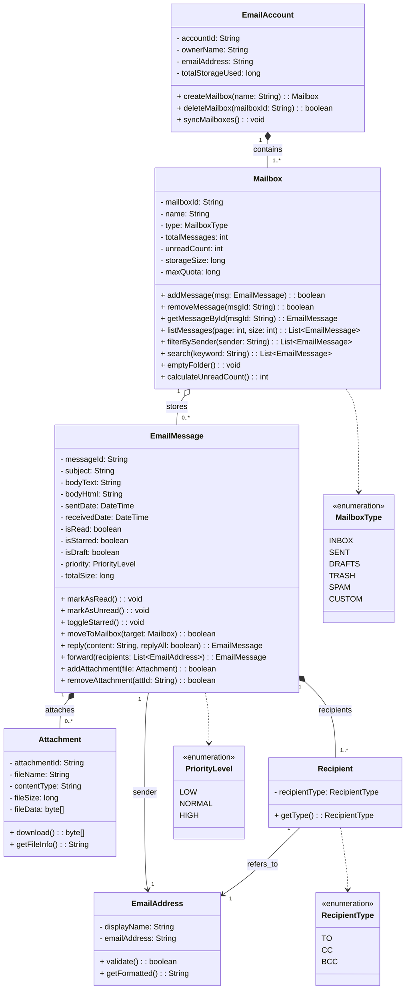
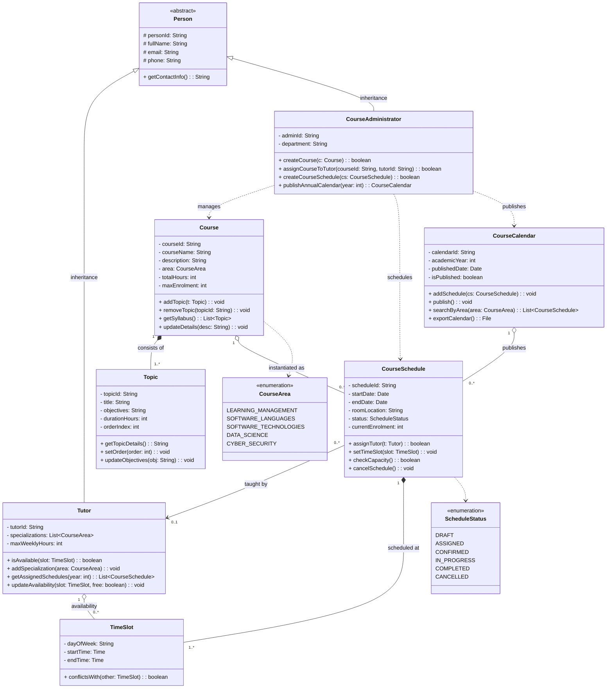
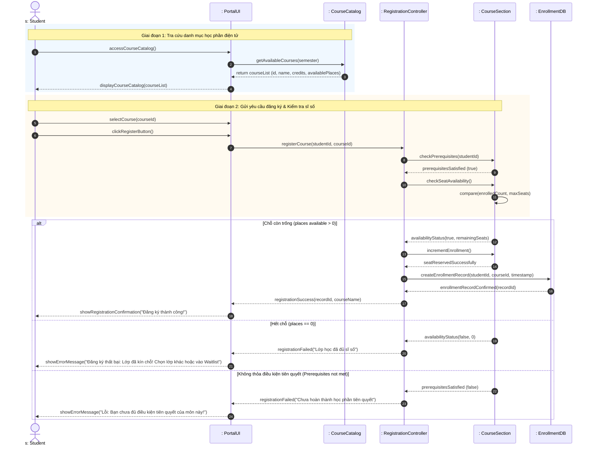
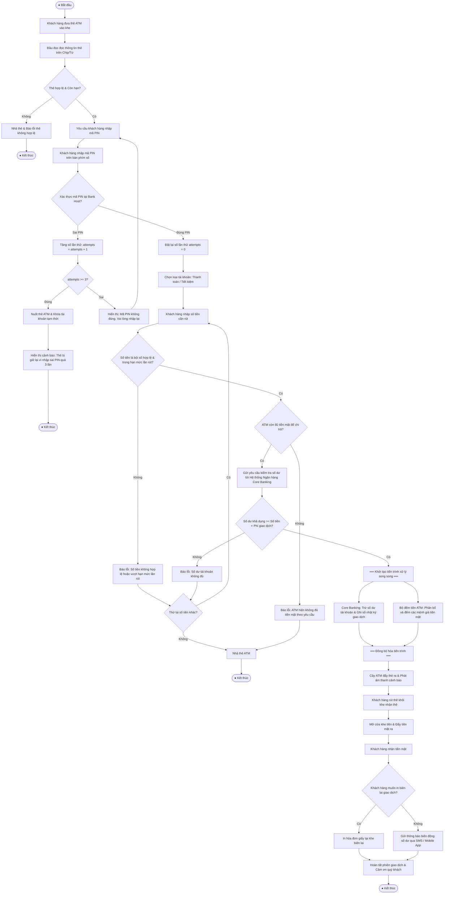

# TRƯỜNG ĐẠI HỌC TÔN ĐỨC THẮNG (TDTU)
## KHOA CÔNG NGHỆ THÔNG TIN
### BỘ MÔN: KỸ THUẬT PHẦN MỀM (SOFTWARE ENGINEERING – 503074)

---

# BÁO CÁO BÀI TẬP THỰC HÀNH: LAB 4 – LAB 5 – LAB 6
## CHỦ ĐỀ: CLASS DIAGRAM, SEQUENCE DIAGRAM & ACTIVITY DIAGRAM
**(Tài liệu tham chiếu: Lab04_6Class_Sequence.pdf)**

---

### THÔNG TIN SINH VIÊN THỰC HIỆN:
- **Họ và tên:** Ngô Lâm Tiến
- **Mã số sinh viên (MSSV):** 524H0195
- **Lớp:** Kỹ thuật Phần mềm (503074) – Nhóm thực hành Tuần 04
- **Giảng viên hướng dẫn:** ThS. Mai Văn Mạnh

---

## MỤC LỤC BÁO CÁO
1. [EXERCISE 1 (LAB 4): XÂY DỰNG MÔ HÌNH LỚP ĐỐI TƯỢNG (CLASS DIAGRAM)](#exercise-1-xây-dựng-mô-hình-lớp-đối-tượng-object-class-modeling)
   - [1.1 Mô hình hóa Hộp thư (Mailbox) và Thư điện tử (E-mail Message)](#11-mô-hình-hóa-hộp-thư-mailbox-và-thư-điện-tử-e-mail-message)
   - [1.2 Mô hình hóa Hệ thống Quản lý Khóa học (Courseware Management System)](#12-mô-hình-hóa-hệ-thống-quản-lý-khóa-học-courseware-management-system)
2. [EXERCISE 2 (LAB 5): BIỂU ĐỒ TUẦN TỰ ĐĂNG KÝ HỌC PHẦN (SEQUENCE DIAGRAM)](#exercise-2-biểu-đồ-tuần-tự-đăng-ký-học-phần-course-registration-sequence-diagram)
   - [2.1 Phân tích bài toán & Xác định các đối tượng tham gia](#21-phân-tích-bài-toán--xác-định-các-đối-tượng-tham-gia)
   - [2.2 Kịch bản tương tác tuần tự (Normal & Alternative Flows)](#22-kịch-bản-tương-tác-tuần-tự-normal--alternative-flows)
   - [2.3 Biểu đồ tuần tự chi tiết (Sequence Diagram)](#23-biểu-đồ-tuần-tự-chi-tiết-sequence-diagram)
3. [EXERCISE 3 (LAB 6): BIỂU ĐỒ HOẠT ĐỘNG RÚT TIỀN TẠI CÂY ATM (ACTIVITY DIAGRAM)](#exercise-3-biểu-đồ-hoạt-động-rút-tiền-tại-cây-atm-atm-cash-withdrawal-activity-diagram)
   - [3.1 Phân tích quy trình xử lý dữ liệu giao dịch rút tiền mặt](#31-phân-tích-quy-trình-xử-lý-dữ-liệu-giao-dịch-rút-tiền-mặt)
   - [3.2 Biểu đồ hoạt động chi tiết (Activity Diagram)](#32-biểu-đồ-hoạt-động-chi-tiết-activity-diagram)
   - [3.3 Giải thích các luồng điều kiện, song song và xử lý ngoại lệ](#33-giải-thích-các-luồng-điều-kiện-song-song-và-xử-lý-ngoại-lệ)
4. [TỔNG KẾT VÀ NGUYÊN LÝ THIẾT KẾ ÁP DỤNG](#tổng-kết-và-nguyên-lý-thiết-kế-áp-dụng)

---

# EXERCISE 1 (LAB 4): XÂY DỰNG MÔ HÌNH LỚP ĐỐI TƯỢNG (CLASS DIAGRAM)

---

## 1.1 Mô hình hóa Hộp thư (Mailbox) và Thư điện tử (E-mail Message)

### 1. Yêu cầu đề bài (Problem Statement)
> *"Look carefully at how messages and mailboxes are represented in the email system that you use. Model the object classes that might be used in the system implementation to represent a mailbox and an e-mail message."*

### 2. Phân tích thực tế từ hệ thống Email hiện đại (Gmail, Outlook, Apple Mail)
Trong các hệ thống email phổ biến hiện nay:
- **E-mail Message:** Đại diện cho một bức thư điện tử, bao gồm các thông tin định danh (`Message-ID`), tiêu đề, nội dung (văn bản thuần hoặc định dạng HTML), thời gian gửi/nhận, trạng thái đọc/chưa đọc, mức độ ưu tiên, danh sách tệp đính kèm (`Attachment`), người gửi (`Sender`) và người nhận (`Recipients`: TO, CC, BCC).
- **Mailbox:** Đại diện cho một ngăn chứa thư (thư mục/hộp thư) của người dùng như *Inbox (Hộp thư đến), Sent (Đã gửi), Drafts (Bản nháp), Spam (Thư rác), Trash (Thùng rác)* hoặc các thư mục tùy chỉnh. Hộp thư chịu trách nhiệm quản lý danh sách các bức thư, tính toán dung lượng đã sử dụng, số lượng thư chưa đọc, và cung cấp các thao tác tìm kiếm, lọc, phân loại thư.
- **Mối quan hệ:** 
  - Một tài khoản email (`EmailAccount`) sở hữu nhiều `Mailbox`.
  - Một `Mailbox` chứa từ $0$ đến nhiều `EmailMessage` ($0..*$).
  - Một `EmailMessage` có thể liên kết với $0$ đến nhiều tệp đính kèm `Attachment` ($0..*$) theo quan hệ sở hữu thành phần (Composition).
  - Một bức thư gắn liền với các địa chỉ email người gửi và người nhận (`EmailAddress`).

### 3. Bảng đặc tả chi tiết các Lớp đối tượng

#### Lớp `Mailbox`
| Thành phần | Tên | Kiểu dữ liệu / Kiểu trả về | Mô tả chi tiết |
|---|---|---|---|
| **Thuộc tính** | `- mailboxId` | `String` | Mã định danh duy nhất của hộp thư |
| | `- name` | `String` | Tên hộp thư (*Inbox, Sent, Drafts, Trash, v.v.*) |
| | `- type` | `MailboxType` | Phân loại (*SYSTEM, USER_DEFINED, ARCHIVE*) |
| | `- totalMessages` | `int` | Tổng số lượng thư hiện có trong hộp thư |
| | `- unreadCount` | `int` | Số lượng thư chưa đọc |
| | `- storageSize` | `long` | Tổng dung lượng chiếm dụng (bytes) |
| | `- maxQuota` | `long` | Hạn mức dung lượng cho phép của hộp thư |
| **Phương thức** | `+ addMessage(msg: EmailMessage): boolean` | `boolean` | Thêm thư mới vào hộp thư |
| | `+ removeMessage(msgId: String): boolean` | `boolean` | Xóa thư khỏi hộp thư |
| | `+ getMessageById(msgId: String): EmailMessage` | `EmailMessage` | Lấy thông tin thư theo ID |
| | `+ listMessages(page: int, size: int): List<EmailMessage>` | `List<EmailMessage>` | Phân trang danh sách thư |
| | `+ filterBySender(senderEmail: String): List<EmailMessage>` | `List<EmailMessage>` | Lọc danh sách thư theo người gửi |
| | `+ search(keyword: String): List<EmailMessage>` | `List<EmailMessage>` | Tìm kiếm thư theo từ khóa trong tiêu đề/nội dung |
| | `+ emptyFolder(): void` | `void` | Dọn sạch tất cả các thư trong hộp thư |
| | `+ calculateUnreadCount(): int` | `int` | Đếm và cập nhật số lượng thư chưa đọc |

#### Lớp `EmailMessage`
| Thành phần | Tên | Kiểu dữ liệu / Kiểu trả về | Mô tả chi tiết |
|---|---|---|---|
| **Thuộc tính** | `- messageId` | `String` | Khóa chính/ID chuẩn RFC 2822 của thư |
| | `- subject` | `String` | Tiêu đề của thư điện tử |
| | `- bodyText` | `String` | Nội dung thư dạng văn bản thuần (Plain Text) |
| | `- bodyHtml` | `String` | Nội dung thư có định dạng HTML |
| | `- sentDate` | `DateTime` | Ngày giờ gửi thư đi |
| | `- receivedDate` | `DateTime` | Ngày giờ máy chủ nhận được thư |
| | `- isRead` | `boolean` | Trạng thái đã xem thư hay chưa |
| | `- isStarred` | `boolean` | Đánh dấu thư quan trọng / gắn dấu sao |
| | `- isDraft` | `boolean` | Cờ nhận diện thư đang soạn dở (Draft) |
| | `- priority` | `PriorityLevel` | Mức ưu tiên (*LOW, NORMAL, HIGH*) |
| | `- totalSize` | `long` | Kích thước toàn bộ bức thư (bao gồm tệp đính kèm) |
| **Phương thức** | `+ markAsRead(): void` | `void` | Đánh dấu bức thư là đã đọc |
| | `+ markAsUnread(): void` | `void` | Đánh dấu bức thư là chưa đọc |
| | `+ toggleStarred(): void` | `void` | Đảo trạng thái gắn cờ quan trọng |
| | `+ moveToMailbox(target: Mailbox): boolean` | `boolean` | Di chuyển thư sang hộp thư/thư mục khác |
| | `+ reply(replyContent: String, replyAll: boolean): EmailMessage` | `EmailMessage` | Tạo thư phản hồi cho người gửi |
| | `+ forward(newRecipients: List<EmailAddress>): EmailMessage` | `EmailMessage` | Chuyển tiếp bức thư cho người nhận mới |
| | `+ addAttachment(file: Attachment): boolean` | `boolean` | Đính kèm tệp tin vào thư |
| | `+ removeAttachment(attachmentId: String): boolean` | `boolean` | Gỡ bỏ tệp đính kèm |

#### Lớp phụ trợ `Attachment`
- **Thuộc tính:** `attachmentId: String`, `fileName: String`, `contentType: String`, `fileSize: long`, `dataPayload: byte[]`.
- **Phương thức:** `download(): byte[]`, `preview(): FilePreview`.

#### Lớp phụ trợ `EmailAddress`
- **Thuộc tính:** `displayName: String`, `emailAddress: String`.
- **Phương thức:** `isValid(): boolean`, `toString(): String`.

---

### 4. Sơ đồ Lớp UML (Class Diagram) – Bài 1.1

---

## 1.2 Mô hình hóa Hệ thống Quản lý Khóa học (Courseware Management System)

### 1. Phân tích miền bài toán theo đề bài
Đề bài cung cấp các thông tin cốt lõi:
1. **Lĩnh vực và Khóa học (Courses & Areas):** Tổ chức cung cấp nhiều khóa học thuộc các lĩnh vực khác nhau (*Kỹ năng quản lý, Ngôn ngữ lập trình, Công nghệ phần mềm*). Mỗi khóa học (`Course`) được cấu thành từ một tập hợp các chủ đề (`Topic`).
2. **Giảng viên / Hướng dẫn viên (Tutors):** Các Tutor được phân công giảng dạy các khóa học căn cứ trên **chuyên môn (specialization)** và **thời gian rảnh / tính sẵn sàng (availability)** của họ.
3. **Lịch biểu thường niên (Annual Calendar):** Tổ chức phát hành và duy trì lịch biểu hàng năm ghi nhận các lớp học được tổ chức và giảng viên được phân công tương ứng.
4. **Nhân viên quản trị khóa học (Course Administrators):** Quản lý nội dung khóa học, phân công giảng viên vào khóa học, xác định và công bố lịch mở lớp (`Course Schedule`).
5. **Mục tiêu của Courseware Management System (CMS):** Giúp tổ chức kiểm soát tốt hơn, tăng tính minh bạch và chuẩn hóa quy trình phân công, lên lịch và quản lý khóa học.

### 2. Các thực thể cốt lõi (Core Domain Entities)

1. `Course` (Khóa học):
   - Đại diện cho chương trình đào tạo tổng quát.
   - Chứa mã khóa học, tên khóa học, mô tả, lĩnh vực đào tạo (`CourseArea`), thời lượng, số học viên tối đa.
   - Có quan hệ thành phần (Composition) $1..*$ với `Topic`.
2. `Topic` (Chủ đề bài giảng):
   - Một phần cấu thành nội dung đào tạo trong khóa học.
   - Thuộc tính: mã bài học, tiêu đề bài, mục tiêu học tập, thời lượng dự kiến, thứ tự giảng dạy (`orderIndex`).
3. `Tutor` (Giảng viên / Hướng dẫn viên):
   - Chuyên gia chịu trách nhiệm giảng dạy.
   - Kế thừa thông tin từ lớp trừu tượng `Person` (họ tên, email, số điện thoại).
   - Có danh sách lĩnh vực chuyên môn (`specializations: List<CourseArea>`) và lịch rảnh (`availabilities: List<TutorAvailability>`).
   - Có phương thức kiểm tra lịch trống: `isAvailable(timeSlot: TimeSlot): boolean`.
4. `CourseAdministrator` (Người quản trị khóa học):
   - Nhân viên quản trị hệ thống đào tạo.
   - Thực hiện nghiệp vụ: tạo mới/chỉnh sửa khóa học, phân công giảng viên, xếp lịch mở lớp, xuất bản lịch thường niên.
5. `CourseSchedule` (Lớp học / Đợt mở lớp cụ thể):
   - Một phiên bản triển khai cụ thể của một `Course` trong năm học.
   - Gắn liền với: thời gian bắt đầu/kết thúc, phòng học/link online, số lượng sinh viên đăng ký, trạng thái lớp (`ScheduleStatus`).
   - Được phân công cho một `Tutor` cụ thể.
6. `CourseCalendar` (Lịch đào tạo thường niên):
   - Tập hợp toàn bộ các `CourseSchedule` được tổ chức trong năm của viện/trung tâm.
   - Cung cấp tính năng xuất bản và tra cứu lịch cho toàn tổ chức.

---

### 3. Bảng đặc tả chi tiết các Lớp của Hệ thống CMS

| Tên Lớp | Thuộc tính chính | Phương thức chính | Trách nhiệm |
|---|---|---|---|
| `Course` | `- courseId: String` `- courseName: String` `- description: String` `- area: CourseArea` `- totalHours: int` `- maxEnrolment: int` | `+ addTopic(t: Topic): void` `+ removeTopic(topicId: String): void` `+ getSyllabus(): List<Topic>` `+ updateDetails(desc: String): void` | Quản lý thông tin và đề cương chi tiết của khóa học |
| `Topic` | `- topicId: String` `- title: String` `- objectives: String` `- durationHours: int` `- orderIndex: int` | `+ getTopicDetails(): String` `+ setOrder(order: int): void` `+ updateObjectives(obj: String): void` | Quản lý nội dung bài giảng chi tiết trong khóa học |
| `Tutor` | `- tutorId: String` `- specializations: List<CourseArea>` `- maxWeeklyHours: int` | `+ isAvailable(slot: TimeSlot): boolean` `+ addSpecialization(area: CourseArea): void` `+ getAssignedSchedules(year: int): List<CourseSchedule>` `+ updateAvailability(slot: TimeSlot, free: boolean): void` | Lưu trữ chuyên môn, tính khả dụng và nhận lịch dạy |
| `CourseAdministrator` | `- adminId: String` `- department: String` | `+ createCourse(c: Course): boolean` `+ assignCourseToTutor(cId: String, tId: String): boolean` `+ createCourseSchedule(cs: CourseSchedule): boolean` `+ publishAnnualCalendar(year: int): CourseCalendar` | Điều phối phân công, duyệt lịch và quản trị hệ thống |
| `CourseSchedule` | `- scheduleId: String` `- startDate: Date` `- endDate: Date` `- roomLocation: String` `- status: ScheduleStatus` `- currentEnrolment: int` | `+ assignTutor(t: Tutor): boolean` `+ setTimeSlot(slot: TimeSlot): void` `+ checkCapacity(): boolean` `+ cancelSchedule(): void` | Đại diện cho một lớp học cụ thể diễn ra theo thời gian biểu |
| `CourseCalendar` | `- calendarId: String` `- academicYear: int` `- publishedDate: Date` `- isPublished: boolean` | `+ addSchedule(cs: CourseSchedule): void` `+ publish(): void` `+ searchByArea(area: CourseArea): List<CourseSchedule>` `+ exportCalendar(): File` | Quản lý lịch biểu đào tạo toàn diện hàng năm của tổ chức |

---

### 4. Sơ đồ Lớp UML (Class Diagram) – Bài 1.2

---

# EXERCISE 2 (LAB 5): BIỂU ĐỒ TUẦN TỰ ĐĂNG KÝ HỌC PHẦN (SEQUENCE DIAGRAM)

---

### 2.1 Phân tích bài toán & Xác định các đối tượng tham gia
> *"Develop a sequence diagram showing the interactions involved when a student registers for a course in a university. Courses may have limited enrolment, so the registration process must include checks that places are available. Assume that the student accesses an electronic course catalog to find out about available courses."*

#### 1. Các Actor và Đối tượng (Lifelines):
1. **`s: Student` (Actor):** Sinh viên thực hiện tra cứu và đăng ký học phần trên cổng đào tạo.
2. **`: PortalUI` (Boundary Layer):** Giao diện cổng thông tin đăng ký học phần trực tuyến (Web/Mobile App).
3. **`: CourseCatalog` (Control / Catalog Service):** Hệ thống danh mục khóa học điện tử lưu trữ và cung cấp thông tin các môn học được mở trong kỳ.
4. **`: RegistrationController` (Application Service):** Bộ điều phối nghiệp vụ đăng ký học phần, chịu trách nhiệm kiểm tra điều kiện tiên quyết và điều phối việc cấp chỗ.
5. **`: CourseSection` (Domain Entity):** Lớp học phần cụ thể được chọn, quản lý giới hạn sĩ số (`maxSeats`), số lượng đã đăng ký (`enrolledCount`) và trạng thái còn chỗ.
6. **`: EnrollmentDB` (Data Persistence Layer):** Cơ sở dữ liệu ghi nhận bản ghi đăng ký chính thức của sinh viên.

---

### 2.2 Kịch bản tương tác tuần tự (Normal & Alternative Flows)

1. **Bước 1: Tra cứu môn học (Browse Catalog):**
   - Sinh viên truy cập vào giao diện, gửi yêu cầu tìm kiếm danh mục môn học (`searchCourses(criteria)`).
   - `PortalUI` chuyển tiếp yêu cầu đến `CourseCatalog`.
   - `CourseCatalog` truy vấn và trả về danh sách các lớp học phần cùng số chỗ trống hiện thời.
   - Giao diện hiển thị danh sách cho sinh viên.
2. **Bước 2: Gửi yêu cầu đăng ký (Submit Registration):**
   - Sinh viên chọn mã lớp học phần mong muốn và nhấn "Đăng ký" (`submitCourseRegistration(studentId, courseId)`).
   - `PortalUI` gửi lệnh đăng ký đến `RegistrationController`.
3. **Bước 3: Kiểm tra sĩ số & Điều kiện học phần (Validation & Capacity Check):**
   - `RegistrationController` gửi thông điệp yêu cầu kiểm tra sĩ số tới đối tượng `CourseSection` (`checkAvailability()`).
   - `CourseSection` đối chiếu số sinh viên hiện có với số lượng tối đa (`enrolledCount < maxSeats`).
4. **Bước 4: Rẽ nhánh điều kiện (UML `alt` fragment):**
   - **Nhánh thành công `[Chỗ trống hợp lệ (places available)]`:**
     - `CourseSection` trả về `placesAvailable == true`.
     - `RegistrationController` gửi lệnh giữ chỗ và tăng sĩ số (`reserveSeat()`).
     - `RegistrationController` tạo bản ghi đăng ký chính thức xuống `EnrollmentDB` (`saveEnrollmentRecord()`).
     - `EnrollmentDB` xác nhận đã lưu thành công (`recordSaved`).
     - `RegistrationController` gửi thông báo thành công về `PortalUI`.
     - `PortalUI` hiển thị kết quả "Đăng ký thành công kèm mã phiếu đăng ký" cho sinh viên.
   - **Nhánh thất bại 1 `[Lớp đã hết chỗ (Course full)]`:**
     - `CourseSection` trả về `placesAvailable == false`.
     - `RegistrationController` gửi phản hồi lỗi `registrationFailed("Lớp học phần đã hết chỗ")`.
     - `PortalUI` thông báo lỗi và đề xuất cho sinh viên đăng ký vào danh sách chờ (`Waitlist`) hoặc chọn lớp khác.
   - **Nhánh thất bại 2 `[Trùng lịch học hoặc chưa đạt môn tiên quyết]`:**
     - `RegistrationController` phát hiện xung đột và từ chối đăng ký, thông báo lý do cụ thể về giao diện.

---

### 2.3 Biểu đồ tuần tự chi tiết (Sequence Diagram)

---

# EXERCISE 3 (LAB 6): BIỂU ĐỒ HOẠT ĐỘNG RÚT TIỀN TẠI CÂY ATM (ACTIVITY DIAGRAM)

---

### 3.1 Phân tích quy trình xử lý dữ liệu giao dịch rút tiền mặt
> *"Based on your experience with a bank ATM, draw an activity diagram that models the data processing involved when a customer withdraws cash from the machine."*

Quy trình rút tiền tại cây ATM là một giao dịch ngân hàng đòi hỏi tính toàn vẹn dữ liệu (ACID), bảo mật cao và an toàn vật lý. Quy trình xử lý dữ liệu gồm các bước chặt chẽ:
1. **Khởi tạo & Đọc thông tin thẻ:**
   - Khách hàng đưa thẻ vào khe đọc thẻ.
   - Đầu đọc thẻ (Card Reader) giải mã thông tin tài khoản trên chip EMV/dải từ.
   - Nếu thẻ không đọc được hoặc thẻ đã hết hạn/bị khóa $\rightarrow$ Trả thẻ kèm thông báo lỗi.
2. **Nhập mã PIN & Xác thực danh tính:**
   - Khách hàng nhập mã PIN (4 đến 6 chữ số).
   - Mã PIN được mã hóa phần cứng (Hardware Security Module - HSM) và gửi về máy chủ ngân hàng (Bank Host) để đối soát.
   - **Xử lý sai PIN:** Nếu nhập sai, tăng biến đếm số lần thử (`attempts = attempts + 1`). Nếu sai quá 3 lần liên tiếp, ATM nuốt thẻ (tịch thu thẻ) để bảo vệ tài khoản.
3. **Lựa chọn loại giao dịch & Số tiền:**
   - Khách hàng chọn giao dịch "Rút tiền" (Cash Withdrawal).
   - Chọn loại tài khoản (Thanh toán / Tiết kiệm) và nhập số tiền cần rút.
4. **Kiểm tra tính hợp lệ dữ liệu (Data & Business Validation):**
   - **Kiểm tra 1 (Bội số mệnh giá):** Số tiền có phải là bội số của mệnh giá ATM đang có (ví dụ: bội số của 50.000 VNĐ) và nằm trong hạn mức 1 lần rút hay không?
   - **Kiểm tra 2 (Khả năng chi tiền của ATM):** Hộc đựng tiền mặt trong cây ATM có còn đủ tiền để chi trả hay không?
   - **Kiểm tra 3 (Số dư tài khoản khách hàng):** Số dư khả dụng trong tài khoản có đủ để chi trả `Số tiền rút + Phí giao dịch` hay không? Hạn mức rút tiền trong ngày có bị vượt quá không?
5. **Thực thi giao dịch tài chính (Data Transaction Processing):**
   - Khởi tạo giao dịch ngân hàng trừ tiền tài khoản khách hàng và ghi nhận nhật ký giao dịch (Audit Log).
   - Kích hoạt hộc đếm tiền (Cash Dispenser) chuẩn bị các tờ tiền mặt phù hợp.
6. **Trả thẻ & Chi tiền (Tuân thủ chuẩn an toàn quốc tế):**
   - **Nguyên tắc an toàn:** Cây ATM luôn **nhả thẻ trước** và phát âm thanh cảnh báo để khách hàng rút thẻ, tránh trường hợp khách lấy tiền xong quên lấy lại thẻ.
   - Sau khi thẻ đã được rút ra, khe chi tiền mở ra cho khách nhận tiền mặt.
   - Hỏi khách hàng có muốn in biên lai hay không (In biên lai hoặc gửi e-receipt qua SMS/App).
7. **Kết thúc phiên giao dịch.**

---

### 3.2 Biểu đồ hoạt động chi tiết (Activity Diagram)

---

### 3.3 Giải thích các luồng điều kiện, song song và xử lý ngoại lệ

1. **Xử lý rủi ro bảo mật (Security Safeguards):**
   - Biểu đồ mô hình hóa điều kiện kiểm tra biến đếm mã PIN (`attempts >= 3`). Đây là yêu cầu bắt buộc của các chuẩn bảo mật ngân hàng nhằm chống lại các cuộc tấn công brute-force dò mã PIN.
2. **Kiểm tra 3 lớp (3-tier Validation):**
   - Lớp 1: Ràng buộc logic đầu vào (bội số của 50.000 VNĐ, tối thiểu 50.000, tối đa 5.000.000 VNĐ/lần).
   - Lớp 2: Kiểm tra vật lý nội tại của ATM (số lượng tiền còn lại trong hộc tiền mặt `Cassette`).
   - Lớp 3: Kiểm tra tài chính từ Core Banking (số dư khả dụng, hạn mức thẻ trong ngày, trạng thái tài khoản không bị phong tỏa).
3. **Thanh phân nhánh & Hợp nhất song song (Fork & Join Nodes):**
   - Sau khi giao dịch được chấp thuận, hai tác vụ được thực thi song song:
     - Giao tiếp mạng: Trừ tiền tài khoản và ghi nhận Transaction Log trên máy chủ trung tâm.
     - Cơ điện tử: Động cơ bước trong ATM nhặt từng tờ tiền từ các hộp mệnh giá khác nhau, kiểm tra độ dày tránh dính tờ tiền và đưa ra khay đệm.
   - Thanh Join đảm bảo cả 2 quá trình đều thành công trước khi tiến hành trả tiền mặt cho khách.
4. **Quy tắc an toàn nhả thẻ trước (Eject Card Before Cash):**
   - Điểm thiết kế thực tế quan trọng: ATM luôn yêu cầu khách hàng nhận lại thẻ ATM trước, sau đó mới đẩy tiền ra. Thiết kế này giải quyết triệt để vấn đề tâm lý khách hàng khi đã cầm tiền trong tay thường sẽ bỏ đi ngay và để quên thẻ tại máy.

---

# TỔNG KẾT VÀ NGUYÊN LÝ THIẾT KẾ ÁP DỤNG

Báo cáo đã giải quyết đầy đủ và toàn diện 3 bài tập lớn trong tài liệu thực hành Tuần 04:

1. **Exercise 1 (Class Diagram):**
   - **1.1 Mailbox & EmailMessage:** Tách bạch rõ ràng giữa đối tượng lưu trữ (`Mailbox`) và đối tượng dữ liệu truyền thông (`EmailMessage`), áp dụng triệt để nguyên lý *Single Responsibility Principle (SRP)* và quan hệ Composition chặt chẽ với tệp đính kèm.
   - **1.2 Courseware Management System:** Thiết lập mô hình hướng đối tượng phản ánh trung thực toàn bộ nghiệp vụ thực tế của một trung tâm đào tạo: phân cấp đề cương khóa học (`Course` - `Topic`), ràng buộc chuyên môn và tính khả dụng của giảng viên (`Tutor` - `TimeSlot`), và cơ chế xuất bản lịch thường niên (`CourseCalendar`).

2. **Exercise 2 (Sequence Diagram):**
   - Mô tả chính xác sự tương tác đa tầng giữa Sinh viên, Giao diện Web, Bộ dịch vụ danh mục điện tử, Bộ điều phối đăng ký và Thực thể lớp học phần.
   - Sử dụng các phân đoạn UML (`alt`, `opt`, `ref`) để biểu diễn các kịch bản thực tế: lớp còn chỗ, lớp hết chỗ, hoặc không thỏa điều kiện tiên quyết.

3. **Exercise 3 (Activity Diagram):**
   - Thể hiện một quy trình nghiệp vụ tài chính hoàn chỉnh tại cây ATM theo chuẩn công nghiệp.
   - Áp dụng đầy đủ các nút quyết định (Decision Node), thanh song song (Fork/Join) và các luồng xử lý ngoại lệ an ninh (sai PIN 3 lần, thiếu tiền trong máy, vượt số dư).
