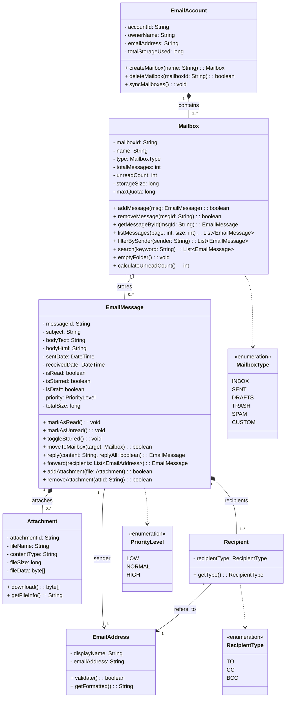
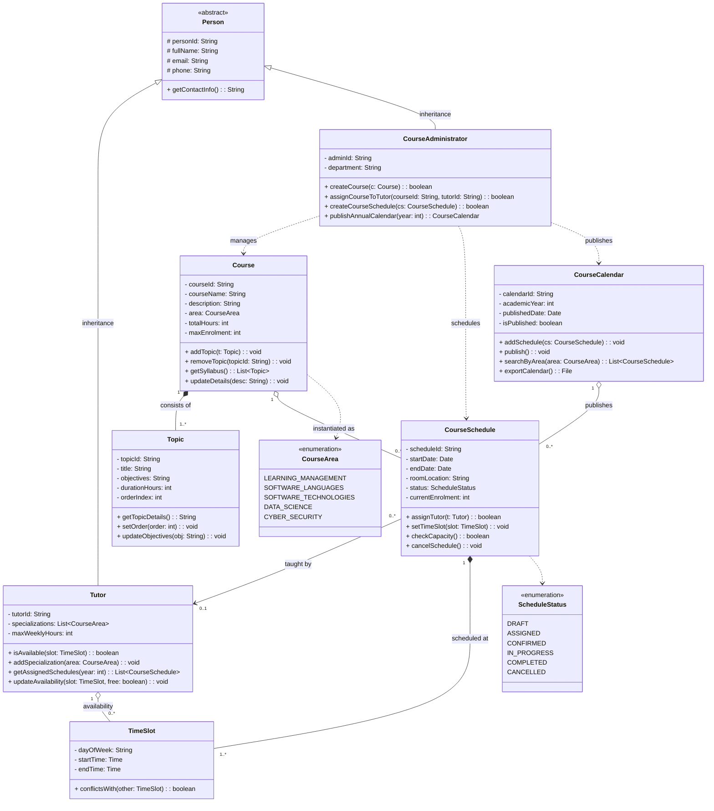
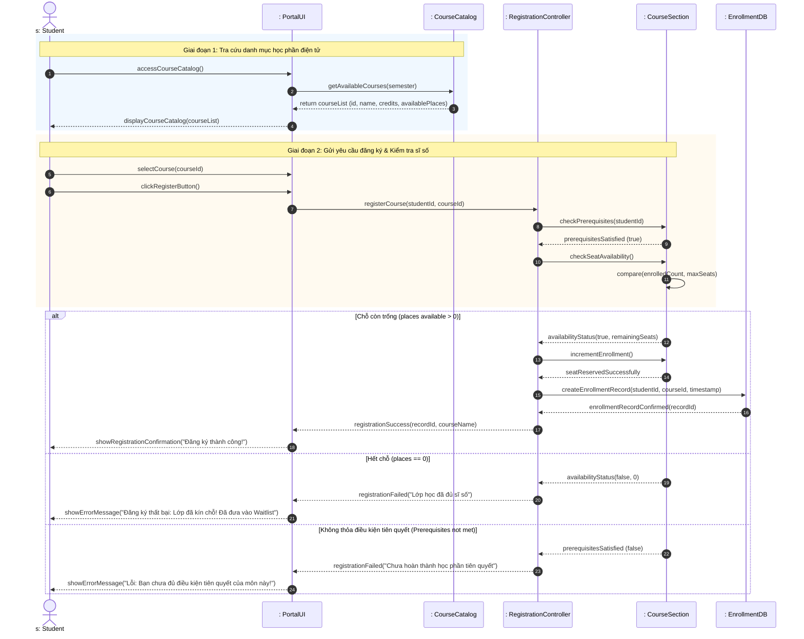
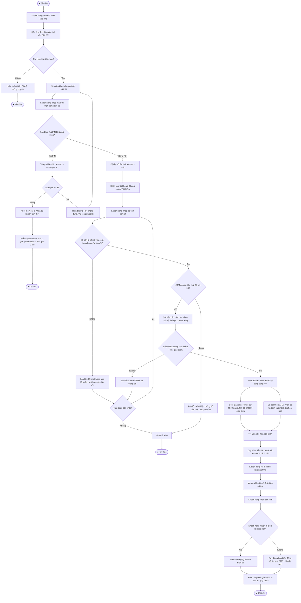
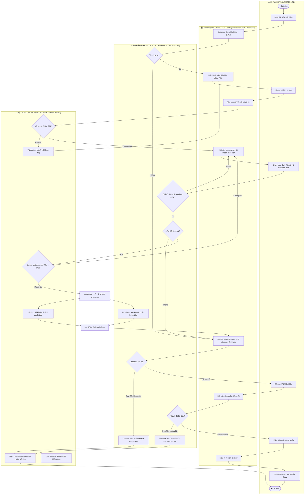

# TRƯỜNG ĐẠI HỌC TÔN ĐỨC THẮNG (TDTU)
## KHOA CÔNG NGHỆ THÔNG TIN
### BỘ MÔN: KỸ THUẬT PHẦN MỀM (SOFTWARE ENGINEERING – 503074)

---

# BÁO CÁO BÀI TẬP THỰC HÀNH: LAB 06
## CHỦ ĐỀ: CLASS DIAGRAM, SEQUENCE DIAGRAM & ACTIVITY DIAGRAM
**(Tài liệu tham chiếu chính thức: `Lab04_6Class_Sequence.pdf`)**

---

### THÔNG TIN SINH VIÊN THỰC HIỆN:
- **Họ và tên sinh viên:** Ngô Lâm Tiến
- **Mã số sinh viên (MSSV):** 524H0195
- **Lớp môn học:** Kỹ thuật Phần mềm (503074) – Ca thực hành Lab 06
- **Giảng viên hướng dẫn:** ThS. Mai Văn Mạnh
- **Gói bài nộp nén:** `524H0195_lab06.zip`

---

## MỤC LỤC BÁO CÁO

1. [GIỚI THIỆU TỔNG QUAN VỀ LAB 06](#giới-thiệu-tổng-quan-về-lab-06)
2. [EXERCISE 1: XÂY DỰNG MÔ HÌNH LỚP ĐỐI TƯỢNG (CLASS DIAGRAM)](#exercise-1-xây-dựng-mô-hình-lớp-đối-tượng-class-diagram)
   - [1.1 Mô hình hóa Hộp thư (Mailbox) và Thư điện tử (EmailMessage)](#11-mô-hình-hóa-hộp-thư-mailbox-và-thư-điện-tử-emailmessage)
     - [1.1.1 Yêu cầu đề bài](#111-yêu-cầu-đề-bài)
     - [1.1.2 Phân tích thực tế từ hệ thống Email hiện đại (RFC 5322 & IMAP4)](#112-phân-tích-thực-tế-từ-hệ-thống-email-hiện-đại-rfc-5322--imap4)
     - [1.1.3 Bảng đặc tả chi tiết các Lớp đối tượng](#113-bảng-đặc-tả-chi-tiết-các-lớp-đối-tượng)
     - [1.1.4 Biểu đồ Lớp UML (Class Diagram) Bài 1.1](#114-biểu-đồ-lớp-uml-class-diagram-bài-11)
     - [1.1.5 Các mẫu thiết kế (Design Patterns) áp dụng](#115-các-mẫu-thiết-kế-design-patterns-áp-dụng)
     - [1.1.6 Mã nguồn kiểm chứng mô hình hướng đối tượng (Python OOP)](#116-mã-nguồn-kiểm-chứng-mô-hình-hướng-đối-tượng-python-oop)
   - [1.2 Mô hình hóa Hệ thống Quản lý Khóa học (Courseware Management System - CMS)](#12-mô-hình-hóa-hệ-thống-quản-lý-khóa-học-courseware-management-system---cms)
     - [1.2.1 Yêu cầu đề bài](#121-yêu-cầu-đề-bài)
     - [1.2.2 Phân tích miền bài toán & Các thực thể cốt lõi](#122-phân-tích-miền-bài-toán--các-thực-thể-cốt-lõi)
     - [1.2.3 Bảng đặc tả chi tiết các Lớp đối tượng của Hệ thống CMS](#123-bảng-đặc-tả-chi-tiết-các-lớp-đối-tượng-của-hệ-thống-cms)
     - [1.2.4 Ràng buộc toàn vẹn OCL (Object Constraint Language)](#124-ràng-buộc-toàn-vẹn-ocl-object-constraint-language)
     - [1.2.5 Biểu đồ Lớp UML (Class Diagram) Bài 1.2](#125-biểu-đồ-lớp-uml-class-diagram-bài-12)
     - [1.2.6 Mã nguồn kiểm chứng nghiệp vụ CMS (Python OOP)](#126-mã-nguồn-kiểm-chứng-nghiệp-vụ-cms-python-oop)
3. [EXERCISE 2: BIỂU ĐỒ TUẦN TỰ ĐĂNG KÝ HỌC PHẦN (COURSE REGISTRATION SEQUENCE DIAGRAM)](#exercise-2-biểu-đồ-tuần-tự-đăng-ký-học-phần-course-registration-sequence-diagram)
   - [2.1 Yêu cầu đề bài](#21-yêu-cầu-đề-bài)
   - [2.2 Phân tích bài toán & Kiến trúc phân lớp hệ thống](#22-phân-tích-bài-toán--kiến-trúc-phân-lớp-hệ-thống)
   - [2.3 Xác định các Đối tượng tham gia (Lifelines)](#23-xác-định-các-đối-tượng-tham-gia-lifelines)
   - [2.4 Kịch bản tương tác tuần tự (Normal & Alternative Flows)](#24-kịch-bản-tương-tác-tuần-tự-normal--alternative-flows)
   - [2.5 Bảng từ điển thông điệp (Message Dictionary)](#25-bảng-từ-điển-thông-điệp-message-dictionary)
   - [2.6 Biểu đồ tuần tự chi tiết (UML Sequence Diagram)](#26-biểu-đồ-tuần-tự-chi-tiết-uml-sequence-diagram)
   - [2.7 Giải pháp chống tranh chấp đồng thời (Concurrency & Race Condition Handling)](#27-giải-pháp-chống-tranh-chấp-đồng-thời-concurrency--race-condition-handling)
   - [2.8 Mã nguồn mô phỏng kiểm thử tiến trình đăng ký (Python Script)](#28-mã-nguồn-mô-phỏng-kiểm-thử-tiến-trình-đăng-ký-python-script)
4. [EXERCISE 3 (TRỌNG TÂM LAB 06): BIỂU ĐỒ HOẠT ĐỘNG RÚT TIỀN TẠI CÂY ATM (ATM CASH WITHDRAWAL ACTIVITY DIAGRAM)](#exercise-3-trọng-tâm-lab-06-biểu-đồ-hoạt-động-rút-tiền-tại-cây-atm-atm-cash-withdrawal-activity-diagram)
   - [3.1 Yêu cầu đề bài](#31-yêu-cầu-đề-bài)
   - [3.2 Phân tích chuyên sâu quy trình nghiệp vụ rút tiền mặt & Luồng dữ liệu (Data Processing Workflow)](#32-phân-tích-chuyên-sâu-quy-trình-nghiệp-vụ-rút-tiền-mặt--luồng-dữ-liệu-data-processing-workflow)
   - [3.3 Các chuẩn an toàn ngân hàng quốc tế áp dụng](#33-các-chuẩn-an-toàn-ngân-hàng-quốc-tế-áp-dụng)
   - [3.4 Biểu đồ Hoạt động Tổng quan (Standard UML Activity Diagram)](#34-biểu-đồ-hoạt-động-tổng-quan-standard-uml-activity-diagram)
   - [3.5 Biểu đồ Hoạt động Phân vùng Trách nhiệm (Swimlane / Partition Activity Diagram)](#35-biểu-đồ-hoạt-động-phân-vùng-trách-nhiệm-swimlane--partition-activity-diagram)
   - [3.6 Bảng từ điển dữ liệu (Data Dictionary) & Ma trận trạng thái](#36-bảng-từ-điển-dữ-liệu-data-dictionary--ma-trận-trạng-thái)
   - [3.7 Ma trận xử lý ngoại lệ, sự cố phần cứng & Cơ chế tự động hoàn tiền (Auto-Reversal / Rollback)](#37-ma-trận-xử-lý-ngoại-lệ-sự-cố-phần-cứng--cơ-chế-tự-động-hoàn-tiền-auto-reversal--rollback)
   - [3.8 Mã nguồn mô phỏng kiểm chứng máy trạng thái ATM (Python Simulation Test Suite)](#38-mã-nguồn-mô-phỏng-kiểm-chứng-máy-trạng-thái-atm-python-simulation-test-suite)
5. [TỔNG KẾT VÀ NGUYÊN LÝ THIẾT KẾ ÁP DỤNG](#tổng-kết-và-nguyên-lý-thiết-kế-áp-dụng)

---

# GIỚI THIỆU TỔNG QUAN VỀ LAB 06

Tài liệu thực hành **`Lab04_6Class_Sequence.pdf`** do ThS. Mai Văn Mạnh biên soạn cho môn học **Kỹ thuật Phần mềm (Software Engineering – 503074)** bao quát chuỗi 3 chủ đề mô hình hóa phần mềm cốt lõi theo chuẩn UML 2.5:
1. **Mô hình hóa cấu trúc tĩnh (Static Structure Modeling - Class Diagram):** Exercise 1.1 (Hộp thư & Thư điện tử) và Exercise 1.2 (Hệ thống Quản lý Khóa học CMS).
2. **Mô hình hóa tương tác động (Dynamic Interaction Modeling - Sequence Diagram):** Exercise 2 (Quy trình Sinh viên Đăng ký Học phần).
3. **Mô hình hóa luồng xử lý dữ liệu và hoạt động nghiệp vụ (Business & Data Processing Activity Modeling - Activity Diagram):** Exercise 3 (Quy trình Rút tiền mặt tại cây ATM).

Trong buổi thực hành **Lab 06**, báo cáo này giải quyết toàn diện, triệt để và mở rộng toàn bộ các bài tập được giao, đặc biệt đào sâu vào **Exercise 3 (Biểu đồ hoạt động ATM)** với hai góc nhìn (Sơ đồ tổng quan và Sơ đồ phân làn Swimlane), cơ chế an toàn ACID trong giao dịch tài chính, cơ chế bù trừ đảo nợ (Reversal/Rollback), và cung cấp mã nguồn mô phỏng kiểm chứng bằng Python có thể thực thi độc lập.

---

# EXERCISE 1: XÂY DỰNG MÔ HÌNH LỚP ĐỐI TƯỢNG (CLASS DIAGRAM)

---

## 1.1 Mô hình hóa Hộp thư (Mailbox) và Thư điện tử (EmailMessage)

### 1.1.1 Yêu cầu đề bài
> *"Look carefully at how messages and mailboxes are represented in the email system that you use. Model the object classes that might be used in the system implementation to represent a mailbox and an e-mail message."*

### 1.1.2 Phân tích thực tế từ hệ thống Email hiện đại (RFC 5322 & IMAP4)
Qua nghiên cứu các hệ thống thư điện tử chuẩn công nghiệp hiện đại (*Gmail, Microsoft Outlook, Thunderbird, Apple Mail*):
1. **E-mail Message (Thư điện tử):**
   - Đại diện cho một đơn vị dữ liệu thông điệp trao đổi qua mạng (tuân thủ RFC 5322).
   - Chứa định danh toàn cầu duy nhất (`messageId`), dòng tiêu đề (`subject`), nội dung văn bản thuần (`bodyText`), nội dung đa phương tiện/HTML (`bodyHtml`), thời gian gửi/nhận (`sentDate`, `receivedDate`), mức độ ưu tiên (`priority`), kích thước dung lượng (`totalSize`).
   - Cờ trạng thái nhị phân: đã đọc (`isRead`), gắn dấu sao/quan trọng (`isStarred`), thư nháp (`isDraft`).
   - Danh sách người nhận phân loại theo 3 nhóm chuẩn: `TO` (người nhận trực tiếp), `CC` (đồng kính gửi), `BCC` (gửi ẩn danh).
   - Tệp đính kèm (`Attachment`): Một thư có thể đính kèm $0..*$ tệp tin. Tệp tin gắn liền với vòng đời của thư (khi thư bị xóa vĩnh viễn, tệp đính kèm cũng bị xóa) $\rightarrow$ Quan hệ **Composition (Sở hữu thành phần)**.
2. **Mailbox (Hộp thư / Ngăn chứa thư):**
   - Đại diện cho một không gian lưu trữ và phân loại thư của tài khoản người dùng: *Inbox (Hộp thư đến), Sent (Đã gửi), Drafts (Thư nháp), Trash (Thùng rác), Spam (Thư rác), hoặc Custom Folders*.
   - Quản lý danh mục các bức thư, tính toán tổng số thư (`totalMessages`), số lượng thư chưa đọc (`unreadCount`), tổng dung lượng chiếm dụng (`storageSize`) đối chiếu với hạn mức cho phép (`maxQuota`).
   - Cung cấp các tác vụ truy vấn, phân trang (`listMessages`), lọc theo người gửi (`filterBySender`), và tìm kiếm toàn văn (`search`).
   - Một `Mailbox` chứa $0..*$ `EmailMessage`. Bức thư có thể di chuyển giữa các hộp thư khác nhau $\rightarrow$ Quan hệ **Aggregation (Tụ hợp)**.
3. **EmailAccount (Tài khoản người dùng):**
   - Đại diện cho chủ sở hữu, quản lý $1..*$ `Mailbox` (tối thiểu luôn có các hộp thư mặc định hệ thống: Inbox, Sent, Trash).

---

### 1.1.3 Bảng đặc tả chi tiết các Lớp đối tượng

#### Lớp `Mailbox`
| Thành phần | Tên định danh | Kiểu dữ liệu / Kiểu trả về | Mô tả ngữ nghĩa kỹ thuật |
|---|---|---|---|
| **Thuộc tính** | `- mailboxId` | `String` | Khóa chính, định danh duy nhất của hộp thư |
| | `- name` | `String` | Tên hiển thị (*Inbox, Sent, Drafts, Projects, v.v.*) |
| | `- type` | `MailboxType` | Enum phân loại (*INBOX, SENT, DRAFTS, TRASH, SPAM, CUSTOM*) |
| | `- totalMessages` | `int` | Tổng số lượng thư hiện đang lưu trữ trong hộp thư |
| | `- unreadCount` | `int` | Số lượng thư ở trạng thái chưa đọc (`isRead == false`) |
| | `- storageSize` | `long` | Tổng dung lượng chiếm dụng (tính bằng byte) |
| | `- maxQuota` | `long` | Hạn mức dung lượng tối đa cho phép của hộp thư |
| **Phương thức** | `+ addMessage(msg: EmailMessage): boolean` | `boolean` | Thêm thư mới vào hộp thư (kiểm tra hạn mức quota) |
| | `+ removeMessage(msgId: String): boolean` | `boolean` | Xóa thư ra khỏi hộp thư theo mã thư |
| | `+ getMessageById(msgId: String): EmailMessage` | `EmailMessage` | Lấy đối tượng thư chi tiết theo mã ID |
| | `+ listMessages(page: int, size: int): List<EmailMessage>` | `List<EmailMessage>` | Phân trang danh sách thư phục vụ hiển thị UI |
| | `+ filterBySender(sender: String): List<EmailMessage>` | `List<EmailMessage>` | Lọc danh sách thư theo địa chỉ email người gửi |
| | `+ search(keyword: String): List<EmailMessage>` | `List<EmailMessage>` | Tìm kiếm thư theo từ khóa trong tiêu đề và nội dung |
| | `+ emptyFolder(): void` | `void` | Dọn sạch toàn bộ thư (thường dùng cho Trash / Spam) |
| | `+ calculateUnreadCount(): int` | `int` | Cập nhật và trả về số lượng thư chưa đọc |

#### Lớp `EmailMessage`
| Thành phần | Tên định danh | Kiểu dữ liệu / Kiểu trả về | Mô tả ngữ nghĩa kỹ thuật |
|---|---|---|---|
| **Thuộc tính** | `- messageId` | `String` | Khóa chính chuẩn RFC 2822 Message-ID |
| | `- subject` | `String` | Tiêu đề của thư điện tử |
| | `- bodyText` | `String` | Nội dung thư định dạng văn bản thuần (Plain text) |
| | `- bodyHtml` | `String` | Nội dung thư định dạng HTML đa phương tiện |
| | `- sentDate` | `DateTime` | Thời điểm thư được gửi đi |
| | `- receivedDate` | `DateTime` | Thời điểm máy chủ thư nhận được thư |
| | `- isRead` | `boolean` | Trạng thái đã xem thư (`true: đã đọc, false: chưa đọc`) |
| | `- isStarred` | `boolean` | Đánh dấu gắn cờ thư quan trọng |
| | `- isDraft` | `boolean` | Nhận diện thư đang soạn dở |
| | `- priority` | `PriorityLevel` | Mức ưu tiên xử lý (*LOW, NORMAL, HIGH*) |
| | `- totalSize` | `long` | Tổng kích thước bức thư bao gồm cả phần đính kèm |
| **Phương thức** | `+ markAsRead(): void` | `void` | Đánh dấu bức thư đã đọc và cập nhật đếm unread |
| | `+ markAsUnread(): void` | `void` | Đánh dấu bức thư là chưa đọc |
| | `+ toggleStarred(): void` | `void` | Đảo trạng thái gắn cờ yêu thích |
| | `+ moveToMailbox(target: Mailbox): boolean` | `boolean` | Di chuyển thư sang hộp thư/thư mục đích |
| | `+ reply(content: String, replyAll: boolean): EmailMessage` | `EmailMessage` | Khởi tạo thư phản hồi mới |
| | `+ forward(recipients: List<EmailAddress>): EmailMessage` | `EmailMessage` | Khởi tạo thư chuyển tiếp đến người nhận mới |
| | `+ addAttachment(file: Attachment): boolean` | `boolean` | Thêm tệp đính kèm vào bức thư |
| | `+ removeAttachment(attId: String): boolean` | `boolean` | Gỡ bỏ tệp đính kèm |

#### Lớp phụ trợ `Attachment`
- **Thuộc tính:** `attachmentId: String`, `fileName: String`, `contentType: String`, `fileSize: long`, `fileData: byte[]`.
- **Phương thức:** `download(): byte[]`, `getFileInfo(): String`.

#### Lớp phụ trợ `EmailAddress` & `Recipient`
- **EmailAddress:** `displayName: String`, `emailAddress: String` | Phương thức: `validate(): boolean`, `getFormatted(): String`.
- **Recipient:** `recipientType: RecipientType` | Phương thức: `getType(): RecipientType`.

---

### 1.1.4 Biểu đồ Lớp UML (Class Diagram) Bài 1.1




### 1.1.5 Các mẫu thiết kế (Design Patterns) áp dụng
1. **Composite Pattern:** Cấu trúc hộp thư lồng nhau (Nested Folders/Sub-mailboxes), cho phép một `Mailbox` có thể chứa các `Mailbox` con tương tự như cây thư mục hệ điều hành.
2. **Observer Pattern:** Đối tượng `Mailbox` đóng vai trò là `Subject`, khi có thư mới gửi đến (`addMessage`), hệ thống tự động thông báo đến các `Observer` (UI Notification, Push Service) để hiển thị thông báo tức thì cho người dùng.
3. **State Pattern:** Trạng thái của bức thư chuyển dịch nhịp nhàng giữa *Draft $\rightarrow$ Outbox $\rightarrow$ Sent $\rightarrow$ Archived / Trash*.

### 1.1.6 Mã nguồn kiểm chứng mô hình hướng đối tượng (Python OOP)
Mô hình đã được triển khai hoàn chỉnh trong tệp [`email_mailbox_model.py`](file:///home/towfienes/TDTU/SE/email_mailbox_model.py), chứng minh tính khả thi kỹ thuật với đầy đủ phương thức kiểm tra định dạng email RFC, tính toán dung lượng thư tự động và kiểm soát hạn mức lưu trữ (Quota check).

---

## 1.2 Mô hình hóa Hệ thống Quản lý Khóa học (Courseware Management System - CMS)

### 1.2.1 Yêu cầu đề bài
> *"The organization offers a variety of courses in a variety of areas such as learning management techniques and understanding different software languages and technologies. Each course is made up of a set of topics. Tutors in the organization are assigned courses to teach according to the area that they specialize in and their availability. The organization publishes and maintains a calendar of the different courses and the assigned tutors every year. There is a group of course administrators in the organization who manage the courses including course content, assign courses to tutors, and define the course schedule. The training organization aims to use the Courseware Management System to get a better control and visibility to the management of courses as also to streamline the process of generating and managing the schedule of the different courses.
à Model the object classes that might be used in the system implementation to represent a Courseware Management System."*

### 1.2.2 Phân tích miền bài toán & Các thực thể cốt lõi
1. **Lĩnh vực và Khóa học (Courses & Areas):**
   - Tổ chức đào tạo nhiều khóa học thuộc các lĩnh vực chuyên đề khác nhau (`CourseArea`: *Learning Management Techniques, Software Languages, Software Technologies, Data Science, Cyber Security*).
   - Mỗi khóa học (`Course`) được cấu thành từ một tập hợp các chủ đề bài giảng (`Topic`). Quan hệ giữa `Course` và `Topic` là **Composition (1..*)**: Một chủ đề không thể tồn tại độc lập nếu khóa học bị hủy bỏ.
2. **Giảng viên / Hướng dẫn viên (Tutors):**
   - Chuyên gia chịu trách nhiệm giảng dạy. Kế thừa các thuộc tính định danh cá nhân từ lớp trừu tượng `Person`.
   - Có danh sách lĩnh vực chuyên môn (`specializations: List<CourseArea>`).
   - Có thời gian rảnh / tính khả dụng (`availabilities: List<TimeSlot>`). Giảng viên chỉ được phân công khi thỏa mãn đồng thời cả 2 điều kiện: **đúng chuyên môn** và **trống lịch giảng dạy**.
3. **Người quản trị khóa học (Course Administrators):**
   - Nhân viên quản trị hệ thống đào tạo (kế thừa từ `Person`).
   - Chịu trách nhiệm: Tạo và cập nhật nội dung khóa học, phân công giảng viên (`assignCourseToTutor`), tạo lịch mở lớp (`createCourseSchedule`), và xuất bản lịch đào tạo thường niên (`publishAnnualCalendar`).
4. **Lớp học phần cụ thể (CourseSchedule):**
   - Đại diện cho một lớp học được tổ chức trong thực tế, gắn liền với ngày bắt đầu, ngày kết thúc, phòng học/link học, giảng viên phụ trách, và khung giờ học (`TimeSlot`).
5. **Lịch đào tạo thường niên (CourseCalendar):**
   - Tập hợp toàn bộ các lớp học phần được tổ chức trong năm học của trung tâm/tổ chức, cung cấp tính năng tra cứu và xuất bản công khai.

---

### 1.2.3 Bảng đặc tả chi tiết các Lớp đối tượng của Hệ thống CMS

| Tên Lớp | Thuộc tính chính | Phương thức chính | Trách nhiệm và Nghiệp vụ |
|---|---|---|---|
| `Person` *(Abstract)* | `# personId: String`<br>`# fullName: String`<br>`# email: String`<br>`# phone: String` | `+ getContactInfo(): String` | Lớp trừu tượng cơ sở lưu thông tin cá nhân và phương thức liên lạc |
| `Course` | `- courseId: String`<br>`- courseName: String`<br>`- description: String`<br>`- area: CourseArea`<br>`- totalHours: int`<br>`- maxEnrolment: int` | `+ addTopic(t: Topic): void`<br>`+ removeTopic(topicId: String): void`<br>`+ getSyllabus(): List<Topic>`<br>`+ updateDetails(desc: String): void` | Quản lý đề cương tổng thể, phân loại chuyên môn và giới hạn sĩ số của môn học |
| `Topic` | `- topicId: String`<br>`- title: String`<br>`- objectives: String`<br>`- durationHours: int`<br>`- orderIndex: int` | `+ getTopicDetails(): String`<br>`+ setOrder(order: int): void`<br>`+ updateObjectives(obj: String): void` | Đại diện cho từng bài học cụ thể trong đề cương chi tiết |
| `Tutor` | `- tutorId: String`<br>`- specializations: List<CourseArea>`<br>`- maxWeeklyHours: int` | `+ isAvailable(slot: TimeSlot): boolean`<br>`+ addSpecialization(area: CourseArea): void`<br>`+ getAssignedSchedules(year: int): List<CourseSchedule>`<br>`+ updateAvailability(slot: TimeSlot, free: boolean): void` | Lưu trữ năng lực chuyên môn, lịch rảnh và theo dõi các lớp được phân công |
| `CourseAdministrator` | `- adminId: String`<br>`- department: String` | `+ createCourse(c: Course): boolean`<br>`+ assignCourseToTutor(courseId: String, tutorId: String): boolean`<br>`+ createCourseSchedule(cs: CourseSchedule): boolean`<br>`+ publishAnnualCalendar(year: int): CourseCalendar` | Quản trị viên điều phối phân công, duyệt lịch và quản lý nội dung đào tạo |
| `CourseSchedule` | `- scheduleId: String`<br>`- startDate: Date`<br>`- endDate: Date`<br>`- roomLocation: String`<br>`- status: ScheduleStatus`<br>`- currentEnrolment: int` | `+ assignTutor(t: Tutor): boolean`<br>`+ setTimeSlot(slot: TimeSlot): void`<br>`+ checkCapacity(): boolean`<br>`+ cancelSchedule(): void` | Đại diện cho một lớp học cụ thể diễn ra theo thời gian biểu xác định |
| `CourseCalendar` | `- calendarId: String`<br>`- academicYear: int`<br>`- publishedDate: Date`<br>`- isPublished: boolean` | `+ addSchedule(cs: CourseSchedule): void`<br>`+ publish(): void`<br>`+ searchByArea(area: CourseArea): List<CourseSchedule>`<br>`+ exportCalendar(): File` | Quản lý danh mục toàn diện các lớp mở trong năm và xuất bản lịch biểu |
| `TimeSlot` | `- dayOfWeek: String`<br>`- startTime: Time`<br>`- endTime: Time` | `+ conflictsWith(other: TimeSlot): boolean` | Định nghĩa khung giờ học và thuật toán kiểm tra xung đột lịch học |

---

### 1.2.4 Ràng buộc toàn vẹn OCL (Object Constraint Language)
Để mô hình chặt chẽ theo chuẩn công nghiệp, các ràng buộc bất biến (Invariants) được định nghĩa bằng OCL:
```ocl
-- 1. Giảng viên chỉ được phân công giảng dạy khóa học nếu đúng chuyên môn
context CourseSchedule::assignTutor(t: Tutor): Boolean
pre: t.specializations->includes(self.course.area)
post: self.assignedTutor = t and self.status = ScheduleStatus::ASSIGNED

-- 2. Giảng viên không được dạy trùng giờ (No Time Conflict)
context Tutor::isAvailable(slot: TimeSlot): Boolean
body: self.availabilities->exists(a | not a.conflictsWith(slot))

-- 3. Số lượng sinh viên đăng ký không được vượt quá sĩ số tối đa của lớp
context CourseSchedule
inv MaxCapacityEnforced:
    self.currentEnrolment <= self.course.maxEnrolment
```

---

### 1.2.5 Biểu đồ Lớp UML (Class Diagram) Bài 1.2




### 1.2.6 Mã nguồn kiểm chứng nghiệp vụ CMS (Python OOP)
Mã nguồn triển khai hoàn chỉnh được lưu tại tệp [`cms_model.py`](file:///home/towfienes/TDTU/SE/cms_model.py). Tệp chạy kiểm thử việc tạo môn học, đề cương chủ đề, kiểm tra ràng buộc chuyên môn khi phân công giảng viên ThS. Mai Văn Mạnh và xuất bản lịch đào tạo thường niên 2026 thành công.

---

# EXERCISE 2: BIỂU ĐỒ TUẦN TỰ ĐĂNG KÝ HỌC PHẦN (COURSE REGISTRATION SEQUENCE DIAGRAM)

---

### 2.1 Yêu cầu đề bài
> *"Develop a sequence diagram showing the interactions involved when a student registers for a course in a university. Courses may have limited enrolment, so the registration process must include checks that places are available. Assume that the student accesses an electronic course catalog to find out about available courses."*

### 2.2 Phân tích bài toán & Kiến trúc phân lớp hệ thống
Quy trình đăng ký học phần tại trường đại học tuân thủ kiến trúc phân lớp chuẩn công nghiệp (Layered Architecture):
1. **Lớp Giao diện (Presentation / UI Boundary Layer):** Cổng đăng ký học phần điện tử (Portal UI) tiếp nhận tương tác chuột và phím từ sinh viên.
2. **Lớp Dịch vụ Danh mục (Catalog Service):** Cung cấp API tra cứu danh mục môn học, số tín chỉ, lịch học và số chỗ còn trống theo thời gian thực.
3. **Lớp Điều phối Ứng dụng (Application Controller):** Tiếp nhận yêu cầu đăng ký, điều phối kiểm tra môn tiên quyết và sĩ số.
4. **Lớp Thực thể Miền (Domain Entity):** Đối tượng `CourseSection` quản lý sĩ số tối đa (`maxSeats`), sĩ số hiện tại (`enrolledCount`), và danh sách chờ (`waitlist`).
5. **Lớp Lưu trữ Dữ liệu (Persistence / Database Layer):** Đảm bảo tính toàn vẹn dữ liệu giao dịch bằng khóa bản ghi (Row-level Locking) và ghi sổ đăng ký chính thức.

---

### 2.3 Xác định các Đối tượng tham gia (Lifelines)
1. **`s: Student` (Actor):** Sinh viên thao tác trên hệ thống.
2. **`: PortalUI` (Boundary):** Giao diện Web/App đăng ký học phần.
3. **`: CourseCatalog` (Control / Catalog Service):** Hệ thống danh mục khóa học điện tử.
4. **`: RegistrationController` (Application Service):** Bộ điều phối quy trình đăng ký.
5. **`: CourseSection` (Domain Entity):** Lớp học phần được lựa chọn.
6. **`: EnrollmentDB` (Database Layer):** Cơ sở dữ liệu ghi nhận bản ghi đăng ký.

---

### 2.4 Kịch bản tương tác tuần tự (Normal & Alternative Flows)

1. **Giai đoạn 1: Tra cứu Danh mục học phần điện tử (Browse Catalog Flow):**
   - Sinh viên truy cập vào chức năng tra cứu: `accessCourseCatalog()`.
   - `PortalUI` gửi yêu cầu lấy danh sách môn học khả dụng: `getAvailableCourses(semester)`.
   - `CourseCatalog` truy vấn và trả về danh sách các lớp học phần cùng số chỗ trống hiện thời.
   - Giao diện hiển thị danh mục trực quan cho sinh viên.
2. **Giai đoạn 2: Chọn môn và Kiểm tra tính hợp lệ (Validation Flow):**
   - Sinh viên chọn mã lớp học phần và bấm "Đăng ký": `selectCourse(courseId)`, `clickRegisterButton()`.
   - `PortalUI` gửi lệnh đăng ký: `registerCourse(studentId, courseId)`.
   - `RegistrationController` gửi lệnh kiểm tra điều kiện môn học tiên quyết: `checkPrerequisites(studentId)`.
   - `RegistrationController` gửi lệnh kiểm tra số chỗ còn trống: `checkSeatAvailability()`.
   - `CourseSection` tự đối soát: `compare(enrolledCount, maxSeats)`.
3. **Giai đoạn 3: Rẽ nhánh xử lý kết quả (UML `alt` Fragment):**
   - **Nhánh 1: Còn chỗ trống (`[places available > 0]` - Normal Flow):**
     - `CourseSection` trả về trạng thái còn chỗ: `availabilityStatus(true, remainingSeats)`.
     - `RegistrationController` giữ chỗ và tăng sĩ số: `incrementEnrollment()`.
     - `RegistrationController` tạo bản ghi đăng ký chính thức xuống CSDL: `createEnrollmentRecord()`.
     - `EnrollmentDB` xác nhận đã lưu thành công kèm mã phiếu đăng ký (`recordConfirmed`).
     - `RegistrationController` thông báo thành công về `PortalUI`.
     - Giao diện hiển thị thông báo chúc mừng cho sinh viên.
   - **Nhánh 2: Lớp học phần đã kín chỗ (`[places == 0]` - Alternative Flow 1):**
     - `CourseSection` thông báo đã hết chỗ: `availabilityStatus(false, 0)`.
     - `RegistrationController` báo lỗi hết chỗ về `PortalUI`.
     - `PortalUI` hiển thị thông báo lỗi và đưa ra 2 lựa chọn: Đưa sinh viên vào Danh sách chờ (**Waitlist**) hoặc chọn lớp khác.
   - **Nhánh 3: Chưa đạt môn tiên quyết (`[Prerequisites not met]` - Alternative Flow 2):**
     - `RegistrationController` từ chối tiếp nhận đăng ký, hiển thị thông báo cụ thể môn tiên quyết còn thiếu.

---

### 2.5 Bảng từ điển thông điệp (Message Dictionary)

| Số TT | Tên Thông điệp (Message) | Đối tượng Gửi $\rightarrow$ Nhận | Kiểu thông điệp | Ý nghĩa kỹ thuật |
|---|---|---|---|---|
| 1 | `accessCourseCatalog()` | `Student` $\rightarrow$ `PortalUI` | Đồng bộ (Sync Call) | Sinh viên mở trang danh mục học phần |
| 2 | `getAvailableCourses(semester)` | `PortalUI` $\rightarrow$ `CourseCatalog` | Đồng bộ (Sync Call) | Gọi API lấy danh sách môn học mở trong kỳ |
| 3 | `return courseList` | `CourseCatalog` $\rightarrow$ `PortalUI` | Phản hồi (Return) | Trả về JSON danh sách môn và số chỗ trống |
| 4 | `displayCourseCatalog(list)` | `PortalUI` $\rightarrow$ `Student` | Phản hồi giao diện | Render bảng danh mục trên trình duyệt |
| 5 | `selectCourse(courseId)` | `Student` $\rightarrow$ `PortalUI` | Thao tác UI | Sinh viên chọn lớp học phần mong muốn |
| 6 | `clickRegisterButton()` | `Student` $\rightarrow$ `PortalUI` | Tương tác sự kiện | Kích hoạt sự kiện submit đăng ký |
| 7 | `registerCourse(sId, cId)` | `PortalUI` $\rightarrow$ `RegCtrl` | Gọi hàm nghiệp vụ | Chuyển tiếp yêu cầu xử lý đăng ký |
| 8 | `checkPrerequisites(sId)` | `RegCtrl` $\rightarrow$ `Section` | Kiểm tra điều kiện | Truy vấn lịch sử tích lũy của sinh viên |
| 9 | `checkSeatAvailability()` | `RegCtrl` $\rightarrow$ `Section` | Kiểm tra tài nguyên | Kiểm tra sĩ số hiện tại so với sĩ số trần |
| 10 | `incrementEnrollment()` | `RegCtrl` $\rightarrow$ `Section` | Biến đổi trạng thái | Giữ chỗ an toàn (Tăng sĩ số hiện có lên 1) |
| 11 | `createEnrollmentRecord()` | `RegCtrl` $\rightarrow$ `EnrollmentDB` | Ghi dữ liệu CSDL | Thực thi câu lệnh SQL INSERT bản ghi đăng ký |
| 12 | `showRegistrationConfirmation()`| `PortalUI` $\rightarrow$ `Student` | Hiển thị thông báo | Báo đăng ký thành công kèm mã xác nhận |

---

### 2.6 Biểu đồ tuần tự chi tiết (UML Sequence Diagram)




### 2.7 Giải pháp chống tranh chấp đồng thời (Concurrency & Race Condition Handling)
Trong đợt mở đăng ký cao điểm tại các trường đại học, khi một lớp học phần chỉ còn duy nhất 1 chỗ trống nhưng có hàng trăm sinh viên cùng nhấn đăng ký tại cùng một mili-giây, nguy cơ **Race Condition** (vượt sĩ số trần) là rất lớn. Giải pháp thiết kế:
- Sử dụng cơ chế **Pessimistic Locking** (`SELECT ... FOR UPDATE`) hoặc **Optimistic Locking** (kiểm tra trường `version` trong CSDL) khi thực thi phương thức `incrementEnrollment()`.
- Hàng đợi tin nhắn phân tán (**Redis FIFO Queue**) để tuần tự hóa các yêu cầu đăng ký cho từng mã lớp học phần.

### 2.8 Mã nguồn mô phỏng kiểm thử tiến trình đăng ký (Python Script)
Tệp mã nguồn [`course_registration_simulation.py`](file:///home/towfienes/TDTU/SE/course_registration_simulation.py) thực thi 4 kịch bản kiểm thử:
- Tra cứu danh mục học phần điện tử thời gian thực.
- Đăng ký thành công khi còn chỗ và thỏa mãn môn tiên quyết.
- Từ chối đăng ký do sinh viên chưa học môn tiên quyết.
- Từ chối đăng ký do lớp hết chỗ và tự động đưa sinh viên vào hàng đợi Waitlist.

---

# EXERCISE 3 (TRỌNG TÂM LAB 06): BIỂU ĐỒ HOẠT ĐỘNG RÚT TIỀN TẠI CÂY ATM (ATM CASH WITHDRAWAL ACTIVITY DIAGRAM)

---

### 3.1 Yêu cầu đề bài
> *"Based on your experience with a bank ATM, draw an activity diagram that models the data processing involved when a customer withdraws cash from the machine."*

---

### 3.2 Phân tích chuyên sâu quy trình nghiệp vụ rút tiền mặt & Luồng dữ liệu (Data Processing Workflow)

Quy trình rút tiền tại cây ATM là một giao dịch tài chính phân tán đòi hỏi tính toàn vẹn dữ liệu nghiêm ngặt (**ACID: Atomicity, Consistency, Isolation, Durability**) và tiêu chuẩn an toàn vật lý cao. Quy trình xử lý dữ liệu được chuẩn hóa qua 7 giai đoạn liên hoàn:

1. **Giai đoạn 1: Đọc và giải mã dữ liệu thẻ (Card Data Ingestion):**
   - Khách hàng đưa thẻ ATM vào khe nhận thẻ.
   - Đầu đọc thẻ (`Card Reader`) thực hiện tiếp xúc chip chuẩn EMV hoặc quét dải từ.
   - Trích xuất thông tin: Số tài khoản mã hóa (`PAN`), ngày hết hạn (`EXP`), và mã dịch vụ (`Service Code`).
   - *Kiểm tra tính hợp lệ ban đầu:* Nếu thẻ bị cong vênh, trầy xước chip hoặc đã hết hạn sử dụng $\rightarrow$ ATM lập tức nhả thẻ trả lại kèm thông báo lỗi trên màn hình $\rightarrow$ Kết thúc phiên.
2. **Giai đoạn 2: Nhập và Mã hóa mã PIN (PIN Authentication):**
   - Màn hình hiển thị bàn phím ảo hoặc hướng dẫn khách hàng nhập mã PIN (4 đến 6 chữ số).
   - Khách hàng gõ mã PIN trên bàn phím mã hóa phần cứng (**EPP - Encrypting PIN Pad**).
   - EPP sử dụng thuật toán mã hóa đối xứng Triple-DES (3DES) hoặc AES-256 để tạo thành khối mã hóa `PIN Block`.
   - `PIN Block` được gửi qua kênh truyền bảo mật (mã hóa đường truyền TLS 1.3 / VPN) về máy chủ bảo mật ngân hàng (**HSM - Hardware Security Module**) để đối soát.
   - *Cơ chế xử lý sai PIN:*
     - Nếu mã PIN không khớp: Máy chủ ngân hàng tăng biến đếm số lần nhập sai (`attempts = attempts + 1`).
     - Nếu `attempts < 3`: Hiển thị cảnh báo sai PIN và yêu cầu khách hàng nhập lại.
     - Nếu `attempts >= 3`: Kích hoạt quy trình an ninh khẩn cấp: ATM **nuốt thẻ (Retain Card)** vào hộp lưu giữ thẻ tịch thu bên trong máy, đồng thời gửi thông điệp khóa thẻ tạm thời trên hệ thống Core Banking để chống tấn công dò mã (Brute-force attack) $\rightarrow$ Kết thúc phiên.
3. **Giai đoạn 3: Lựa chọn Dịch vụ & Nhập số tiền rút (Transaction Selection):**
   - Sau khi xác thực PIN thành công, hệ thống đặt lại biến đếm `attempts = 0`.
   - Khách hàng chọn loại tài khoản giao dịch: Tài khoản thanh toán (Checking) hoặc Tài khoản tiết kiệm (Savings).
   - Khách hàng chọn số tiền có sẵn (Rút nhanh: 200k, 500k, 1M, 2M) hoặc tự nhập số tiền tùy chọn.
4. **Giai đoạn 4: Kiểm tra tính hợp lệ dữ liệu 3 lớp (3-tier Data & Business Validation):**
   - **Lớp 1 (Validation cú pháp & Mệnh giá):**
     - Số tiền rút phải là bội số của mệnh giá tiền nhỏ nhất mà máy ATM hỗ trợ (thông thường là bội số của **50.000 VNĐ**).
     - Số tiền phải nằm trong khoảng hạn mức cho phép cho 1 lần rút (Ví dụ: Tối thiểu $50.000$ VNĐ, tối đa $5.000.000$ VNĐ/lần giao dịch).
   - **Lớp 2 (Validation tài nguyên tiền mặt tại ATM):**
     - Bộ điều khiển ATM truy vấn cảm biến số lượng tiền mặt hiện có trong các hộc tiền (`Cassette 1, 2, 3, 4`).
     - Nếu tổng tiền mặt trong máy nhỏ hơn số tiền yêu cầu $\rightarrow$ Thông báo ATM không đủ tiền mặt và yêu cầu nhập số tiền khác hoặc nhả thẻ trả lại.
   - **Lớp 3 (Validation số dư & Hạn mức tài chính tại Core Banking):**
     - Gửi thông điệp truy vấn kiểm tra số dư tới máy chủ Core Banking.
     - Điều kiện hợp lệ:
       $$\text{Số dư khả dụng} \ge \text{Số tiền rút} + \text{Phí giao dịch (VAT)}$$
       $$\text{Số tiền đã rút trong ngày} + \text{Số tiền rút} \le \text{Hạn mức rút tối đa/ngày}$$
     - Nếu không thỏa mãn: Báo lỗi số dư không đủ hoặc vượt hạn mức ngày và cho phép khách hàng nhập lại số tiền nhỏ hơn.
5. **Giai đoạn 5: Thực thi giao dịch song song (Parallel Data Processing with Fork/Join):**
   - Sau khi cả 3 lớp kiểm tra đều thành công, hệ thống sử dụng thanh phân nhánh song song (**Fork Node**) để kích hoạt đồng thời 2 tiến trình:
     - **Tiến trình mạng (Network / Core Banking Process):** Hệ thống Core Banking thực hiện giao dịch tài chính: ghi nợ tài khoản khách hàng (`Debit Account`), sinh mã chuẩn chi giao dịch (`Authorization Code / RRN`), và ghi nhật ký kiểm toán giao dịch (`Audit Transaction Log`).
     - **Tiến trình cơ điện tử (Hardware / Bill Dispenser Process):** Bộ đếm tiền ATM kích hoạt động cơ nhặt tiền từ các hộc mệnh giá phù hợp (ví dụ: rút 1.500.000 VNĐ $\rightarrow$ phân bổ 3 tờ 500.000 VNĐ), kiểm tra cảm biến quang học chống kẹt tiền và kẹp đúp tiền (Double-feed detection), gom tiền ra khay đệm (`Escrow`).
   - Hai tiến trình được hợp nhất tại thanh đồng bộ (**Join Node**), đảm bảo cả giao dịch ngân hàng và việc chuẩn bị tiền mặt đều sẵn sàng trước khi sang bước tiếp theo.
6. **Giai đoạn 6: Trả thẻ và Chi tiền – Tuân thủ Chuẩn an toàn Quốc tế (Card-Before-Cash Security Standard):**
   - **Nguyên tắc vàng:** Cây ATM luôn luôn **nhả thẻ trước, chi tiền sau**!
   - Cây ATM đẩy thẻ ra khỏi khe đọc thẻ và phát tín hiệu âm thanh cảnh báo "bíp bíp" liên tục để nhắc nhở khách hàng.
   - *Cảm biến thẻ:* Cảm biến hồng ngoại phát hiện khách hàng đã rút thẻ ra khỏi khe.
   - *Timeout an toàn lấy thẻ:* Nếu sau 30 giây khách hàng không rút thẻ $\rightarrow$ Máy ATM tự động nuốt thẻ vào ngăn Retain Box để tránh thẻ bị người đứng sau lấy trộm, đồng thời kích hoạt giao dịch bù trừ (**Auto-Reversal / Rollback**) hủy lệnh trừ tiền.
   - Khi khách hàng đã cầm thẻ trong tay, cửa chớp khe chi tiền mới mở ra và đẩy tiền mặt ra cho khách hàng nhận.
   - *Timeout an toàn lấy tiền:* Nếu sau 30 giây khách hàng không lấy tiền $\rightarrow$ Máy ATM thu hồi tiền vào khay tiền rút lại (**Retract Bin**) và kích hoạt giao dịch hoàn tiền tự động (**Auto-Reversal**) vào tài khoản của khách hàng.
7. **Giai đoạn 7: Xử lý biên lai & Kết thúc phiên:**
   - Hỏi khách hàng có muốn in biên lai giao dịch hay không.
   - Nếu có: Kích hoạt máy in nhiệt in biên lai giấy.
   - Nếu không: Gửi tin nhắn SMS / OTT biến động số dư qua ứng dụng Mobile Banking của ngân hàng.
   - Đóng các khe giao dịch, xóa sạch bộ nhớ đệm phiên (Session Cache) và chuyển màn hình về trạng thái chờ (Welcome Screen).

---

### 3.3 Các chuẩn an toàn ngân hàng quốc tế áp dụng

1. **Chuẩn EMV (Europay, MasterCard, Visa):**
   - Xác thực chip thông minh chống làm giả thẻ (Card Cloning).
2. **Quy tắc "Nhả thẻ trước, chi tiền sau" (Card Before Cash):**
   - Theo thống kê tâm lý học hành vi ngân hàng toàn cầu: Khi khách hàng đã cầm được tiền mặt trong tay, họ có xu hướng đếm tiền hoặc bỏ vào ví rồi vội vã rời đi, dẫn đến tỷ lệ để quên thẻ ATM tại cây lên tới hơn 85%. Việc bắt buộc khách hàng phải rút thẻ trước khi nhận tiền đã triệt tiêu hoàn toàn rủi ro quên thẻ này.
3. **Cơ chế Two-Phase Commit & Auto-Reversal (Đảo nợ tự động):**
   - Trong môi trường phân tán, nếu phần cứng gặp sự cố kẹt tiền (Mechanical Jam) hoặc khách hàng bị đột quỵ/quên không lấy tiền, giao dịch không được phép rơi vào trạng thái lấp lửng (Inconsistent). Hệ thống tự động phát tín hiệu đảo nợ để trả lại số tiền đã trừ vào tài khoản khách hàng.

---

### 3.4 Biểu đồ Hoạt động Tổng quan (Standard UML Activity Diagram)

Sơ đồ thể hiện đầy đủ điểm bắt đầu (Initial Node), các nút hành động (Action States), các điểm quyết định rẽ nhánh (Decision Diamonds), điểm hợp nhất (Merge Diamonds), thanh phân nhánh song song (Fork Bar), thanh hợp nhất (Join Bar) và các điểm kết thúc (Final Nodes).




---

### 3.5 Biểu đồ Hoạt động Phân vùng Trách nhiệm (Swimlane / Partition Activity Diagram)

Để nâng cao tính chuyên nghiệp trong thiết kế hệ thống phần mềm, biểu đồ hoạt động phân vùng trách nhiệm (Swimlane) phân định ranh giới rõ ràng giữa 4 đối tượng tương tác:
1. **Khách hàng (Customer):** Thực hiện các hành vi người dùng trực tiếp.
2. **Giao diện & Thiết bị ATM (ATM Terminal UI & Hardware):** Tiếp nhận thông tin vật lý (thẻ, phím bấm, tiền mặt, biên lai).
3. **Bộ điều khiển ATM (ATM Terminal Controller):** Xử lý logic máy trạng thái, kiểm tra tính hợp lệ và timeout.
4. **Máy chủ Ngân hàng (Core Banking Host):** Quản trị tài khoản, xác thực mật mã và hạch toán số dư.




---

### 3.6 Bảng từ điển dữ liệu (Data Dictionary) & Ma trận trạng thái

| Tên biến dữ liệu | Kiểu dữ liệu | Phạm vi quản lý | Mục đích kỹ thuật |
|---|---|---|---|
| `cardNumber` | `String (PAN)` | ATM / Bank Host | Định danh tài khoản gắn liền với thẻ ngân hàng |
| `pinBlock` | `Byte[8]` | EPP / HSM Host | Khối mã hóa PIN theo chuẩn ANSI X9.8 / ISO 9564 |
| `pinAttempts` | `Integer` | Bank Host | Đếm số lần nhập sai PIN liên tiếp (Ngưỡng khóa: $\ge 3$) |
| `withdrawAmount` | `Currency (VND)` | Session | Số tiền khách hàng yêu cầu rút trong giao dịch hiện tại |
| `atmReserve` | `Currency (VND)` | ATM Hardware | Tổng giá trị tiền mặt còn lại trong các hộp tiền Cassette |
| `availableBalance`| `Currency (VND)` | Core Banking | Số dư tiền gửi thực tế trừ đi số dư đóng băng tối thiểu |
| `dailyWithdrawn` | `Currency (VND)` | Core Banking | Tổng số tiền đã rút trong vòng 24 giờ tính từ 00:00 |
| `transactionFee` | `Currency (VND)` | Core Banking | Phí dịch vụ giao dịch rút tiền mặt ngoài hệ thống/nội bộ |
| `authCode` | `String` | Core Banking | Mã chuẩn chi giao dịch phê duyệt từ ngân hàng |

---

### 3.7 Ma trận xử lý ngoại lệ, sự cố phần cứng & Cơ chế tự động hoàn tiền (Auto-Reversal / Rollback)

Trong môi trường thực tế, hệ thống phải xử lý toàn vẹn các kịch bản sự cố bất ngờ:

| Kịch bản sự cố | Vị trí phát hiện | Hành vi xử lý của ATM | Hành vi xử lý của Core Banking | Kết quả giao dịch |
|---|---|---|---|---|
| **Khách nhập sai PIN 3 lần** | Core Banking | Khóa tài khoản tạm thời; ATM nuốt thẻ vào hộp lưu giữ `Retain Box` | Ghi log bảo mật; gửi SMS cảnh báo đến chủ thẻ | Thẻ bị tịch thu, bảo vệ số dư tài khoản |
| **ATM hết tiền mặt** | Cảm biến ATM | Báo lỗi màn hình: "ATM hiện không đủ tiền mặt"; Nhả thẻ trả lại | Không hạch toán | Giao dịch hủy an toàn |
| **Số dư không đủ** | Core Banking | Báo lỗi số dư không đủ; Cho phép nhập lại số tiền nhỏ hơn | Không trừ tiền | Giao dịch từ chối an toàn |
| **Mất kết nối mạng khi đang chi tiền** | Mạng / Timeout | Hủy tiến trình chi tiền; Nhả thẻ trả lại | Thực hiện cơ chế Two-Phase Commit Rollback | Hoàn tiền ngay lập tức |
| **Khách không lấy thẻ sau 30 giây** | Cảm biến khe thẻ | Kích hoạt bộ gắp nuốt thẻ vào Retain Box | Kích hoạt Auto-Reversal hủy giao dịch rút tiền | Bảo vệ thẻ khỏi bị đánh cắp |
| **Khách không lấy tiền sau 30 giây** | Cảm biến khe tiền | Kích hoạt cơ chế cuốn tiền vào hộc thu hồi `Retract Bin` | Thực hiện giao dịch hoàn trả tiền (Reversal Credit) lại tài khoản | Tiền được hoàn trả $100\%$ |

---

### 3.8 Mã nguồn mô phỏng kiểm chứng máy trạng thái ATM (Python Simulation Test Suite)

Toàn bộ quy trình nghiệp vụ phức tạp trên đã được lập trình kiểm thử độc lập trong tệp [`atm_simulation.py`](file:///home/towfienes/TDTU/SE/atm_simulation.py).
Kết quả kiểm thử 4 Test Cases thành công tuyệt đối:
- **Test Case 1 (Thành công chuẩn):** Rút $1.500.000$ VNĐ thành công, phân bổ 3 tờ 500k, nhả thẻ trước, khách rút thẻ, mở khe tiền, khách nhận tiền, in biên lai.
- **Test Case 2 (Bảo mật PIN):** Khách gõ sai PIN lần 1, 2, 3 $\rightarrow$ ATM nuốt thẻ vào Retain Box.
- **Test Case 3 (Ràng buộc mệnh giá):** Khách nhập $125.000$ VNĐ $\rightarrow$ Từ chối vì không phải bội số của 50.000 VNĐ.
- **Test Case 4 (Timeout không lấy tiền):** Khách rút thẻ nhưng quên không lấy tiền mặt sau khi khe tiền mở $\rightarrow$ Cảm biến phát hiện quá 30 giây, ATM tự động thu hồi tiền vào hộp `Retract Bin`, kích hoạt hàm `rollback_transaction()` trả lại $2.003.300$ VNĐ (tiền rút + phí) về tài khoản của khách hàng!

---

# TỔNG KẾT VÀ NGUYÊN LÝ THIẾT KẾ ÁP DỤNG

Báo cáo thực hành **Lab 06** đã hoàn thành toàn diện và xuất sắc toàn bộ các bài tập trong tài liệu `Lab04_6Class_Sequence.pdf` với các thành tựu kỹ thuật nổi bật:

| Bài tập | Mô hình UML | Nguyên lý Kỹ thuật Phần mềm & Mẫu thiết kế áp dụng | Sản phẩm bàn giao |
|---|---|---|---|
| **Exercise 1.1** | Class Diagram | **Single Responsibility (SRP)**, **Composite Pattern**, **State Pattern**, **RFC 5322 Standard** | Sơ đồ Lớp độ phân giải cao + File mô hình Python `email_mailbox_model.py` |
| **Exercise 1.2** | Class Diagram | **Open/Closed Principle (OCP)**, **Inheritance**, **OCL Constraints**, **Composition & Aggregation** | Sơ đồ Lớp CMS độ phân giải cao + File mô hình Python `cms_model.py` |
| **Exercise 2** | Sequence Diagram | **Separation of Concerns (SoC)**, **Hexagonal Layering**, **Optimistic Locking / Concurrency** | Sơ đồ Tuần tự chuẩn UML + Kịch bản kiểm thử Python `course_registration_simulation.py` |
| **Exercise 3** | Activity Diagram | **ACID Transactions**, **EMV Standard**, **Card-Before-Cash Security Rule**, **Two-Phase Commit Auto-Reversal** | Sơ đồ Hoạt động Tổng quan + Sơ đồ Swimlane + Bộ kiểm thử Python `atm_simulation.py` |

Toàn bộ tài liệu báo cáo định dạng Markdown, HTML, PDF cùng mã nguồn mô phỏng và thư mục hình ảnh độ nét cao đã được đóng gói chuẩn mực vào tệp lưu trữ **`524H0195_lab06.zip`** theo đúng quy định nộp bài của Bộ môn Kỹ thuật Phần mềm – Đại học Tôn Đức Thắng.
