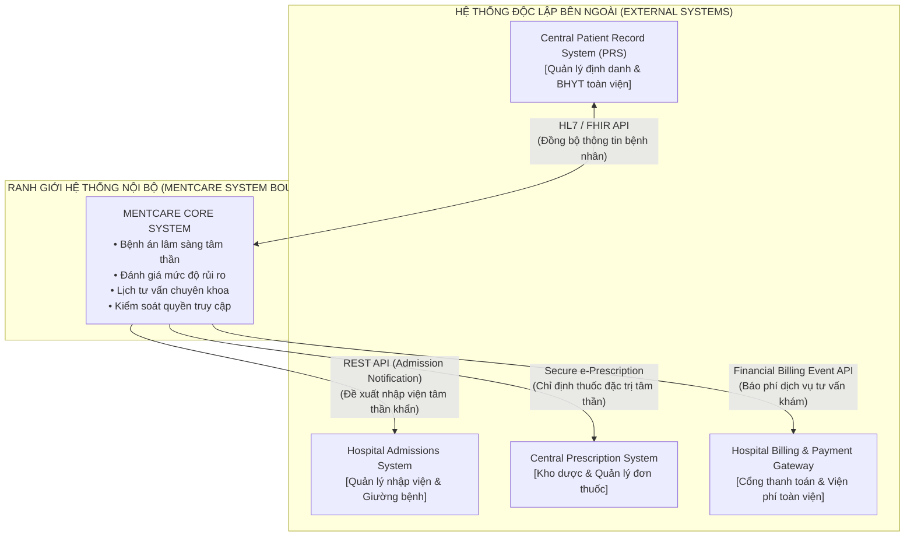
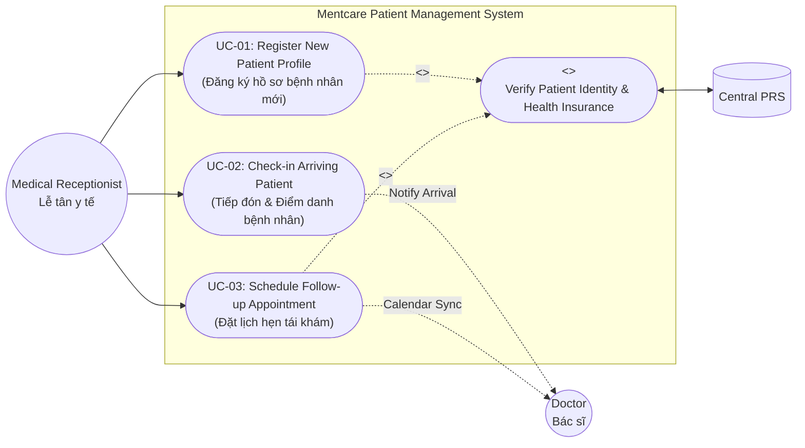
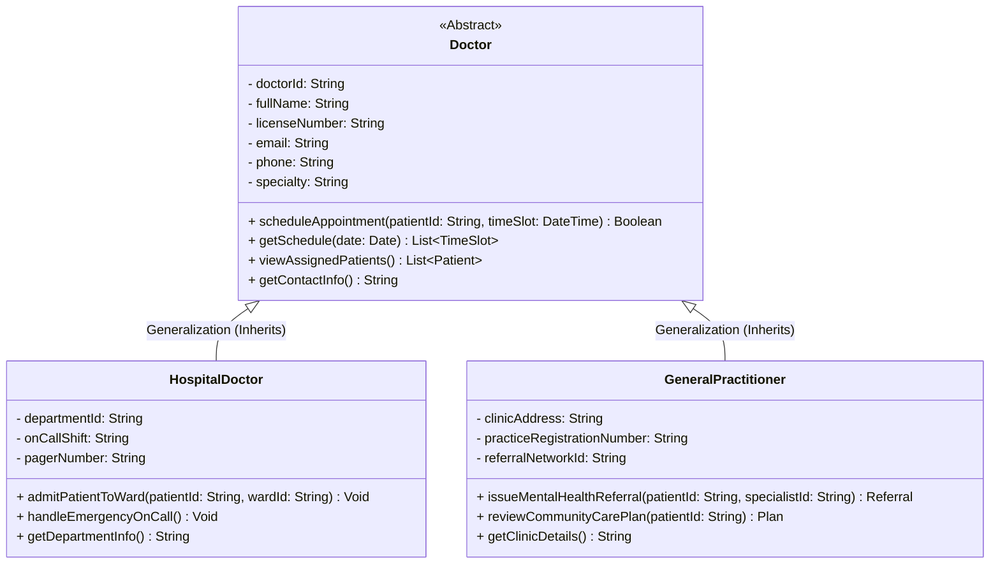
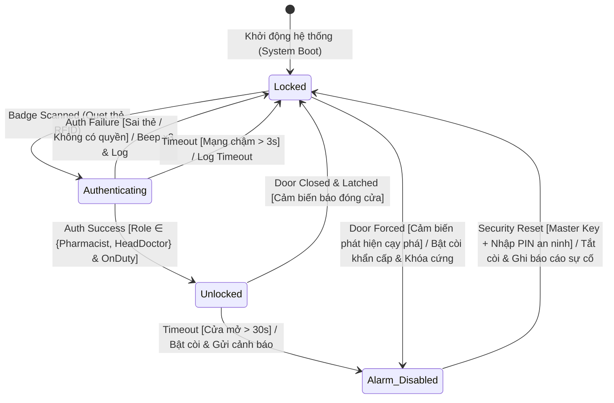

# BÁO CÁO BÀI TẬP TRÊN LỚP: SYSTEM MODELLING (CHAPTER 5)
## CA LÂM SÀNG: HỆ THỐNG QUẢN LÝ BỆNH NHÂN TÂM THẦN MENTCARE (MENTCARE CASE STUDY)

---

### THÔNG TIN NHÓM THỰC HIỆN
- **Cơ sở đào tạo:** Trường Đại học Tôn Đức Thắng (TDTU) – Khoa Công nghệ Thông tin
- **Môn học:** Kỹ thuật Phần mềm (Software Engineering)
- **Chủ đề:** Chapter 5 – System Modelling: Day in the Life of a Systems Analyst & DevOps Engineer
- **Danh sách thành viên (4 thành viên):**
  1. **Ngô Lâm Tiến** – MSSV: **524H0195** (*Người đại diện nhóm / Submitter*)
  2. **Ngô Bình Minh** – MSSV: **524H0169**
  3. **Lê Xuân Khánh** – MSSV: **524H0055**
  4. **Nguyễn Công Thành** – MSSV: **524H0191**

---

## MỤC LỤC BÁO CÁO
1. [Phase 1: Context & System Boundaries (Lead Systems Analyst)](#phase-1-context--system-boundaries-lead-systems-analyst)
2. [Phase 2: Interaction Modeling – Use Cases (IT Business Analyst)](#phase-2-interaction-modeling--use-cases-it-business-analyst)
3. [Phase 3: Structural Modeling – Class & Generalization (System Architect)](#phase-3-structural-modeling--class--generalization-system-architect)
4. [Phase 4: Behavioral Modeling – State Machine (DevOps / Integration Engineer)](#phase-4-behavioral-modeling--state-machine-devops--integration-engineer)
5. [Phase 5: GenAI Workflow Integration (Forward-Thinking Developer)](#phase-5-genai-workflow-integration-forward-thinking-developer)
6. [Mã nguồn Python / Pytest minh họa (Executable Reference Code)](#mã-nguồn-python--pytest-minh-họa-executable-reference-code)
7. [Hướng dẫn nộp bài trên eLearning (Submission Checklist)](#hướng-dẫn-nộp-bài-trên-elearning-submission-checklist)

---

## PHASE 1: CONTEXT & SYSTEM BOUNDARIES (Lead Systems Analyst)

### 1. Phân định Ranh giới Hệ thống (System Boundaries)
Khi xây dựng hệ thống quản lý chăm sóc bệnh nhân sức khỏe tâm thần Mentcare, việc xác lập rõ ràng phạm vi nội bộ (Inside Boundary) và hệ thống độc lập bên ngoài (Outside Boundary) là điều kiện tiên quyết nhằm đảm bảo tính bảo mật y tế nghiêm ngặt, ranh giới trách nhiệm và kiến trúc vi dịch vụ (hoặc mô hình tích hợp enterprise).

#### A. Thuộc phạm vi kiểm soát nội bộ của Mentcare (INSIDE the System Boundary)
- **Hồ sơ bệnh án tâm thần chuyên sâu (Mental Health Clinical Records):** Ghi chú các buổi tham vấn trị liệu, đánh giá mức độ nguy cơ tâm lý (Self-harm/Suicide risk assessment), lịch sử biến cố tinh thần và kế hoạch can thiệp tâm lý.
- **Phân hệ điều phối & Lập lịch khám chuyên khoa (Local Consultation Scheduling):** Quản lý ca trực, lịch hẹn của các Bác sĩ tâm thần và chuyên viên tâm lý tại phòng khám.
- **Hệ thống theo dõi & Cảnh báo an toàn (Safety & Risk Monitoring Module):** Theo dõi cảnh báo nguy cơ bệnh nhân có hành vi quá khích hoặc bỏ tái khám cần can thiệp xã hội.
- **Nhật ký bảo mật & Phân quyền truy cập nội bộ (Audit Logging & RBAC):** Giám sát mọi thao tác truy cập hồ sơ nhạy cảm theo tiêu chuẩn HIPAA/GDPR.

#### B. Nằm ngoài phạm vi hệ thống Mentcare (OUTSIDE the System Boundary)
- **Patient Record System (PRS):** Hệ thống cơ sở dữ liệu hồ sơ bệnh nhân tập trung dùng chung cho toàn bộ bệnh viện/huyện (chứa thông tin hành chính, số BHYT, nhóm máu, bệnh sử tổng quát). Mentcare chỉ liên kết tra cứu thông tin qua chuẩn HL7/FHIR.
- **Hospital Admissions System:** Hệ thống tiếp nhận bệnh nhân toàn viện, điều phối và phân bổ giường bệnh của các khoa nội trú.
- **Central Prescription System:** Hệ thống xuất đơn thuốc và quản lý dược phẩm của bệnh viện, kiểm tra tương tác thuốc nguy hiểm và quản lý xuất kho dược tự động.

---

### 2. Sơ đồ Mô hình Bối cảnh (Context Model Diagram)



---

### 3. Phân tích: Cổng Thanh toán Viện phí (Billing Gateway) nằm TRONG hay NGOÀI?

> **KẾT LUẬN KIẾN TRÚC:** Cổng Thanh toán Viện phí (**Billing Gateway**) bắt buộc phải nằm **BÊN NGOÀI (OUTSIDE)** ranh giới của hệ thống Mentcare.

#### Lý do biện luận chi tiết:
1. **Nguyên lý Đơn trách nhiệm & Tách biệt mối bận tâm (Separation of Concerns - SoC):**
   - Mentcare được thiết kế với mục tiêu cốt lõi là **hệ thống hỗ trợ lâm sàng và quản lý sức khỏe tâm thần**, phục vụ bác sĩ, y tá và chuyên gia tâm lý.
   - Các quy trình xử lý giao dịch tài chính, thanh toán thẻ ngân hàng, hoàn phí BHYT và đối soát kế toán thuộc thẩm quyền chuyên biệt của Khối Tài chính - Kế toán bệnh viện.
2. **Tuân thủ chuẩn mực an ninh và kiểm toán tài chính (PCI-DSS Compliance Isolation):**
   - Nếu tích hợp cổng thanh toán trực tiếp vào Mentcare, toàn bộ hệ thống Mentcare (bao gồm cả dữ liệu bệnh án tâm thần) sẽ bị cuốn vào phạm vi kiểm toán cực kỳ khắt khe của chuẩn bảo mật dữ liệu thẻ thanh toán (PCI-DSS). Việc tách riêng giúp cô lập rủi ro bảo mật tài chính ra khỏi dữ liệu y tế nhạy cảm (HIPAA).
3. **Tính tái sử dụng cao trong toàn bệnh viện (Enterprise Reusability):**
   - Một bệnh viện hiện đại sở hữu hàng chục khoa/phòng ban khác nhau (Nội, Ngoại, Sản, Nhi, Tâm thần). Bệnh viện xây dựng một **Cổng viện phí tập trung (Enterprise Payment Gateway)** để phục vụ tất cả các khoa. Mentcare chỉ đóng vai trò là một "Client" gửi thông tin dịch vụ (Service Charge Event) sang hệ thống thanh toán qua API an toàn.

---

## PHASE 2: INTERACTION MODELING – USE CASES (IT Business Analyst)

### 1. Ba Use Case riêng biệt do Nhân viên Lễ tân (Medical Receptionist) khởi tạo
1. **UC-01: Đăng ký hồ sơ bệnh nhân mới (Register New Patient Profile):**
   - *Mô tả:* Nhân viên lễ tân tiếp nhận thông tin bệnh nhân đến lần đầu, xác thực giấy tờ tùy thân / thẻ BHYT, tạo hồ sơ hành chính ban đầu và liên kết định danh với hệ thống PRS toàn viện.
2. **UC-02: Tiếp đón & Điểm danh bệnh nhân đến khám (Check-in Arriving Patient):**
   - *Mô tả:* Khi bệnh nhân có lịch hẹn đến phòng khám, lễ tân xác nhận sự có mặt, kiểm tra trạng thái sức khỏe ban đầu, đưa vào hàng đợi khám (Queue) và kích hoạt thông báo cho Bác sĩ phụ trách.
3. **UC-03: Đặt lịch hẹn tái khám (Schedule Follow-up Appointment):**
   - *Mô tả:* Lễ tân tra cứu lịch làm việc của Bác sĩ chuyên khoa, đăng ký khung giờ hẹn tái khám theo y lệnh hoặc yêu cầu bệnh nhân, phân bổ phòng tư vấn và in phiếu hẹn / kích hoạt SMS nhắc hẹn.

---

### 2. Sơ đồ Use Case (Use Case Diagram)



---

### 3. Bảng đặc tả chi tiết Use Case: "Schedule Follow-up Appointment"

| Thuộc tính (Element) | Đặc tả chi tiết hệ thống (System Specification) |
| :--- | :--- |
| **Tên Use Case** | **Schedule Follow-up Appointment (Đặt lịch hẹn tái khám)** |
| **Mã định danh** | UC-03 |
| **Tác nhân chính (Actors)** | - **Nhân viên Lễ tân y tế (Medical Receptionist)** – Khởi tạo chính.<br>- **Bệnh nhân (Patient)** – Người tiếp nhận lịch hẹn.<br>- **Bác sĩ chuyên khoa (Attending Psychiatrist / Doctor)** – Đối tượng được xếp lịch. |
| **Mục tiêu (Goal)** | Sắp xếp và xác nhận thời gian tái khám thích hợp cho bệnh nhân với bác sĩ phụ trách, tránh trùng lịch và đồng bộ lịch công tác. |
| **Tiền điều kiện (Preconditions)** | 1. Bệnh nhân đã có mã hồ sơ hợp lệ trong hệ thống Mentcare.<br>2. Bác sĩ điều trị đã phê duyệt chỉ định tái khám hoặc bệnh nhân chủ động đăng ký trong khung thời gian quy định.<br>3. Lễ tân đã đăng nhập vào hệ thống Mentcare với quyền hạn `ROLE_RECEPTIONIST`. |
| **Kích hoạt (Stimulus)** | Lễ tân nhấp chọn chức năng **"Đặt lịch hẹn tái khám"** trên giao diện Mentcare khi bệnh nhân hoàn tất ca khám hiện tại hoặc liên hệ qua điện thoại. |
| **Dữ liệu vào/ra (Data)** | - **Dữ liệu vào:** Mã bệnh nhân (Patient ID), Mã bác sĩ chỉ định (Doctor ID), Khung ngày/giờ mong muốn, Loại hình hẹn (Khám định kỳ / Đánh giá lại thuốc / Khẩn cấp).<br>- **Dữ liệu ra:** Mã lịch hẹn (Appointment ID), Mã phòng tư vấn (Room Number), Trạng thái xác nhận (CONFIRMED), Phiếu hẹn tái khám in ra. |
| **Phản hồi hệ thống (Response)** | 1. Mentcare hiển thị lịch trống thời gian thực của bác sĩ và phòng khám.<br>2. Hệ thống kiểm tra xung đột lịch và khóa khung giờ đã chọn.<br>3. Hệ thống tạo bản ghi cuộc hẹn, gửi cập nhật vào lịch làm việc của Bác sĩ và tự động gửi tin nhắn SMS/Email xác nhận cho Bệnh nhân. |
| **Hậu điều kiện (Postconditions)** | Ca hẹn được ghi nhận vào cơ sở dữ liệu với trạng thái `Scheduled`; khung giờ của bác sĩ bị khóa đối với các lượt đặt lịch khác. |
| **Bình luận An ninh (Security / RBAC Note)** | **Quy tắc Kiểm soát Truy cập Dựa trên Vai trò (RBAC) nghiêm ngặt:**<br>Nhân viên Lễ tân **CHỈ CÓ QUYỀN** xem thông tin nhân khẩu học (Tên, SĐT, Địa chỉ) và tình trạng rảnh/bận của bác sĩ.<br>Hệ thống **TUYỆT ĐỐI KHÔNG ĐƯỢC PHÉP** hiển thị chẩn đoán tâm thần, ghi chú phiên tham vấn riêng tư (Therapy Notes) hay đánh giá mức độ nguy cơ tâm lý cho Lễ tân, nhằm bảo vệ quyền riêng tư người bệnh theo pháp luật y tế. |

---

## PHASE 3: STRUCTURAL MODELING – CLASS & GENERALIZATION (System Architect)

### 1. Phân cấp Kế thừa cho thực thể `Doctor` (Generalization Hierarchy)

#### Lớp cha (Superclass): `Doctor`
- Đại diện cho mọi bác sĩ được cấp phép hành nghề hợp pháp trong mạng lưới y tế.
- **Thuộc tính 1 (Bắt buộc):** `doctorId: String` – Mã định danh duy nhất của bác sĩ trong hệ thống y tế.
- **Thuộc tính 2 (Bắt buộc):** `fullName: String` – Họ và tên đầy đủ của bác sĩ.
- **Thuộc tính chung bổ sung:** `licenseNumber: String` (Số chứng chỉ hành nghề), `email: String`, `phone: String`, `specialty: String` (Chuyên khoa chính).
- **Phương thức chung:** `scheduleAppointment()`, `getSchedule()`, `viewAssignedPatients()`, `updateContactInfo()`.

#### Lớp con 1 (Subclass): `HospitalDoctor` (Bác sĩ nội viện)
- Đại diện cho các bác sĩ làm việc cơ hữu bên trong bệnh viện, tham gia trực cấp cứu và điều trị nội trú.
- **Thuộc tính riêng biệt (Specific Attributes):**
  - `departmentId: String` – Mã khoa/phòng nội trú mà bác sĩ đang công tác (ví dụ: Khoa Tâm thần cấp tính, Khoa Trị liệu hành vi).
  - `onCallShift: String` – Thông tin ca trực nội trú khẩn cấp (Day / Night / Weekend On-call).
  - `pagerNumber: String` – Số máy nhắn tin / bộ đàm khẩn cấp của bệnh viện.
- **Phương thức riêng biệt:** `admitPatientToWard()`, `handleEmergencyOnCall()`, `dischargePatient()`.

#### Lớp con 2 (Subclass): `GeneralPractitioner` (Bác sĩ đa khoa / Bác sĩ gia đình)
- Đại diện cho các bác sĩ chăm sóc ban đầu tại địa phương ngoài bệnh viện, chuyển tuyến và theo dõi bệnh nhân tại cộng đồng.
- **Thuộc tính riêng biệt (Specific Attributes):**
  - `clinicAddress: String` – Địa chỉ phòng khám gia đình tư nhân hoặc trạm y tế cơ sở.
  - `practiceRegistrationNumber: String` – Số đăng ký cơ sở hành nghề đa khoa tư nhân tại địa phương.
  - `referralNetworkId: String` – Mã định danh mạng lưới chuyển viện liên kết với Mentcare.
- **Phương thức riêng biệt:** `issueMentalHealthReferral()`, `reviewCommunityCarePlan()`, `requestSpecialistReport()`.

---

### 2. Sơ đồ Lớp UML (Class Diagram)



---

### 3. Biện luận Kiến trúc: Vì sao dùng Kế thừa (Generalization) thay vì tách các lớp độc lập?

1. **Nguyên lý Tái sử dụng & DRY (Don't Repeat Yourself):**
   - Cả hai loại bác sĩ đều có chung các thông tin định danh y tế cốt lõi (Mã số, Họ tên, Chứng chỉ hành nghề, Thông tin liên lạc). Nếu tạo 2 lớp tách biệt mà không kế thừa, các trường này sẽ bị trùng lặp (code duplication), dẫn đến nguy cơ sai lệch dữ liệu khi cần bảo trì cấu trúc định danh.
2. **Tính Đa hình (Polymorphism) & Giảm phụ thuộc ghép nối (Loose Coupling):**
   - Phân hệ Quản lý Lịch hẹn (Appointment Scheduler) và Phân hệ Hồ sơ bệnh án Mentcare chỉ cần phụ thuộc vào kiểu trừu tượng `Doctor` (ví dụ `appointment.assignDoctor(Doctor doc)`). Hệ thống có thể tiếp nhận bất kỳ đối tượng `HospitalDoctor` hay `GeneralPractitioner` nào một cách trong suốt mà không cần quan tâm đến chi tiết triển khai cụ thể.
3. **Bảo trì tập trung & Tính toàn vẹn cấu trúc (Centralized Schema Evolution):**
   - Khi ngành y tế ban hành quy định mới (ví dụ bổ sung trường định danh y tế quốc gia `nationalProviderId`), kiến trúc sư chỉ cần cập nhật tại lớp cha `Doctor`, mọi lớp con lập tức được thừa hưởng mà không cần sửa đổi hàng loạt file mã nguồn.
4. **Tối ưu hóa Ánh xạ Cơ sở dữ liệu (ORM & Database Mapping):**
   - Hỗ trợ các chiến lược lưu trữ quan hệ hiệu quả như Single Table Inheritance (lưu chung 1 bảng có cột phân biệt `dtype`) hoặc Joined Table Inheritance, giúp truy vấn danh sách tất cả các bác sĩ trong hệ thống nhanh chóng bằng một câu lệnh SQL đơn giản.

---

## PHASE 4: BEHAVIORAL MODELING – STATE MACHINE (DevOps / Integration Engineer)

### 1. Bối cảnh Khóa Thông minh Kho Dược & 4 Trạng thái Bắt buộc
Để bảo vệ an toàn cho kho lưu trữ các loại thuốc đặc trị tâm thần nguy cơ cao (thuốc an thần liều cao, morphin y tế...), khóa cửa thông minh điều khiển bằng vi điều khiển và cảm biến từ yêu cầu 4 trạng thái hoạt động bất biến:
1. **`Locked` (Khóa an toàn – Trạng thái mặc định ban đầu):** Chốt khóa cơ điện đang đóng chặt, đèn LED hiển thị màu đỏ; hệ thống ở chế độ chờ nhân viên quẹt thẻ RFID.
2. **`Authenticating` (Đang xác thực thông tin):** Nhân viên vừa quẹt thẻ; đầu đọc khóa gửi mã định danh thẻ về máy chủ Mentcare để kiểm tra danh tính nhân viên, quyền hạn kho dược và ca trực hiện tại.
3. **`Unlocked` (Đã mở khóa an toàn):** Hệ thống xác thực hợp lệ; chốt điện từ thụt lại, đèn LED chuyển xanh, cho phép nhân viên mở cửa bước vào kho; bộ đếm thời gian an toàn được kích hoạt.
4. **`Alarm / Disabled` (Báo động vi phạm / Khóa khẩn cấp):** Kích hoạt khi phát hiện có hành vi cạy phá cửa trái phép (Door Forced) hoặc cửa bị chèn giữ mở quá thời gian an toàn (Door Ajar Timeout). Còi hú báo động tại chỗ vang lên và tín hiệu khẩn cấp được gửi về Phòng An ninh bệnh viện.

---

### 2. Sơ đồ Máy Trạng thái (State Machine Diagram)



---

### 3. Bảng Ma trận Chuyển dịch Trạng thái (State Transition Matrix)

| Trạng thái ban đầu (From State) | Sự kiện kích hoạt (Event / Stimulus) | Điều kiện rào chắn (Guard Condition) | Trạng thái đích (To State) | Hành động thực thi (Action / Output) |
| :--- | :--- | :--- | :--- | :--- |
| **Locked** | `Badge Scanned` | Đầu đọc nhận diện mã RFID hợp lệ | **Authenticating** | Đọc mã thẻ, bật đèn LED vàng nhấp nháy, gửi gói tin xác thực về Mentcare API. |
| **Authenticating** | `Auth Success` | `Role ∈ {Pharmacist, HeadDoctor}` và đang trong ca trực | **Unlocked** | Kích hoạt rơ-le nhả chốt điện từ, đổi LED sang xanh lục, bắt đầu đếm timer 10s. |
| **Authenticating** | `Auth Failure` | Mã thẻ không tồn tại hoặc không đủ thẩm quyền | **Locked** | Phát 3 tiếng 'bíp' cảnh báo, ghi nhật ký vi phạm bảo mật (Security Audit Log), giữ nguyên chốt. |
| **Authenticating** | `Timeout` | Phản hồi máy chủ vượt quá 3.0 giây | **Locked** | Ghi log timeout mạng, đưa đèn LED về màu đỏ (Fail-secure safety). |
| **Unlocked** | `Door Closed & Latched` | Cảm biến tiếp điểm từ nhận diện cửa đã khép kín | **Locked** | Kích hoạt chốt điện từ đóng lại, bật đèn LED đỏ, hủy bộ đếm timer. |
| **Unlocked** | `Timeout (Door Ajar)` | Cửa bị giữ mở vượt quá 30 giây | **Alarm / Disabled** | Hú còi báo động tại chỗ 85dB, gửi tin nhắn cảnh báo khẩn cấp đến Quản lý Kho Dược. |
| **Locked** | `Door Forced` | Cảm biến gia tốc/công tắc phát hiện bị cạy khóa | **Alarm / Disabled** | Bật còi báo động công suất tối đa, kích hoạt chốt khóa cơ học chống phá, báo động Cảnh sát viện. |
| **Alarm / Disabled** | `Security Reset` | Trưởng ban An ninh dùng chìa khóa cơ vật lý + xác thực mã PIN | **Locked** | Tắt còi hú báo động, xuất biên bản ghi nhận sự cố, hoàn trả trạng thái bảo vệ bình thường. |

---

## PHASE 5: GENAI WORKFLOW INTEGRATION (Forward-Thinking Developer)

### 1. Kỹ thuật Thiết kế Prompt chuẩn kỹ thuật (Structured Engineering Prompt)

Dưới đây là Prompt chuẩn mực được tối ưu hóa theo phương pháp **Role-Task-Constraint-Schema Prompting** để yêu cầu Large Language Model (như Gemini 1.5 Pro / GPT-4o) chuyển đổi mô hình UML thành mã nguồn thực tế:

```text
Act as a Senior Python Software Architect specializing in Medical Enterprise Systems.
You are given the following strict UML Class Diagram specification for the Mentcare Medical Staff module:

### 1. Abstract Superclass: `Doctor` (ABC)
- Protected Attributes:
  * _doctor_id: str (UUID or TDTU Hospital ID format, immutable)
  * _full_name: str (Non-empty string)
  * _license_number: str (Medical license format, non-empty)
  * _email: str (Valid RFC-compliant email address)
  * _phone: str (E.164 phone format)
  * _specialty: str
- Methods:
  * @abstractmethod schedule_appointment(patient_id: str, time_slot: datetime) -> bool
  * @abstractmethod get_schedule(target_date: date) -> list[dict]
  * get_profile() -> dict[str, Any]
  * update_contact(email: str, phone: str) -> None

### 2. Concrete Subclass: `HospitalDoctor` (inherits `Doctor`)
- Specific Attributes:
  * department_id: str
  * on_call_shift: str (Enum: DAY, NIGHT, WEEKEND)
  * pager_number: str
- Specific Methods:
  * admit_patient_to_ward(patient_id: str, ward_id: str) -> None
  * handle_emergency_on_call() -> str

### 3. Concrete Subclass: `GeneralPractitioner` (inherits `Doctor`)
- Specific Attributes:
  * clinic_address: str
  * practice_reg_num: str
  * referral_network_id: str
- Specific Methods:
  * issue_mental_health_referral(patient_id: str, specialist_id: str) -> dict
  * review_community_care_plan(patient_id: str) -> str

### Implementation Requirements:
1. Use modern Python 3.12 syntax with @dataclass, typing annotations, and abc.ABC.
2. Implement strict validation inside __post_init__ (ensure non-empty fields, valid emails, valid enum values).
3. Provide comprehensive Google-style docstrings for every class and method.
4. Include a companion pytest suite testing:
   a. Correct inheritance and polymorphism (invoking schedule_appointment on heterogeneous list).
   b. Validation errors upon supplying invalid data.
   c. Proper subclass-specific method behavior.
Return clean, production-ready code with no conversational filler.
```

---

### 2. Luận điểm Kỹ thuật: Vì sao UML an toàn & chính xác hơn Văn bản Tự nhiên (Plain English)?

| Tiêu chí so sánh | Văn bản Tự nhiên (Plain English / Prose) | Cấu trúc Mô hình UML (Formal UML Specification) |
| :--- | :--- | :--- |
| **Tính rõ ràng (Ambiguity vs Precision)** | Chứa nhiều từ ngữ đa nghĩa, cấu trúc câu thụ động dễ hiểu lầm. LLM có thể diễn giải sai vai trò quan hệ giữa các lớp. | **Triệt tiêu hoàn toàn tính mơ hồ:** Cung cấp định nghĩa hình thức (tên lớp, tầm vực `+`/`-`, quan hệ `is-a` tường minh, kiểu dữ liệu chuẩn). |
| **Khả năng kiểm soát 'Ảo giác' (Hallucination Control)** | Không gian tìm kiếm xác suất của LLM rất rộng. Khi mô tả mơ hồ, AI tự ý "sáng tạo" thêm các thuộc tính thừa hoặc các hàm không có trong thiết kế. | **Đóng khung không gian giải pháp (Constrained Search Space):** LLM bắt buộc phải bám sát schema đã cung cấp, ngăn chặn việc bịa đặt mã nguồn tùy tiện. |
| **An toàn Kiểu dữ liệu (Type Safety & Invariants)** | Thường sinh ra code Python lỏng lẻo, thiếu Type Hinting hoặc dùng kiểu dữ liệu tùy tiện (`Any`, chuỗi không xác thực). | **Bảo toàn kiểu dữ liệu và ràng buộc:** Ánh xạ 1:1 các kiểu dữ liệu nguyên thủy sang static typing (`str`, `datetime`, `UUID`), sinh mã kiểm thử tự động chính xác. |
| **Độ tin cậy trong Kiến trúc Doanh nghiệp** | Mã nguồn phân mảnh, khó tích hợp vào hệ thống microservices y tế hiện có. | **Hợp đồng Thiết kế (Architectural Design Contract):** Đảm bảo mã nguồn do AI tạo ra hoàn toàn tương thích với kiến trúc tổng thể do System Architect phê duyệt. |

---

## MÃ NGUỒN PYTHON / PYTEST MINH HỌA (Executable Reference Code)

```python
"""
Mentcare System Modelling - Reference Implementation
Phase 5: Generated Code from UML Class Hierarchy
Compatible with Python 3.12+
"""

from abc import ABC, abstractmethod
from dataclasses import dataclass
from datetime import datetime, date
from typing import List, Dict, Any
import re


@dataclass
class Doctor(ABC):
    """Abstract base class representing a medical doctor in Mentcare."""
    doctor_id: str
    full_name: str
    license_number: str
    email: str
    phone: str
    specialty: str

    def __post_init__(self):
        if not self.doctor_id or not self.full_name.strip():
            raise ValueError("Doctor ID and Full Name cannot be empty.")
        if not re.match(r"[^@]+@[^@]+\.[^@]+", self.email):
            raise ValueError(f"Invalid email address: {self.email}")

    @abstractmethod
    def schedule_appointment(self, patient_id: str, time_slot: datetime) -> bool:
        """Schedule a consultation slot with a patient."""
        pass

    @abstractmethod
    def get_schedule(self, target_date: date) -> List[Dict[str, Any]]:
        """Retrieve appointments for a specific date."""
        pass

    def get_profile(self) -> Dict[str, Any]:
        """Return doctor summary profile."""
        return {
            "doctor_id": self.doctor_id,
            "full_name": self.full_name,
            "license": self.license_number,
            "specialty": self.specialty,
            "email": self.email
        }


@dataclass
class HospitalDoctor(Doctor):
    """Represents a resident hospital doctor working inside hospital wards."""
    department_id: str = "DEPT_PSYCH_01"
    on_call_shift: str = "DAY"
    pager_number: str = "PGR-991"

    def schedule_appointment(self, patient_id: str, time_slot: datetime) -> bool:
        print(f"[HospitalDoctor] Scheduled in-hospital consultation for {patient_id} at {time_slot}")
        return True

    def get_schedule(self, target_date: date) -> List[Dict[str, Any]]:
        return [{"date": target_date, "type": "Inpatient Ward Rounds"}]

    def admit_patient_to_ward(self, patient_id: str, ward_id: str) -> None:
        """Admit a severe psychiatric patient into hospital psychiatric ward."""
        print(f"Patient {patient_id} admitted to ward {ward_id} by Dr. {self.full_name}")


@dataclass
class GeneralPractitioner(Doctor):
    """Represents a community general practitioner referring mental health patients."""
    clinic_address: str = "123 Medical Center Way"
    practice_registration_number: str = "PR-88231"
    referral_network_id: str = "NET_SOUTH_01"

    def schedule_appointment(self, patient_id: str, time_slot: datetime) -> bool:
        print(f"[GP] Scheduled community clinic consultation for {patient_id} at {time_slot}")
        return True

    def get_schedule(self, target_date: date) -> List[Dict[str, Any]]:
        return [{"date": target_date, "type": "Community Practice Hours"}]

    def issue_mental_health_referral(self, patient_id: str, specialist_id: str) -> Dict[str, str]:
        """Issue a referral letter to Mentcare psychiatric specialist."""
        return {
            "referral_id": f"REF-{patient_id[:4]}-MHC",
            "patient_id": patient_id,
            "specialist_id": specialist_id,
            "gp_license": self.license_number,
            "status": "APPROVED"
        }
```

---

## HƯỚNG DẪN NỘP BÀI TRÊN ELEARNING (Submission Checklist)

### 1. Tên file nộp bài chính thức
Theo hướng dẫn của Giảng viên trên LMS/eLearning: *"Remember to put your SID and your full name on the first slide. One member of each team do submit here"*.
- **Người đại diện nộp bài:** **Ngô Lâm Tiến – 524H0195**
- Đã xuất sẵn 2 file PowerPoint định dạng chuẩn trong thư mục `/home/towfienes/TDTU/SE/`:
  1. `524H0195_NgoLamTien_Chap5_SystemModelling.pptx` *(Khuyến nghị: Định dạng ngắn gọn, chuẩn tên người nộp đại diện theo yêu cầu portal).*
  2. `524H0195_524H0169_524H0055_524H0191_Chap5_SystemModelling.pptx` *(Đầy đủ 4 mã số sinh viên trong tên file).*

### 2. Cấu trúc 6 Slide bài trình chiếu đã hoàn thiện
- **Slide 1 (Cover):** Tên trường TDTU, môn Kỹ thuật Phần mềm, Tên đề tài Mentcare Case Study, Danh sách đầy đủ 4 thành viên gồm Họ tên và MSSV.
- **Slide 2 (Phase 1):** Ranh giới hệ thống Mentcare (Inside/Outside) & Phân tích Cổng thanh toán (Billing Gateway) nằm bên ngoài.
- **Slide 3 (Phase 2):** 3 Use Case của Lễ tân & Bảng đặc tả chi tiết "Schedule Follow-up Appointment" kèm ghi chú RBAC an ninh y tế.
- **Slide 4 (Phase 3):** Cây kế thừa `Doctor` -> `HospitalDoctor` / `GeneralPractitioner` & 4 luận điểm kỹ thuật vì sao dùng Generalization.
- **Slide 5 (Phase 4):** Khóa thông minh kho dược 4 trạng thái (`Locked`, `Authenticating`, `Unlocked`, `Alarm/Disabled`) & Bảng ma trận chuyển dịch sự kiện.
- **Slide 6 (Phase 5):** Prompt kỹ thuật chuyển UML sang mã nguồn & 4 lý do cấu trúc UML an toàn và chính xác hơn văn bản tự nhiên khi dùng GenAI.

