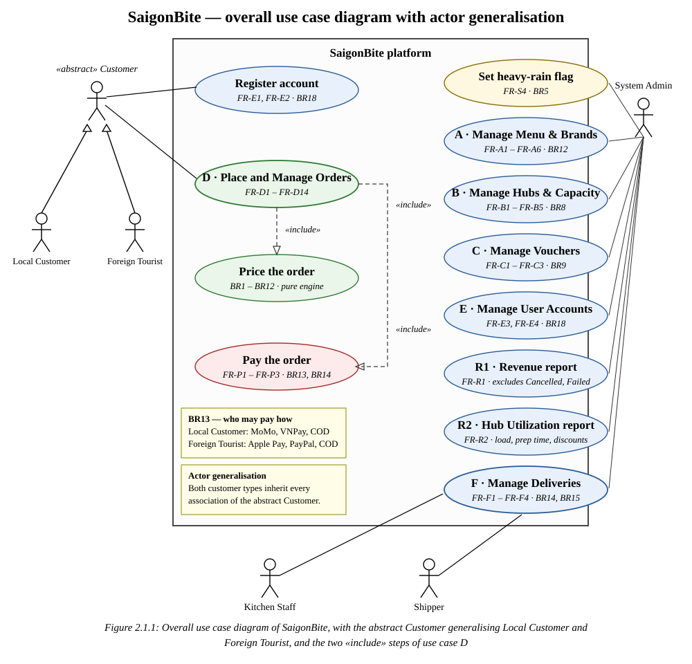
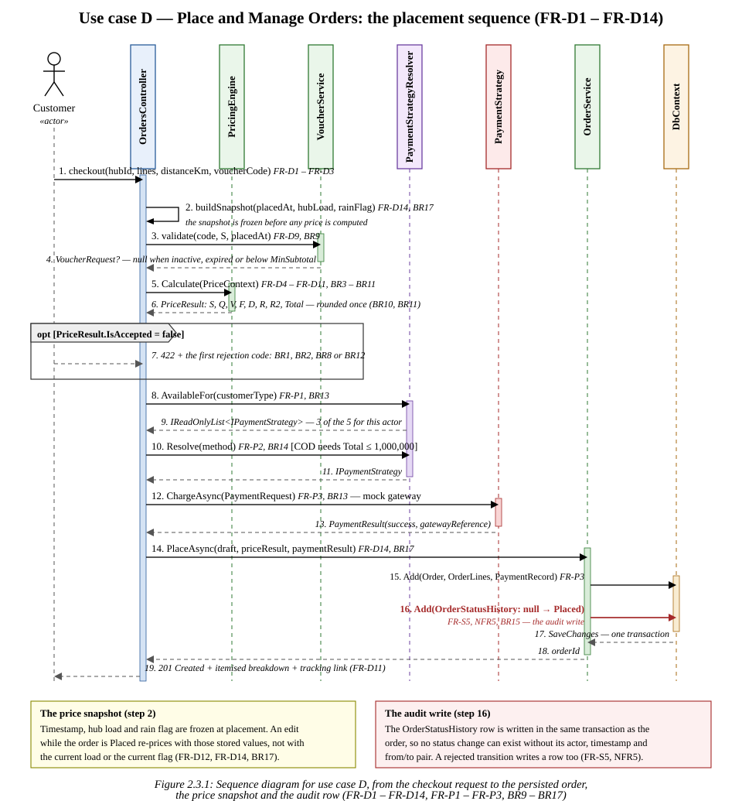
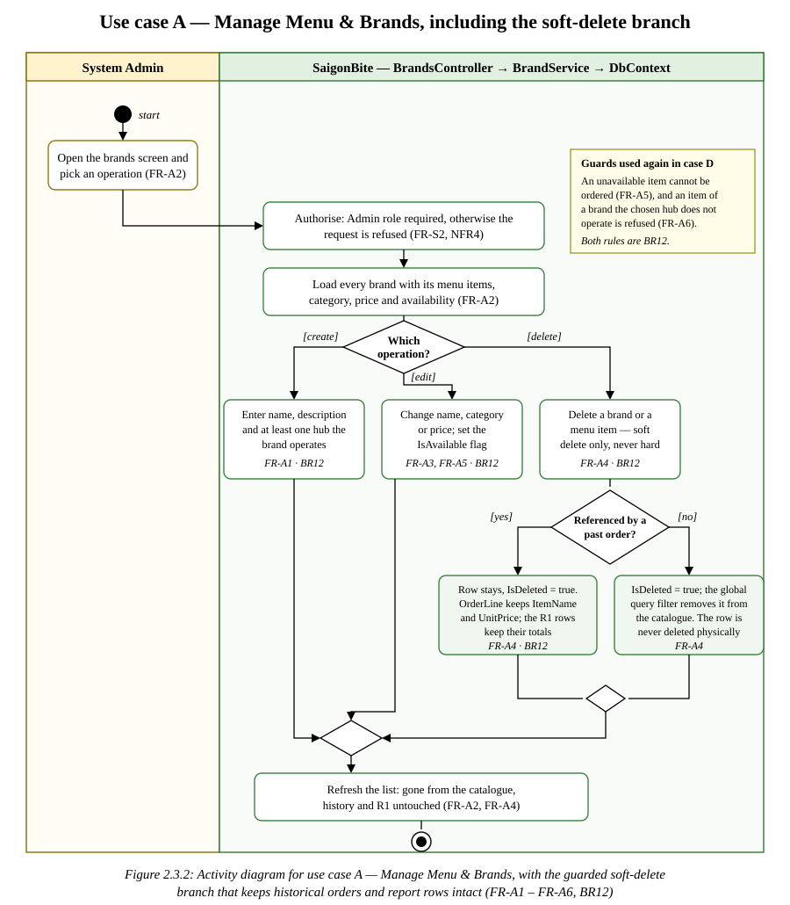
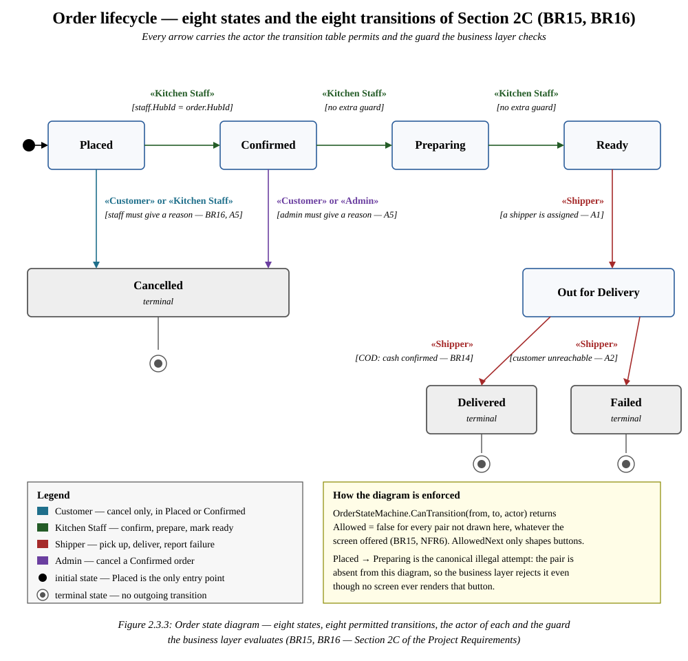
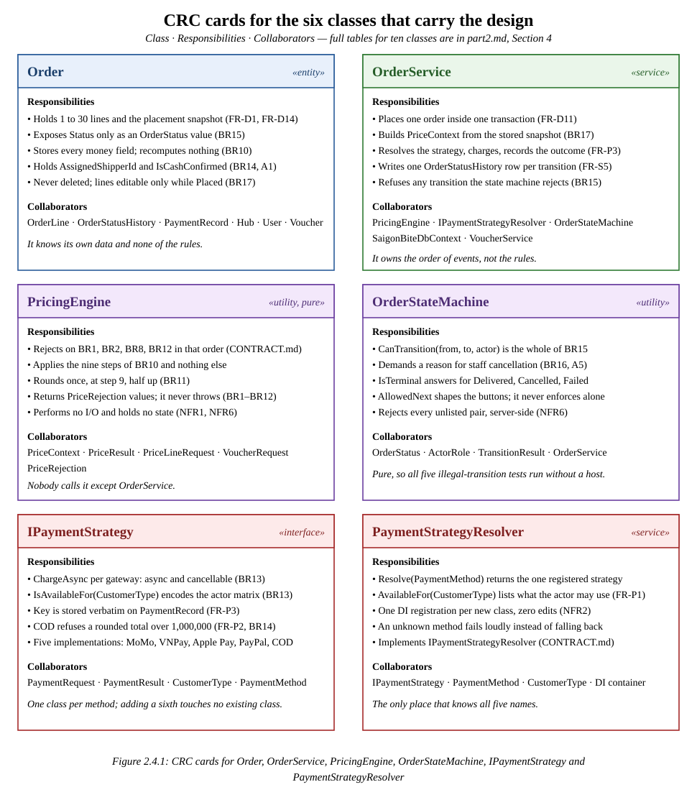
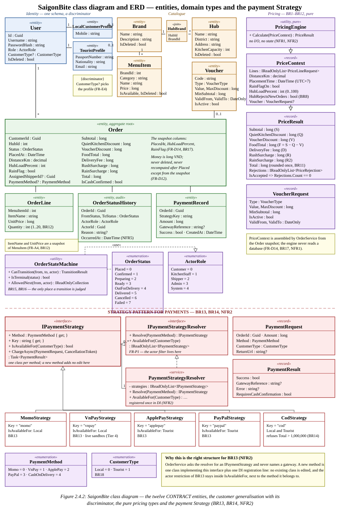
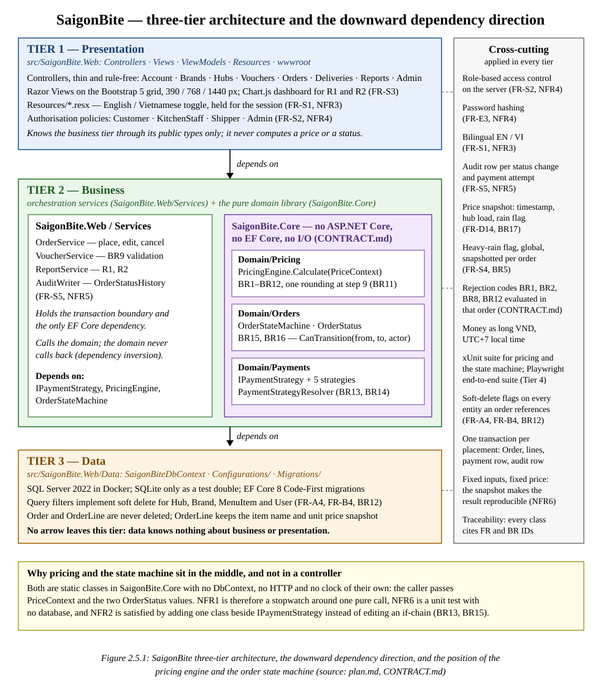
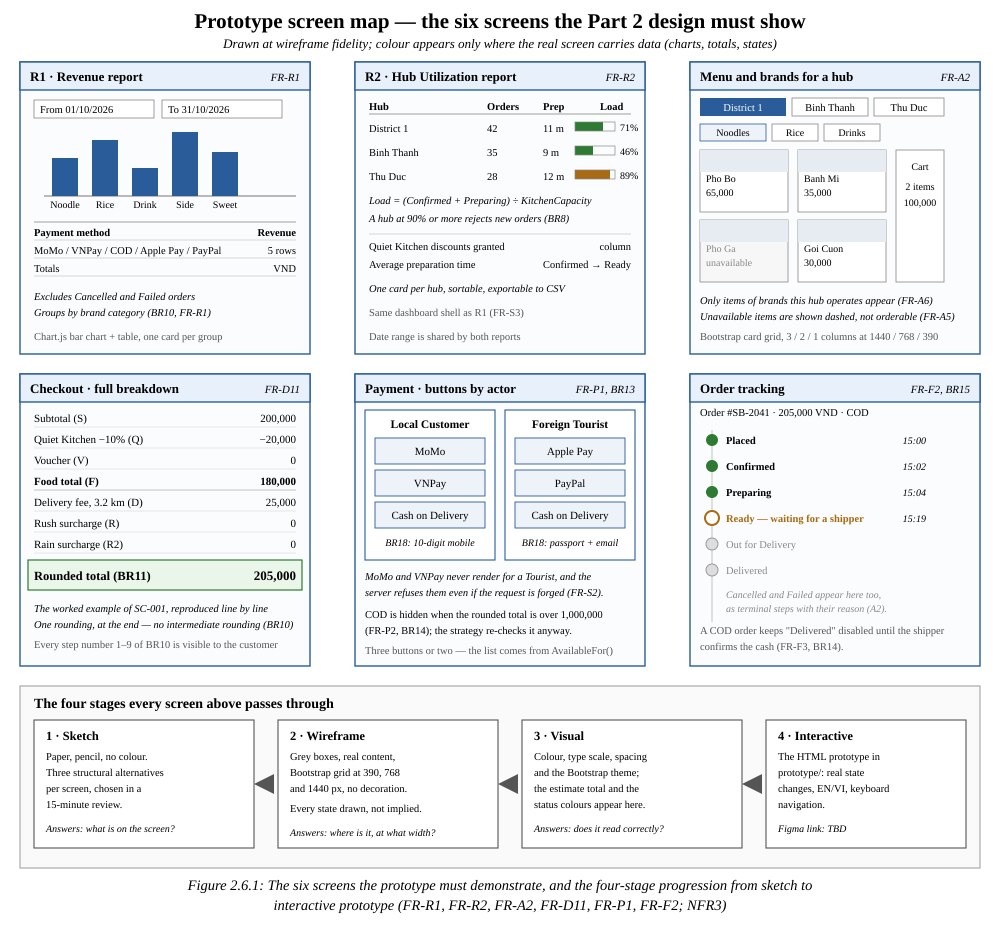

# Part 2 — Software Design, Architecture and UI/UX

**Project:** SaigonBite — Cloud-Kitchen Food Delivery Hub for Ho Chi Minh City
**Course:** Software Engineering · Sem01_2627 · Ton Duc Thang University
**Tier declared:** Tier 4 (cap 10.0, floor 9.5) · **Semester:** Semester 1, 2026–2027

| Member | Student ID | Main use case (full CRUD) | Secondary scope | Report |
|---|---|---|---|---|
| Ngô Lâm Tiến | 524H0195 | **D — Place and Manage Orders** | C — Manage Vouchers; pricing engine and payment Strategy | — |
| Nguyễn Công Thành | 524H0191 | **A — Manage Menu & Brands** | E — Manage User Accounts | R1 — Revenue |
| **TBD** | **TBD** | **B — Manage Hubs & Capacity** | F — Manage Deliveries; Change Request Impact Note | R2 — Hub Utilization |

## How to read this part

Every artefact below is traceable. Three conventions hold throughout.

1. **Requirement identifiers.** Functional requirements are cited as `FR-xN` (for example `FR-D4`) and
   business rules as `BRn`, exactly as they are numbered in Part 1 and in the Project Requirements
   document. A diagram, a step or a class without an identifier is a defect.
2. **Type names.** Every class, property and method name is copied from `CONTRACT.md` character for
   character. Where the specification and `CONTRACT.md` disagree, the disagreement is stated in the
   text rather than silently resolved.
3. **Figure numbers.** Figures are numbered `Figure 2.s.n` — this part, section, figure within the
   section — and the same number appears inside the image and in `figures.json`, so the LIST OF
   FIGURES can be generated from the captions without retyping them.

Diagram sources live in `docs/part2-design/diagrams/*.svg` as hand-written SVG. They carry colour for
grouping (tiers, actors, pattern roles) and their captions stay monochrome, per the report style.

---

## 1. Overall Use Case Diagram

Figure 2.1.1 shows the system boundary of the SaigonBite platform with the six actors of Section 2A of
the Project Requirements. `Customer` is an abstract actor: `Local Customer` and `Foreign Tourist`
inherit every association it has, and they add none of their own. That single modelling choice is what
lets the schema hold both customer types in one `User` table (BR18, FR-E4) while the registration
validation and the payment set still differ (BR13, BR18). The two differences are written as
constraints on the diagram instead of as extra associations, because a second association would have
duplicated the whole ordering chain only to express a validation difference.

**Figure 2.1.1: Overall use case diagram of SaigonBite, with the abstract Customer generalising Local Customer and Foreign Tourist, and the two «include» steps of use case D.**

### 1.1 Reading the diagram

- **Use cases A–F** are the six CRUD-bearing use cases of the course specification, each labelled with
  its FR range and its governing business rule. D is the required use case and belongs to 524H0195.
- **`Price the order` and `Pay the order`** are `«include»`d by D. They are separate use cases because
  each has its own rules, its own tests and its own owner, yet neither is reachable on its own: an
  order is never priced without being placed, and it is never paid before it is priced (BR10 places the
  price before the payment).
- **`Register account`** is separated from `E · Manage User Accounts` because the two halves of FR-E
  have different actors. Registration (FR-E1, FR-E2) is done by a customer; administration (FR-E3,
  FR-E4) is done by the System Admin. Keeping them in one ellipse would have attached one use case to
  two unrelated actors and hidden the fact that the admin never registers on the customer's behalf.
- **`Set heavy-rain flag`** is its own use case rather than a step inside B, because BR5 makes the flag
  a platform-wide switch that changes the price of every order placed while it is on (FR-S4).
- **The two reports** are use cases owned by different members, which is why R1 sits with the menu
  domain (it aggregates by brand category and payment method) and R2 with the hub domain.

### 1.2 Actor-to-use-case matrix

A filled cell means the actor has an association with the use case. `inherited` means the actor
receives the association through the Customer generalisation and must not be drawn with a second line.

| Actor | Register account | D · Place and Manage Orders | A · Menu & Brands | B · Hubs & Capacity | C · Vouchers | E · User Accounts | F · Deliveries | R1 · Revenue | R2 · Hub Utilization | Set rain flag |
|---|---|---|---|---|---|---|---|---|---|---|
| Customer *(abstract)* | ✓ | ✓ | | | | | | | | |
| Local Customer | inherited | inherited | | | | | | | | |
| Foreign Tourist | inherited | inherited | | | | | | | | |
| Kitchen Staff | | | | | | | ✓ | | | |
| Shipper | | | | | | | ✓ | | | |
| System Admin | | | ✓ | ✓ | ✓ | ✓ | ✓ | ✓ | ✓ | ✓ |

`Price the order` and `Pay the order` are reached only through D, so they are bound by the `«include»`
arrow rather than by a direct association. The payment set each customer type may use is a constraint
on `Pay the order` (BR13) and is enforced by `IPaymentStrategy.IsAvailableFor`, not by hiding buttons
(FR-S2).

### 1.3 Use case inventory

| # | Use case | FR set | Business rules | Owner | Primary actor |
|---|---|---|---|---|---|
| A | Manage Menu & Brands | FR-A1 – FR-A6 | BR12 | 524H0191 | System Admin |
| B | Manage Hubs & Capacity | FR-B1 – FR-B5 | BR8 | **TBD** | System Admin |
| C | Manage Vouchers | FR-C1 – FR-C3 | BR9 | 524H0195 (secondary) | System Admin |
| D | Place and Manage Orders | FR-D1 – FR-D14 | BR1 – BR12, BR17 | 524H0195 | Customer |
| E | Manage User Accounts | FR-E1 – FR-E4 | BR18 | 524H0191 (secondary) | Customer, System Admin |
| F | Manage Deliveries | FR-F1 – FR-F4 | BR14, BR15, BR16 | **TBD** (secondary) | Kitchen Staff, Shipper, System Admin |
| — | Price the order | FR-D4 – FR-D11 (included) | BR1 – BR12 | 524H0195 | — (included by D) |
| — | Pay the order | FR-P1 – FR-P3 (included) | BR13, BR14 | 524H0195 | — (included by D) |
| — | Register account | FR-E1, FR-E2 (subset of E) | BR18 | 524H0191 | Customer |
| — | Set heavy-rain flag | FR-S4 | BR5 | **TBD** | System Admin |
| R1 | Revenue report | FR-R1 | — | 524H0191 | System Admin |
| R2 | Hub Utilization report | FR-R2 | BR8 | **TBD** | System Admin |

### 1.4 Modelling decisions taken where the specification is silent

| # | Question the specification leaves open | Decision taken in this diagram | Why |
|---|---|---|---|
| D1 | Is registration part of E or of the customer's flow? | A separate `Register account` use case, associated with the abstract Customer, with `E · Manage User Accounts` keeping FR-E3 and FR-E4 for the admin | FR-E1 and FR-E2 name the customer as the actor; FR-E3 and FR-E4 name the administrator. One ellipse would have had two unrelated primary actors. |
| D2 | Is `Set heavy-rain flag` part of B? | Its own use case | BR5 makes the flag global and price-affecting, not hub-specific; FR-S4 is a cross-cutting requirement, not a B requirement. |
| D3 | Do `Price` and `Pay` appear at all? | Drawn as `«include»` targets of D | The grading rubric asks for the payment design to be visible; an include keeps the ownership of D intact while showing the two collaborating steps. |
| D4 | How is "actor generalisation" demonstrated for the database? | Constraint note on the diagram plus the discriminator in Figure 2.4.2 | The requirement is about the schema as much as the diagram, so the note points at `CustomerType` and the two profile tables. |

---

## 2. Use Case Specifications

The three main use cases owned by the team are specified in full below. Each specification lists the
actors, the pre-conditions, the numbered main flow, the alternate and exception flows, the
post-conditions, and the FR/BR identifier every step satisfies. The secondary use cases C, E and F are
summarised in Table 2.4.

### 2.1 UC-D — Place and Manage Orders

| Field | Content |
|---|---|
| **Use case ID** | UC-D |
| **Name** | Place and Manage Orders |
| **Owner** | 524H0195 (Ngô Lâm Tiến) — also owns the shared pricing engine and the payment Strategy module |
| **Primary actor** | Customer (Local Customer or Foreign Tourist) |
| **Supporting actors** | Payment gateway (simulated mock gateway; VNPay sandbox for Tier 4), System Admin (reads the outcome through R1) |
| **Trigger** | The customer presses *Place order* on the checkout screen |
| **Pre-conditions** | P1. The customer is authenticated and holds the `Customer` role (FR-S2, NFR4). P2. The cart holds 1 to 30 lines, each with a quantity of 1 to 20 (FR-D1, BR12). P3. Every item is available and belongs to a brand the chosen hub operates (FR-A5, FR-A6, BR12). P4. The chosen hub exists, is not soft-deleted and its load is below 90 % (FR-B5, BR8). |
| **Post-conditions (success)** | An `Order` row exists in state `Placed` with the placement snapshot (FR-D14), its `OrderLine` rows, one `PaymentRecord`, and one `OrderStatusHistory` row from `null` to `Placed` (FR-S5, NFR5). The customer sees the itemised breakdown and the tracking page (FR-D11). |
| **Post-conditions (failure)** | No `Order` row is created. A rejected attempt leaves the cart intact and writes no audit row, because no state changed. |
| **Requirements** | FR-D1 – FR-D14, FR-P1 – FR-P3 |
| **Business rules** | BR1 – BR12 (pricing and lines), BR13 – BR14 (payment), BR15 (initial state), BR17 (snapshot) |

**Main flow**

| # | Actor or system | Action | FR / BR |
|---|---|---|---|
| 1 | Customer | Selects the hub and opens the cart; the cart is bound to exactly one hub. | FR-D1, BR12 |
| 2 | System | Validates the cart shape: 1–30 lines, quantity 1–20 per line, every item `IsAvailable`, every item's brand operated by that hub. | FR-D1, FR-A5, FR-A6, BR12 |
| 3 | System | Freezes the placement snapshot: `PlacedAt`, `HubLoadPercent` (confirmed + preparing ÷ `KitchenCapacity`, the new order excluded) and `RainFlag`. | FR-D14, FR-B2, BR8, BR17 |
| 4 | System | Validates the optional voucher: at most one, active, inside its validity window, `S ≥ MinSubtotal`. | FR-C3, FR-D9, BR9 |
| 5 | System | Calls `PricingEngine.Calculate(PriceContext)`, which applies the nine steps of BR10 and rounds once at step 9. | FR-D2 – FR-D11, BR1 – BR11 |
| 6 | System | Shows the itemised breakdown: subtotal, Quiet Kitchen discount, voucher, food total, delivery fee, rush surcharge, rain surcharge, rounded total. | FR-D11, BR10 |
| 7 | System | Lists only the payment methods that belong to the customer's actor group. | FR-P1, BR13 |
| 8 | Customer | Chooses a method and confirms. Cash on Delivery is refused above 1,000,000. | FR-P2, BR14 |
| 9 | System | Resolves the strategy with `PaymentStrategyResolver.Resolve` and calls `ChargeAsync`. | FR-P3, BR13 |
| 10 | System | Persists `Order`, `OrderLine` rows and `PaymentRecord` in one transaction. | FR-P3, FR-D14, BR17 |
| 11 | System | Writes `OrderStatusHistory` for `null → Placed` with actor, timestamp and snapshot reference. | FR-S5, NFR5, BR15 |
| 12 | System | Returns the order number, the breakdown and the tracking link. | FR-D11 |

**Alternate flows**

| # | Condition | Flow | FR / BR |
|---|---|---|---|
| A1 | The price is rejected at step 5 | Return the first rejection code in CONTRACT order (BR1, BR2, BR8, BR12) with the customer-facing message; no payment is attempted; the cart stays intact. | FR-D2, FR-D3, FR-B5, BR1, BR2, BR8, BR12 |
| A2 | The voucher is invalid at step 4 | Drop the voucher, tell the customer why, recompute the price without it and continue from step 5. | FR-D9, BR9 |
| A3 | The customer edits items while the order is `Placed` | Re-price using the **stored** snapshot, not the current load or rain flag; write no new snapshot. | FR-D12, BR17 |
| A4 | The customer cancels while the order is `Placed` or `Confirmed` | Move to `Cancelled`; if the order was paid online, issue a full simulated refund; write the audit row. | FR-D13, BR16, NFR5 |
| A5 | COD is chosen but the rounded total exceeds 1,000,000 | `CodStrategy` refuses; the screen keeps MoMo, VNPay, Apple Pay or PayPal as the remaining choice. | FR-P2, BR14 |
| A6 | The gateway call fails at step 9 | Store `PaymentRecord` with `Success = false`; do not create the order; allow a retry with the same snapshot. | FR-P3, BR13 |

**Exception flows**

| # | Condition | Flow | FR / BR |
|---|---|---|---|
| E1 | The hub reaches 90 % load between steps 1 and 3 | Reject with BR8 and ask the customer to choose another hub. | FR-B5, BR8 |
| E2 | The delivery distance exceeds 8.0 km | Reject with BR2 before any payment step. | FR-D3, BR2 |
| E3 | The item subtotal is below 50,000 | Reject with BR1 before any payment step. | FR-D2, BR1 |
| E4 | The session expires mid-checkout | Return 401, keep the cart, redirect to sign-in and resume at step 1. | FR-S2, NFR4 |
| E5 | Another actor changed the order status while the customer was editing | Reject with 409 and re-read the order; no silent overwrite. | BR15, NFR6 |

### 2.2 UC-A — Manage Menu & Brands

| Field | Content |
|---|---|
| **Use case ID** | UC-A |
| **Name** | Manage Menu & Brands |
| **Owner** | 524H0191 (Nguyễn Công Thành) |
| **Primary actor** | System Admin (an authorised user) |
| **Supporting actors** | Visitor (read-only browsing, FR-A2) |
| **Trigger** | The admin opens `/brands` and chooses an operation |
| **Pre-conditions** | P1. The user is authenticated with the `Admin` role (FR-S2, NFR4). P2. At least one hub exists, because a brand must be operated by a hub. |
| **Post-conditions (success)** | The brand or menu item is created, updated, made available or unavailable, or flagged deleted. The catalogue reflects the change immediately and no historical order or report row is altered. |
| **Post-conditions (failure)** | Nothing is written; the previous catalogue state remains. |
| **Requirements** | FR-A1 – FR-A6 |
| **Business rules** | BR12 (lines, availability, hub–brand ownership) |

**Main flow**

| # | Actor or system | Action | FR / BR |
|---|---|---|---|
| 1 | Admin | Signs in and opens the brands screen. | FR-S2, NFR4 |
| 2 | System | Authorises the request against the `Admin` policy; a non-admin receives 403. | FR-S2, NFR4 |
| 3 | System | Loads every brand with its menu items, category, price and availability flag. | FR-A2 |
| 4 | Admin | Chooses one of four operations: create, edit, set availability, delete. | FR-A1, FR-A3, FR-A5, FR-A4 |
| 5a | Admin | **Create:** enters the name, the description and at least one operating hub. | FR-A1, BR12 |
| 5b | Admin | **Edit:** changes the name, the category or the price of a brand or menu item. | FR-A3, BR12 |
| 5c | Admin | **Availability:** sets `IsAvailable` on a menu item. | FR-A5, BR12 |
| 5d | Admin | **Delete:** requests deletion of a brand or menu item. | FR-A4, BR12 |
| 6 | System | Validates: the name is not empty, at least one hub is selected, the price is greater than zero. | BR12 |
| 7 | System | Persists the change (brand plus `HubBrand` rows for a create) and refreshes the list. | FR-A2 |

**Alternate flows**

| # | Condition | Flow | FR / BR |
|---|---|---|---|
| A1 | The item exists on a historical order line | Soft delete only: `IsDeleted = true`; the `OrderLine` snapshot keeps `ItemName` and `UnitPrice`, and the R1 totals are unchanged. | FR-A4, BR12 |
| A2 | The item has never been ordered | Soft delete: `IsDeleted = true`; the global query filter removes it from the catalogue, and the row is still never physically deleted. | FR-A4, BR12 |
| A3 | An item is made unavailable | It stays visible in the catalogue with an *unavailable* marker and can no longer be ordered (enforced again at checkout by BR12). | FR-A5, FR-A6, BR12 |
| A4 | A brand is removed from one hub only | Delete the `HubBrand` row, leave the brand itself and the other hubs untouched. | FR-A1, BR12 |

**Exception flows**

| # | Condition | Flow | FR / BR |
|---|---|---|---|
| E1 | No hub selected on create | Reject with 422 and a field-level message; nothing is written. | FR-A1, BR12 |
| E2 | Price set to zero or negative | Reject with 422; the price must be a positive whole number of VND. | FR-A3, BR12 |
| E3 | Non-admin calls the endpoint directly | 403 from the authorisation policy, not from the view. | FR-S2, NFR4 |
| E4 | Concurrent edit of the same item | Optimistic concurrency check; the second writer gets 409. | NFR6 |

### 2.3 UC-B — Manage Hubs & Capacity

| Field | Content |
|---|---|
| **Use case ID** | UC-B |
| **Name** | Manage Hubs & Capacity |
| **Owner** | **TBD** (third member) |
| **Primary actor** | System Admin |
| **Supporting actors** | Customer (indirectly: BR8 refuses an order at a full hub), Kitchen Staff (belongs to one hub) |
| **Trigger** | The admin opens `/hubs` |
| **Pre-conditions** | P1. The user holds the `Admin` role (FR-S2, NFR4). |
| **Post-conditions (success)** | The hub exists, is edited or is soft-deleted; the derived load is recomputed for every hub on every read, and the current load percentage shown to the admin is the same number the pricing engine receives. |
| **Post-conditions (failure)** | Nothing is written; the previous capacity and load remain. |
| **Requirements** | FR-B1 – FR-B5 |
| **Business rules** | BR8 (load, capacity, 90 % protection) |

**Main flow**

| # | Actor or system | Action | FR / BR |
|---|---|---|---|
| 1 | Admin | Opens the hub list. | FR-B1 |
| 2 | System | Lists every hub with its district, address, `KitchenCapacity` and current load percentage, derived from the orders in `Confirmed` or `Preparing`. | FR-B2, BR8 |
| 3 | Admin | Creates a hub with a district, an address and a whole-number kitchen capacity greater than zero. | FR-B1, BR8 |
| 4 | System | Validates the capacity: a whole number ≥ 1, so load can never divide by zero. | FR-B1, BR8 |
| 5 | Admin | Edits a capacity, or removes a hub. | FR-B3, FR-B4 |
| 6 | System | Recomputes the load immediately after the capacity changes; existing orders keep their snapshot and are not re-priced. | FR-B3, BR8, BR17 |
| 7 | System | On delete, sets `IsDeleted = true`: the hub leaves the ordering screens, while its historical orders and R2 rows keep their hub name. | FR-B4, BR8 |

**Alternate flows**

| # | Condition | Flow | FR / BR |
|---|---|---|---|
| A1 | A new capacity drops the hub to 90 % load or above | The admin sees the load jump immediately; new orders are refused with BR8 until load falls, but orders already placed continue. | FR-B3, FR-B5, BR8 |
| A2 | The hub is the last hub operating a brand | Warn the admin before saving; the brand would become unorderable because no hub operates it (BR12). | FR-B4, FR-A1, BR12 |

**Exception flows**

| # | Condition | Flow | FR / BR |
|---|---|---|---|
| E1 | Capacity entered as zero, negative or fractional | 422 with a field message; the hub is not created. | FR-B1, BR8 |
| E2 | A hub is soft-deleted while an order is `Confirmed` there | The order keeps running; only new orders are refused. | FR-B4, BR15 |
| E3 | Two admins edit the same hub capacity | Optimistic concurrency check, 409 for the second writer. | NFR6 |

### 2.4 Secondary use cases (summary)

| Use case | Main flow in one line | Alternate / exception | FR / BR |
|---|---|---|---|
| C — Manage Vouchers | Admin creates a voucher with a code, `PERCENT` or `FIXED` type, value, `MaxDiscount`, `MinSubtotal`, validity dates and an active flag; edits or deactivates it. | A voucher outside its dates or below `MinSubtotal` is refused at checkout and dropped from the price. | FR-C1 – FR-C3, BR9 |
| E — Manage User Accounts | A customer registers (local: ten-digit Vietnamese mobile and OTP; tourist: passport, nationality, valid email and email code); an admin views, edits and deactivates accounts. | A duplicate identifier is rejected; a passport shorter than 6 characters is rejected; a password under 8 characters is rejected. | FR-E1 – FR-E4, BR18, NFR4 |
| F — Manage Deliveries | An admin or dispatcher assigns a shipper to a `Ready` order; kitchen staff and the shipper advance the order along the state table; the shipper confirms cash or reports failure. | A COD order without cash confirmation cannot become `Delivered`; a failure records a reason and moves to `Failed`. | FR-F1 – FR-F4, BR14, BR15, BR16 |

---

## 3. Behavioural Diagrams

Three behavioural views cover the design: one sequence diagram for use case D (the order of
collaborations), one activity diagram for use case A (the decisions inside a single use case), and one
state diagram for the whole team (the lifecycle of an `Order`, which belongs to nobody in particular and
to everybody in practice).

### 3.1 Sequence diagram — use case D

**Figure 2.3.1: Sequence diagram for use case D, from the checkout request to the persisted order, the price snapshot and the audit row (FR-D1 – FR-D14, FR-P1 – FR-P3, BR9 – BR17).**

Four things in this diagram carry the grade, and each of them is a design decision rather than a
drawing decision.

1. **The snapshot is taken before anything is priced (step 2).** `PlacedAt`, `HubLoadPercent` and
   `RainFlag` are frozen on the `Order` before `PricingEngine` is called, and the engine receives them
   inside `PriceContext`. A later edit while the order is `Placed` re-prices with those stored values,
   never with the current load or the current flag (FR-D12, FR-D14, BR17).
2. **`PricingEngine` is called once and reads nothing (step 5).** It has no `DbContext`, no clock and no
   `HttpContext`; the whole of BR1–BR12 is evaluated in a single call that returns either a
   `PriceResult` or a list of `PriceRejection` values. That is what makes NFR1 measurable with a
   stopwatch and NFR6 provable without a database.
3. **The voucher is validated before the engine sees it (steps 3–4).** `VoucherService` turns a code
   into a `VoucherRequest` or into `null`. The engine therefore applies BR9 to a value object and never
   performs a lookup, which keeps its purity intact.
4. **The payment is chosen by actor and executed through an interface (steps 8–12).** The controller
   asks the resolver what *this actor* may use (FR-P1, BR13), then asks for one strategy by method and
   charges through `IPaymentStrategy`. No `if (method == ...)` chain exists anywhere in the controller.

The audit row (step 16) is written in the same transaction as the order, so the sequence cannot persist
an order without a `Placed` history row (FR-S5, NFR5, BR15). The `opt` fragment shows the rejection
path: a price that fails BR1, BR2, BR8 or BR12 returns 422 before any payment attempt, which is why
none of those rules needs to live in the payment code.

### 3.2 Activity diagram — use case A

**Figure 2.3.2: Activity diagram for use case A — Manage Menu & Brands, with the guarded soft-delete branch that keeps historical orders and report rows intact (FR-A1 – FR-A6, BR12).**

The diagram has two partitions: the admin, who chooses the operation, and the system, which validates
and persists. Three decisions matter.

- **Authorisation happens before any data is touched** (FR-S2, NFR4). The admin's role is checked by a
  policy on the server, so a request that bypasses the screen still fails.
- **The soft-delete branch is the point of the diagram.** The specification's own acceptance scenario —
  "soft-delete a menu item that appears in a delivered order and confirm the order history and the
  revenue report are unchanged" — forces a decision: is the row still referenced? Either way the answer
  is the same *write* (`IsDeleted = true`, never a `DELETE`), but the branch documents the reason the
  write is safe: `OrderLine` already holds `ItemName` and `UnitPrice`, and R1 sums orders, not menu
  items. The row is kept so that a report run over an old date range still resolves the item's name.
- **Availability is a state, not a deletion** (FR-A5). An unavailable item stays visible with a marker
  and is refused again at checkout, because the guard that matters for ordering is enforced in the
  business layer (BR12), not by hiding the card.

### 3.3 State diagram — the order lifecycle

**Figure 2.3.3: Order state diagram — eight states, eight permitted transitions, the actor of each and the guard the business layer evaluates (BR15, BR16).**

`OrderStatus` has eight values and the specification permits exactly eight transitions between them.
Every arrow carries the actor the transition table allows and the guard that must hold before the
transition is accepted. `Delivered`, `Cancelled` and `Failed` are terminal: `OrderStateMachine.IsTerminal`
returns true for all three and no transition leaves them.

**Table 3.1 — the transition table implemented by `OrderStateMachine.CanTransition`**

| # | From | To | Permitted actor | Guard | FR / BR | Audit row |
|---|---|---|---|---|---|---|
| T1 | `Placed` | `Confirmed` | Kitchen Staff | The staff member belongs to the order's hub | FR-F2, BR15 | yes |
| T2 | `Placed` | `Cancelled` | Customer or Kitchen Staff | Kitchen Staff must supply a reason; the customer need not (A5) | FR-D13, FR-F2, BR16 | yes |
| T3 | `Confirmed` | `Preparing` | Kitchen Staff | — | FR-F2, BR15 | yes |
| T4 | `Confirmed` | `Cancelled` | Customer or Admin | Admin must supply a reason (A5) | FR-D13, FR-F2, BR16 | yes |
| T5 | `Preparing` | `Ready` | Kitchen Staff | — | FR-F2, BR15 | yes |
| T6 | `Ready` | `Out for Delivery` | Shipper | `AssignedShipperId` is not null (A1) | FR-F1, FR-F2, BR15 | yes |
| T7 | `Out for Delivery` | `Delivered` | Shipper | Online-paid, or `IsCashConfirmed` for a COD order | FR-F3, BR14 | yes |
| T8 | `Out for Delivery` | `Failed` | Shipper | A reason is recorded; an online-paid order is refunded in full (A2) | FR-F4, BR16 | yes |

The initial pseudo-state is `null → Placed`, written by `OrderService` at placement (step 16 of
Figure 2.3.1), not by the state machine. The state machine judges transitions; it does not create
orders.

**Table 3.2 — illegal transitions the test suite must reject (at least five, per SC-002)**

| # | Attempted transition | Actor | Why it is illegal | Test ID |
|---|---|---|---|---|
| I1 | `Placed` → `Preparing` | Kitchen Staff | Skips `Confirmed`; the pair does not exist in the table | TC-F-02 |
| I2 | `Placed` → `Ready` | Kitchen Staff | Skips two states | TC-F-03 |
| I3 | `Ready` → `Delivered` | Shipper | Skips `Out for Delivery` | TC-F-06 |
| I4 | `Delivered` → `Cancelled` | Admin | `Delivered` is terminal | TC-F-07 |
| I5 | `Preparing` → `Cancelled` | Customer | BR16 allows cancellation only in `Placed` or `Confirmed` | TC-D-25 |
| I6 | `Placed` → `Confirmed` | Admin | Wrong actor, even though the pair exists | TC-F-08 |
| I7 | `Ready` → `Out for Delivery` | Customer | Wrong actor | TC-F-09 |
| I8 | `Confirmed` → `Cancelled` | Kitchen Staff | The table gives that transition to the customer or the admin only | TC-F-10 |
| I9 | `Placed` → `Cancelled` | Kitchen Staff, no reason | The transition exists but its guard fails (A5) | TC-F-11 |
| I10 | `Out for Delivery` → `Delivered` | Shipper, COD not confirmed | BR14 guard fails | TC-F-04 |

A rejected attempt changes no state, so it writes no `OrderStatusHistory` row: `CanTransition` returns
`Allowed = false` with the refusal in `TransitionResult.Reason`, the caller returns 409 or 422, and the
attempt is recorded in the structured application log. Keeping the history table to *accepted*
transitions is what lets R2 compute a preparation time as a simple interval between two rows.

---

## 4. Structural and CRC Design

### 4.1 CRC cards

A CRC card is a design conversation, not a data dictionary, so each card below states what the class is
*responsible for* and *who it talks to*. Fourteen classes are covered: the aggregate, its children, the
catalogue entities, the two pure domain classes, the payment Strategy, and the two services that carry
the use cases.

| Class | Responsibilities | Collaborators |
|---|---|---|
| **`Order`** *(entity, aggregate root)* | Hold 1–30 `OrderLine` rows and the placement snapshot (`PlacedAt`, `HubLoadPercent`, `RainFlag`); expose `Status` only as an `OrderStatus` value; keep every money component (`Subtotal` … `Total`) exactly as priced; carry `AssignedShipperId`, `PaymentMethod?` and `IsCashConfirmed`; never be deleted; allow line edits only while `Placed` (FR-D1, FR-D12, FR-D14, BR10, BR14, BR17). | `OrderLine`, `OrderStatusHistory`, `PaymentRecord`, `User`, `Hub`, `Voucher` |
| **`OrderLine`** *(entity)* | Hold one line: `MenuItemId`, the snapshot `ItemName` and `UnitPrice`, and `Quantity` 1–20; never re-read the current menu price after placement (FR-D1, FR-A4, BR12). | `Order`, `MenuItem` (snapshot source) |
| **`OrderStatusHistory`** *(entity, audit)* | Record one transition: `OrderId`, `FromStatus`, `ToStatus`, `ActorRole`, `ActorId`, `Reason`, `OccurredAt`; written once per accepted transition, never updated and never deleted (FR-S5, NFR5, BR15, BR16). | `Order`, `OrderStatus`, `ActorRole` |
| **`PaymentRecord`** *(entity)* | Record one payment attempt: `StrategyKey` (the stable key of the strategy), `Amount`, `GatewayReference`, `Success`, `CreatedAt`; one row per attempt, so a retry is visible (FR-P3, BR13). | `Order`, `IPaymentStrategy` (its `Key`) |
| **`User`** *(entity, discriminator)* | Hold one row per person: `Username`, `PasswordHash`, `Role`, nullable `CustomerType`, `IsDeleted`; the discriminator decides which profile row exists (FR-E3, FR-E4, BR18). | `LocalCustomerProfile`, `TouristProfile`, `Order` |
| **`Hub`** *(entity)* | Hold `District`, `Address`, `KitchenCapacity` (whole number ≥ 1) and the soft-delete flag; expose the derived load that BR8 needs (FR-B1 – FR-B4, BR8). | `Brand` (via `HubBrand`), `Order`, `MenuItem` |
| **`MenuItem`** *(entity)* | Hold `BrandId`, `Category`, `Name`, `Price`, `IsAvailable`, `IsDeleted`; an unavailable or deleted item is not orderable (FR-A3 – FR-A6, BR12). | `Brand`, `OrderLine` |
| **`Voucher`** *(entity)* | Hold `Code`, `Type`, `Value`, `MaxDiscount`, `MinSubtotal`, `ValidFrom`, `ValidTo`, `IsActive`; at most one per order (FR-C1 – FR-C3, BR9). | `Order` (applied discount), `VoucherService` |
| **`PricingEngine`** *(utility, pure)* | Reject on BR1, BR2, BR8 and BR12 in the order CONTRACT fixes; apply the nine steps of BR10 and nothing else; round once at step 9 with halves up; return `PriceRejection` values instead of throwing; perform no I/O and hold no state (FR-D2 – FR-D11, BR1 – BR12, NFR1, NFR6). | `PriceContext`, `PriceResult`, `PriceLineRequest`, `VoucherRequest`, `PriceRejection` |
| **`OrderStateMachine`** *(utility)* | Answer `CanTransition(from, to, actor)` for exactly the eight pairs of Table 3.1; demand a reason for the two staff cancellations; answer `IsTerminal` for the three terminal states; return `AllowedNext` so the UI can hide what the server will refuse (FR-F2, BR15, BR16, NFR6). | `OrderStatus`, `ActorRole`, `TransitionResult`, `OrderService` |
| **`IPaymentStrategy`** *(interface)* | Declare one payment method: `Method`, a stable `Key`, `IsAvailableFor(CustomerType)` (the BR13 matrix), and `ChargeAsync(PaymentRequest, CancellationToken)`. Five implementations: `MomoStrategy`, `VnPayStrategy`, `ApplePayStrategy`, `PayPalStrategy`, `CodStrategy` (FR-P1 – FR-P3, BR13, BR14, NFR2). | `PaymentRequest`, `PaymentResult`, `CustomerType`, `PaymentMethod` |
| **`PaymentStrategyResolver`** *(service)* | Resolve one strategy by `PaymentMethod`; list the strategies available to a `CustomerType`; fail loudly on an unknown method instead of falling back to a default; registered once in DI (FR-P1, BR13, NFR2). | `IPaymentStrategy`, `PaymentMethod`, `CustomerType`, DI container |
| **`OrderService`** *(service)* | Own the transaction and the order of events: build `PriceContext` from the snapshot, call the engine, resolve and charge the strategy, persist the aggregate, write the audit row, refuse anything the state machine rejects (FR-D11 – FR-D14, FR-S5, BR15, BR17, NFR5). | `PricingEngine`, `IPaymentStrategyResolver`, `OrderStateMachine`, `SaigonBiteDbContext`, `VoucherService` |
| **`VoucherService`** *(service)* | Turn a voucher code into a `VoucherRequest` or `null`: check active, validity window and `MinSubtotal` against `S`; never compute a price (FR-C3, FR-D9, BR9). | `Voucher`, `OrderService`, `PricingEngine` (indirectly, through the context) |

**Figure 2.4.1: CRC cards for Order, OrderService, PricingEngine, OrderStateMachine, IPaymentStrategy and PaymentStrategyResolver.**

### 4.2 Class diagram and ERD

**Figure 2.4.2: SaigonBite class diagram — the twelve CONTRACT entities, the customer generalisation with its discriminator, the pure pricing types and the payment Strategy (BR13, BR14, NFR2).**

The diagram is deliberately split into five regions, because the design has five different reasons to
change:

1. **Identity** — `User` with a nullable `CustomerType` discriminator and two optional profile rows.
   This is the schema answer to "one Users table with a role or discriminator plus a profile table per
   customer type" (BR18, FR-E4).
2. **Catalogue** — `Hub`, `Brand`, `HubBrand`, `MenuItem`, `Voucher`. Everything here is soft-deletable,
   because orders and reports reference it (FR-A4, FR-B4, BR12).
3. **Pricing** — `PricingEngine` with `PriceContext`, `PriceResult`, `VoucherRequest`. No entity in this
   region knows about a database.
4. **Order aggregate** — `Order`, `OrderLine`, `OrderStatusHistory`, `PaymentRecord`, plus the state
   machine and its two enumerations.
5. **Payments** — the Strategy: one interface, five implementations, one resolver.

**Table 4.1 — entity-to-table mapping and delete policy**

| CONTRACT entity | Table | Key columns | Delete policy | Note |
|---|---|---|---|---|
| `User` | `Users` | `Id`, `Username` (unique), `Role`, `CustomerType?` | soft delete (`IsDeleted`) | Discriminator instead of two tables, per BR18 |
| `LocalCustomerProfile` | `LocalCustomerProfiles` | `UserId` (PK/FK) | cascade with `User` | One row only when `CustomerType = Local` |
| `TouristProfile` | `TouristProfiles` | `UserId` (PK/FK) | cascade with `User` | One row only when `CustomerType = Tourist` |
| `Hub` | `Hubs` | `Id`, `KitchenCapacity` | soft delete | Load is derived, never stored |
| `Brand` | `Brands` | `Id` | soft delete | |
| `HubBrand` | `HubBrands` | `HubId`, `BrandId` (composite PK) | hard delete allowed (assumption A-3) | Join row, carries no history of its own |
| `MenuItem` | `MenuItems` | `Id`, `BrandId` | soft delete | `OrderLine` keeps the name and price snapshot |
| `Voucher` | `Vouchers` | `Id`, `Code` (unique) | deactivate (`IsActive = false`) | The specification asks for deactivation, not deletion (FR-C2) |
| `Order` | `Orders` | `Id`, `CustomerId`, `HubId`, `Status` | **never deleted** | Holds the placement snapshot |
| `OrderLine` | `OrderLines` | `Id`, `OrderId` | **never deleted** | Quantity constrained to 1–20 |
| `OrderStatusHistory` | `OrderStatusHistories` | `Id`, `OrderId` | **never deleted, never updated** | Append-only audit (NFR5) |
| `PaymentRecord` | `PaymentRecords` | `Id`, `OrderId`, `StrategyKey` | **never deleted** | One row per attempt (FR-P3) |

### 4.3 Why the Strategy pattern is the right structure for BR13

BR13 is not a validation rule; it is a *family of behaviours with a per-actor visibility rule*. Each
payment method has its own gateway call, its own reference format and its own failure modes, and the
allowed set depends on who is paying. Three structures could express that, and only one survives the
change the course applies in Week 5.

- **An `if`/`switch` on `PaymentMethod`** inside `OrderService` would put five gateway calls, the actor
  matrix and the COD ceiling in one method. Every new method edits that method, which is exactly what
  NFR2 forbids ("one new class plus one registration line, and zero edits to existing payment
  classes"), and it would make the COD rule a special case inside a branch instead of a property of the
  method it belongs to.
- **A subclass per customer type** (`LocalOrderService`, `TouristOrderService`) would duplicate the
  whole ordering flow to vary one list of three methods, and it would not survive a third customer type.
- **The Strategy pattern** isolates the varying part. `IPaymentStrategy` fixes four things: the method
  it represents, a stable `Key` that is stored on `PaymentRecord`, the actor rule in
  `IsAvailableFor(CustomerType)`, and the charge operation. `PaymentStrategyResolver` is the only class
  that knows the five names, and it is populated by dependency injection. Adding a method — the Week 5
  change request — is one new class implementing the interface plus one registration line; no existing
  payment class is opened, and `OrderService` does not change at all, because it only ever talks to
  `IPaymentStrategy`.

Two details make the structure honest rather than decorative. First, the actor rule lives in
`IsAvailableFor`, next to the method it constrains, so BR13 cannot drift away from the method it
protects; the screen and the server both read the same source (FR-P1, FR-S2). Second, the COD ceiling
of BR14 is a property of `CodStrategy` and is checked again inside `ChargeAsync`, so a forged request
that skips the screen still gets refused. The class diagram shows this as five realisation arrows from
the implementations to one interface, and one aggregation from the resolver to the same interface — the
resolver holds strategies, it does not inherit them.

The mapping from BR13 to code is therefore one line per actor-method pair:

| Customer type (`CustomerType`) | Permitted `PaymentMethod` values | Enforced by |
|---|---|---|
| `Local` | `Momo`, `VnPay`, `CashOnDelivery` | `MomoStrategy.IsAvailableFor`, `VnPayStrategy.IsAvailableFor`, `CodStrategy.IsAvailableFor` |
| `Tourist` | `ApplePay`, `PayPal`, `CashOnDelivery` | `ApplePayStrategy.IsAvailableFor`, `PayPalStrategy.IsAvailableFor`, `CodStrategy.IsAvailableFor` |

### 4.4 Assumptions recorded where the specification or `CONTRACT.md` is silent

These four points had to be decided to draw the diagram. Each is stated as an assumption rather than
presented as a rule of the specification.

| # | Point | Assumption adopted | Consequence if the team decides otherwise |
|---|---|---|---|
| A-1 | **The customer discriminator.** The Key Entities section of the specification lists `Local`, `Tourist`, `Staff`, `Shipper` and `Admin` as one discriminator, while `CONTRACT.md` defines `CustomerType` as `{Local, Tourist}` and gives `User` a separate `Role : ActorRole` with five values. | Modelled exactly as `CONTRACT.md` defines it: `Role` names all five actor kinds, and the nullable `CustomerType` is the discriminator that selects a profile row. | None on the schema; only the naming of one column changes if the specification wording is preferred. |
| A-2 | **Which voucher an order used.** `CONTRACT.md` gives `Order` a `VoucherDiscount` amount but no voucher reference, so the applied code cannot be recovered from the order row alone. | The applied discount is treated as the record of the voucher's effect; the association to `Voucher` is drawn as `0..1` and read as "the voucher whose terms produced `VoucherDiscount`". | If the audit needs the code, add a nullable `VoucherId` to `Order`; that is one column, one migration and one line in the placement flow. |
| A-3 | **Deleting a hub–brand link.** The specification asks for soft delete on entities that orders reference; `HubBrand` is not referenced by an order. | Removing a brand from a hub deletes the `HubBrand` row; `Hub` and `Brand` themselves stay soft-deletable, so historical orders and report rows are unaffected. | If the team prefers a flag on the join row, add `IsDeleted` and a query filter; the UC-A flow does not change. |
| A-4 | **Shipper assignment is not a state.** The state table gives `Ready → Out for Delivery` to the shipper, guarded by "a shipper is assigned", but assignment itself is not a state. | `AssignedShipperId` is set on the order while it is still `Ready` (ambiguity A1); the state changes only when the shipper picks the order up. The ambiguity log also proposes `AssignedAt`, which `CONTRACT.md` does not list, so Figure 2.4.2 shows only the column the contract names. | None; this is the reading already recorded in the Part 1 ambiguity log. |

---

## 5. Architecture and Quality Design

### 5.1 The three-tier structure

**Figure 2.5.1: SaigonBite three-tier architecture, the downward dependency direction, and the position of the pricing engine and the order state machine (source: plan.md, CONTRACT.md).**

There are three tiers, and the arrows between them only ever point down. Nothing in the data tier knows
that a controller exists; nothing in the domain library knows that ASP.NET Core exists. That single
property is what makes the two graded modules — pricing and the state machine — testable without a
host, a database or a browser.

### 5.2 How each layer maps to the code layout in `plan.md`

| Tier | Path in `plan.md` | What lives there | Depends on |
|---|---|---|---|
| Presentation | `src/SaigonBite.Web/Controllers`, `Views`, `ViewModels`, `Resources`, `wwwroot` | Eight thin controllers (`Account`, `Brands`, `Hubs`, `Vouchers`, `Orders`, `Deliveries`, `Reports`, `Admin`), Razor views on Bootstrap 5, the `.resx` resources for EN/VI, Chart.js for the dashboard. Controllers translate HTTP into a service call and a view model back into HTML; they hold no rule. | Business tier only |
| Business — orchestration | `src/SaigonBite.Web/Services` | `OrderService`, `VoucherService`, `ReportService`, the audit writer. These own the transaction boundary and are the only place that touches `DbContext`. | Domain library and data tier |
| Business — domain | `src/SaigonBite.Core/Pricing`, `Orders`, `Payments` | `PricingEngine` (BR1–BR12), `OrderStateMachine` (BR15, BR16), `IPaymentStrategy` with its five implementations and the resolver. No ASP.NET Core, no EF Core, no I/O. | Nothing |
| Data | `src/SaigonBite.Web/Data`, `Configurations`, `Migrations` | `SaigonBiteDbContext`, entity configurations, code-first migrations, global query filters for the soft-delete flags. SQL Server 2022 for the demo, SQLite as a test double. | EF Core 8 |

**One reconciliation to state explicitly.** The tree in `plan.md` draws a `Domain/` folder *inside*
`src/SaigonBite.Web`, while `CONTRACT.md` splits the domain into its own assembly,
`src/SaigonBite.Core`, which "must not reference ASP.NET Core, EF Core or any I/O assembly". This
design follows `CONTRACT.md`, because a project reference is a stronger guarantee than a folder
convention: with a separate assembly, a `using Microsoft.EntityFrameworkCore;` inside `PricingEngine`
fails to compile instead of failing a review. The class names, the namespaces (`SaigonBite.Core.*`) and
the file ownership in the contract are unchanged.

### 5.3 Where the pricing rules live, and why there

The whole of BR1–BR12 lives in one place: a static method, `PricingEngine.Calculate(PriceContext)`,
inside `SaigonBite.Core.Pricing`. No controller, view, entity, view model or stored procedure computes
a fee, a discount or a total.

There are four reasons for that placement, and each one is testable.

1. **It is the only way to make BR10's order enforceable.** Nine steps in a fixed sequence with a single
   rounding at step 9 (BR11) are a specification of *order*. If any part of the sequence leaked into a
   view model, the order would be re-implemented per screen and would drift.
2. **It is the only way to make NFR1 measurable.** A pure call with no I/O is timed with a stopwatch;
   there is no database connection, no HTTP context and no clock to blame. The 1.5 s target for 30 lines
   is then a property of one method, not of a request.
3. **It is the only way to make NFR6 provable.** "Identical inputs produce identical prices for a fixed
   snapshot" is a statement about a function. The snapshot (`PriceContext`) is the whole input, so the
   claim is a unit test, and the test needs no fixture beyond a record literal.
4. **It keeps the two actors' rules out of the payment code.** BR13 and BR14 concern *who may pay how*
   and *when cash is required*; they live in the strategies. BR1–BR12 concern *what it costs*; they live
   in the engine. The architecture puts a single interface between the two, so neither can absorb the
   other.

The engine returns `PriceRejection` values rather than throwing. That choice keeps the rejection path
ordinary data: the controller maps a rejection code to a message, the tests assert on the code, and the
evaluation order of BR1, BR2, BR8 and BR12 is visible in the source and in `CONTRACT.md`.

### 5.4 Where each SOLID principle is applied

| Principle | Where it is applied | Which NFR it serves |
|---|---|---|
| **S**ingle responsibility | `PricingEngine` prices and does nothing else; `OrderStateMachine` judges transitions and does nothing else; `VoucherService` validates vouchers; `ReportService` aggregates. Each has exactly one reason to change. | NFR2 (one change touches one class), NFR6 |
| **O**pen/closed | `IPaymentStrategy` is closed for modification and open for extension: a new method is a new class, not an edit. `OrderService` never changes when a gateway is added. | NFR2, and the Week 5 change request (SC-005) |
| **L**iskov substitution | The five strategies are interchangeable behind the interface: none narrows the contract, and a refusal (COD over 1,000,000) is returned as `PaymentResult(Success = false, …)`, not thrown as an exception the interface never declared. | NFR6, BR14 |
| **I**nterface segregation | Two narrow interfaces instead of one wide one: `IPaymentStrategy` (used by `OrderService`) and `IPaymentStrategyResolver` (used by the controller and the checkout screen). A strategy never sees the resolver, and no client depends on a member it does not call. | NFR2 |
| **D**ependency inversion | Controllers and services depend on abstractions (`IPaymentStrategyResolver`, `PricingEngine`'s signature), not on the five concrete gateways; and `SaigonBite.Core` depends on no framework at all, so the direction of the source dependency is inverted relative to the runtime dependency. | NFR2, NFR1, NFR6 |

**Separation of concerns, cohesion and coupling.** The tiers separate presentation, orchestration and
domain. Inside the business tier the cohesion is high: every member of `PricingEngine` belongs to one
calculation, and every member of `OrderStateMachine` belongs to one transition table. The coupling is
low and narrow: the presentation tier sends a `PriceContext`-shaped request and receives a
`PriceResult`-shaped answer; the domain knows neither the database nor the HTTP layer. The two most
volatile parts of the system — the pricing rules (BR are the client's favourite place to change) and
the payment gateways — are the two parts with the fewest dependants.

### 5.5 How the design satisfies NFR1 – NFR6

| NFR | Target | Design mechanism that satisfies it | How it will be verified in Part 3 |
|---|---|---|---|
| **NFR1** Performance | A price calculation for 30 line items completes in under 1.5 s, measured server-side | `PricingEngine.Calculate` is a single pass over the lines with no I/O, no allocation per rule and one rounding at the end; the controller calls it exactly once per checkout (Figure 2.3.1, step 5) | A stopwatch around the engine in an integration test with 30 lines, recorded with `dotnet test` output |
| **NFR2** Maintainability | Adding a payment method needs one new class plus one registration line and zero edits to existing payment classes | The Strategy with `IPaymentStrategy` and `IPaymentStrategyResolver`; the resolver is the only class that knows the five names; DI registration is one line per class | The Week 5 Change Request: count added/modified files and show that no existing payment class changed (SC-005) |
| **NFR3** Usability | Every screen usable from 390 px to 1440 px with no horizontal scrolling, and the whole interface toggles EN/VI | Bootstrap 5 grid with three designed breakpoints; tables collapse into cards under 768 px; string resources in `.resx`; language held in session (FR-S1) | Screenshots at 390 / 768 / 1440 px per screen, plus a Playwright viewport check |
| **NFR4** Security | Passwords stored hashed; every role reaches only its own functions, verified by an authorisation test per role | BCrypt hashing at registration (FR-E3); policy-based authorisation on the server (`Customer`, `KitchenStaff`, `Shipper`, `Admin`), never only in the view (FR-S2); the BR13 restriction re-checked in `IsAvailableFor` and in the strategy | One authorisation test per role, each attempting a function outside its policy and expecting 403 |
| **NFR5** Auditability | 100 % of status changes and payment attempts produce an immutable audit row with actor and timestamp | `OrderStatusHistory` written in the same transaction as the status change (Figure 2.3.1, step 16); `PaymentRecord` written for every payment attempt, successful or not; both tables are append-only, and a refused transition changes nothing because no state changed | A test that counts accepted transitions versus history rows and asserts equality, plus a test that a rejected transition writes no state row |
| **NFR6** Reliability | Zero invalid transitions accepted; identical inputs produce identical prices for a fixed snapshot | `OrderStateMachine` is the only judge and knows exactly the eight legal pairs (Table 3.1); ten illegal attempts are in the suite (Table 3.2); pricing is a pure function of the snapshot, so a fixed snapshot always yields the same total | Ten invalid-transition tests that must all be rejected, plus a repeat-run test on the same `PriceContext` |

The two NFRs the team defined itself (NFR5, NFR6) are the two that would otherwise be promises: an audit
trail is easy to claim and hard to prove, and a state machine is easy to draw and easy to bypass. Both
are pinned to a test that can fail.

---

## 6. UI/UX Design

### 6.1 The screens the prototype must show

**Figure 2.6.1: The six screens the prototype must demonstrate, and the four-stage progression from sketch to interactive prototype (FR-R1, FR-R2, FR-A2, FR-D11, FR-P1, FR-F2; NFR3).**

The six screens below are the minimum the design review must show, because between them they expose
every rule that the customer or the operator actually sees.

| # | Screen | Route | Requirements | What the screen must prove |
|---|---|---|---|---|
| S1 | Revenue report (R1) | `/reports/revenue` | FR-R1 | A date range, revenue by brand category as a bar chart, revenue by payment method as a table, and the exclusion of `Cancelled` and `Failed` orders stated on the screen |
| S2 | Hub Utilization report (R2) | `/reports/utilisation` | FR-R2 | Per hub: orders handled, average preparation time from `Confirmed` to `Ready`, current load percentage, number of Quiet Kitchen discounts granted |
| S3 | Menu and brand browsing for a hub | `/brands?hub=` | FR-A2, FR-A5, FR-A6 | A hub selector, category chips, item cards with price and availability, and only brands that hub operates |
| S4 | Checkout with the full breakdown | `/orders/checkout` | FR-D11, BR10 | All eight amounts of BR10, in the BR10 order, with one rounded total; the worked example (200,000 → 205,000) is reproducible on screen |
| S5 | Payment buttons per customer type | `/orders/checkout` (payment step) | FR-P1, FR-P2, BR13, BR14 | Three methods for a Local Customer, three for a Foreign Tourist, no overlap except cash, and COD absent above 1,000,000 |
| S6 | Order tracking | `/orders/track/{id}` | FR-F2, BR15 | The eight-state timeline with timestamps, the current state, cancellation offered only in `Placed` and `Confirmed`, and a terminal reason for a `Failed` order |

Supplementary screens complete the flows but are not part of the six: the admin dashboard shell that
hosts S1 and S2 with the heavy-rain switch (FR-S3, FR-S4), the registration screens for both customer
types (FR-E1, FR-E2), the delivery console for shipper assignment and cash confirmation (FR-F1, FR-F3,
FR-F4), and the voucher and hub administration screens (FR-C1 – FR-C2, FR-B1 – FR-B4).

**Why these six and not the CRUD screens.** CRUD completeness is graded per student in Part 3, but the
design review is graded on whether the *rules* survive the interface. S4 and S5 are the only two screens
where the price and the payment set become visible to a customer, and S1, S2 and S6 are the only three
where an operator sees the consequences of the rules after the fact.

### 6.2 The four-stage progression

Every screen above is produced in four stages, and each stage has an exit condition so that "done"
means something.

| Stage | Deliverable | What it fixes | Exit condition |
|---|---|---|---|
| 1 · **Sketch** | Pencil on paper, no colour, three structurally different alternatives per screen | What is on the screen and what the primary action is | The team picks one alternative in a 15-minute review and writes down why the other two lost |
| 2 · **Wireframe** | Grey boxes with real content, drawn at 390 / 768 / 1440 px on the Bootstrap grid | Where everything sits and how it reflows | No horizontal scrolling at any of the three widths; every state (empty, populated, error) is drawn, not implied |
| 3 · **Visual** | Colour, type scale, spacing, status colours, the Bootstrap theme | Hierarchy and readability; the price breakdown and the status timeline must read at a glance | Contrast meets WCAG AA at the body size; the total and the current state are the two heaviest elements on their screens |
| 4 · **Interactive** | The HTML prototype in `prototype/`, driven by real state changes | Behaviour the static stages cannot show: the price recomputes, a button disappears, a state advances | The six flows can be clicked end to end; the payment buttons change with the signed-in customer type; EN/VI toggles without reloading the data |

The progression is deliberately front-loaded: the sketch and the wireframe are where a wrong structure is
cheap to fix, and the visual and interactive stages are where the rules are demonstrated rather than
designed.

### 6.3 Responsive grid

The layout uses the Bootstrap 5 twelve-column grid at three designed widths, matching NFR3.

| Width | Grid behaviour | Specific changes |
|---|---|---|
| 1440 px | Full 12 columns, content container capped at 1320 px | Reports show the chart beside the table; the menu is a three-column card grid |
| 768 px | Content reflows to 8 effective columns | Reports stack the chart above the table; the menu drops to two columns; the checkout breakdown stays a table |
| 390 px | Single column | The menu is one column; the breakdown becomes a definition list of label/value rows; the payment buttons become full-width and stack; the tracking timeline keeps its vertical line but loses the right-hand timestamps column |

No screen may scroll horizontally at any of the three widths, and the price breakdown is never hidden
behind a "show details" control, because FR-D11 requires the itemised price to be visible before
payment.

### 6.4 Language and formatting

The interface toggles between English and Vietnamese from the header (FR-S1). Every string lives in
`.resx` resources, `en` and `vi`; the chosen language is kept for the session and re-applied on the next
request. Money is always an integer number of VND with thousands separators; the interface never shows a
decimal amount, because every stored money value is a `long` and only the final total is rounded (BR11).

### 6.5 Accessibility and interaction detail

- The price breakdown is a real table with row headers, not an image and not a stack of `div`s, so a
  screen reader reads "Delivery fee, 25,000" as one statement.
- Status is never conveyed by colour alone: the timeline shows the state name and its timestamp, and the
  colour is a redundant cue.
- Every icon-only control (cancel, assign, confirm cash) has a visible label or an `aria-label` in both
  languages.
- Focus stays inside a dialog while it is open, and the destructive actions (cancel an order, delete a
  brand) ask for confirmation and, where BR16 requires it, for a reason.
- The rejection messages of BR1, BR2, BR8 and BR12 are shown next to the field that caused them, in the
  same words the API returns, so the screen and the server cannot disagree.

### 6.6 Prototype status

The four-stage prototype is built as HTML in `prototype/` and is intended to be imported into Figma so
that the design review can open a public link, as the course checklist requires. Until the link exists,
this document records it as **TBD** rather than as a placeholder address, and the gap is tracked in
`docs/appendix/HANDOVER_NEEDED.md` (item 8). The screenshots that accompany this section in the final
PDF come from that prototype; they are not mock-ups drawn for the report.

---

## Appendix — figure index

| Figure | Caption | File |
|---|---|---|
| Figure 2.1.1 | Overall use case diagram with actor generalisation | `diagrams/use-case-overall.svg` |
| Figure 2.3.1 | Sequence diagram for use case D | `diagrams/uc-D-sequence.svg` |
| Figure 2.3.2 | Activity diagram for use case A, including the soft-delete branch | `diagrams/uc-A-activity.svg` |
| Figure 2.3.3 | Order state diagram, eight states and eight transitions | `diagrams/order-state.svg` |
| Figure 2.4.1 | CRC cards for the six central classes | `diagrams/crc-overview.svg` |
| Figure 2.4.2 | Class diagram and ERD with the payment Strategy | `diagrams/class-diagram.svg` |
| Figure 2.5.1 | Three-tier architecture and dependency direction | `diagrams/architecture.svg` |
| Figure 2.6.1 | Prototype screen map and the four-stage progression | `diagrams/ui-screen-map.svg` |

The machine-readable form of this table is `figures.json`; the renderer builds the LIST OF FIGURES from
it, so a caption can never exist in the body and be missing from the list.
